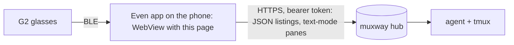
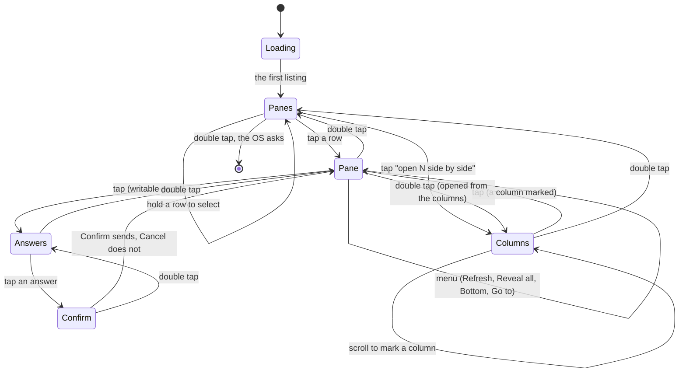
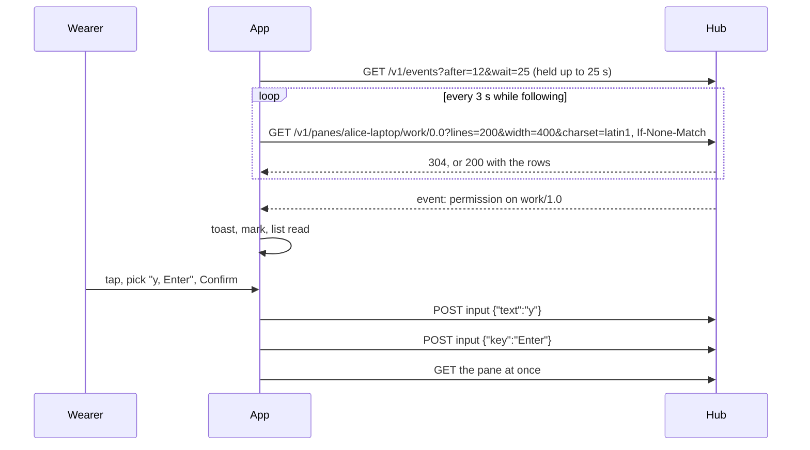

# Architecture

A muxway client for Even Realities G2 glasses. It speaks the hub's
[protocol v1](https://github.com/notmarkopadjen/muxway/blob/main/docs/protocol/v1.md)
and nothing else: listings and events as JSON, pane content in text mode,
where the hub's wrapping and charset folding are what the glasses want.

## Where it sits

An Even Hub app is a web page. The Even app loads it in a WebView, gives
it a bridge to the glasses (the Even Hub SDK), and shows the page itself
on the phone. The phone does the network: the page calls the hub directly
over HTTPS with `Authorization: Bearer`, and the hub answers the CORS
preflight such a page needs. The glasses see only what the page draws.

## Protocol features used

| Call | How | For |
|---|---|---|
| `GET /v1/me` | `Accept: application/json` | the phone pane's **test**: the token's name, whether the hub has a transcriber |
| `GET /v1/panes`, `GET /v1/hosts` | JSON | the pane list every 10 s and on every event: `mode`, `command`, `title`, `alias`, `attention`, `activity`; hosts online or not |
| `GET /v1/panes/{address}` | text mode, `?lines=50..500&width=400&charset=latin1` (or `utf-8`), `If-None-Match` / `ETag`, `Accept: text/plain` | the open pane and the columns: unwrapped rows the app wraps by pixels, in the glyphs the font has |
| `POST /v1/panes/{address}/input` | JSON `{"text"}` or `{"key"}`, one request per piece | answers, the suggestion, the phone's text, a spoken reply |
| `GET /v1/events` | JSON long poll: `?limit=1` for the cursor, then `?after=N&wait=25&limit=50` | notifications |
| `GET /v1/transcribe` | `204` or `404` | whether **Say it** is offered |
| `POST /v1/transcribe` | `audio/wav`, 16 kHz mono, up to 60 s | the spoken reply's text |

Every call carries `Authorization: Bearer <token>`, `credentials: omit`,
`cache: no-store`, and relies on the hub's CORS answers for bearer-token
pages. Addresses in paths are the listing's, checked against the
protocol's grammar and escaped segment by segment. Nothing else of the
protocol (sessions, windows, files, resize, admin) is used.

## Source layout

| Path | What |
|---|---|
| `src/main.ts` | boot: the bridge, settings, the phone pane, the app |
| `src/app.ts` | the page stack, gestures, polling of the open pane and the list, the events long poll, answers |
| `src/views.ts` | what every page says and draws: the pane list, the columns, the pane, the answers, the voice pages |
| `src/glasses.ts` | the two page kinds, the hint, bordered blocks, image containers, the OS menu, in-place upgrades, clamping |
| `src/bitmap.ts`, `src/charts.ts`, `src/raster.ts` | the four-grey raster, the bar, timeline and sparkline charts, a bitmap cut into image containers |
| `src/api.ts` | the calls: listings in JSON, pane content in text mode, caps, timeouts, ETag, errors in words |
| `src/protocol.ts` | the listings' JSON, pane names, URL and token rules |
| `src/lens.ts` | the Claude Code lens ([lenses](features/lenses.md)) |
| `src/answers.ts` | the fixed answers ([screens](features/screens.md)) |
| `src/voice.ts` | the microphone: frames, meter, the WAV ([spoken replies](features/spoken-replies.md)) |
| `src/text.ts` | the measured font, wrapping and fitting by pixels, clamping by bytes, filters |
| `src/settings.ts`, `src/phone.ts`, `index.html` | the phone pane ([phone pane](features/phone-pane.md)) |
| `app.json`, `scripts/pack.sh` | the Even Hub manifest and the package ([install](features/install.md)) |
| `tests/unit/` | `node --test` on the pure modules |
| `tests/e2e/` | the harness, the suite and the Playwright phone tests ([testing](testing.md)) |

## The display

576 x 288, four greys, one proportional font with one size: a line is
28 px and holds about sixty average glyphs. The firmware's rules shape
the whole design:

- a page with a list container spends scrolls on its own highlight and
  reports taps, but not where the highlight is, so a long press on it
  names no row; a page without one hands scrolls and the long press to
  the app. So the pane list is drawn by the app with a cursor of its own,
  the pane is a text page the app pages itself, and the answers are the
  OS's lists;
- a page holds at most eight text containers, the hint among them:
  seven blocks, so the pane list shows seven rows at a time, and there
  is no head line;
- the glasses refused a page with an 8 px wide picture that the
  simulator took, so no picture thinner than 16 px is sent; where the
  window sits is said in words;
- a text container shorter than its text hides the overflow, so every
  line is wrapped by the app with the font's measured advance widths and
  the blocks are whole lines;
- an oversize row or block rejects the whole page without a word, so
  every row is clamped by pixels and by bytes before it is sent (a list
  row is at most 63 bytes);
- a text change is a flicker-free in-place upgrade; a layout change is a
  rebuild during which input is dropped, so each page kind keeps one
  geometry;
- pictures go over Bluetooth in tiles and are slow next to text, so
  titles are text and the only picture left is the loudness graph;
- the font drops glyphs it lacks silently, so pane text is asked from the
  hub in Latin-1 by default and the app's own glyphs are ones known to
  render (`⏎` and `↑` are not among them, so the answers spell out Enter,
  Up and Down).

Every page is a **body** from the top of the glasses down to a **hint**
line (dimmest) naming the gestures that work there; on a dash page the
hint is the container that takes the gestures. Pictures, four greys in
image containers of at most 288 x 144, carry what text cannot: the
loudness graph while listening. A picture is pushed once and skipped
while its key is unchanged; a page the wearer has left stops its pushes.
A 240 x 140 bar chart is 34 KB of pixels.

## Screens

See [screens](features/screens.md) for each page.

## Requests

- `fetch` with a 20 s abort, 45 s for the long poll; at most 256 KiB of
  a body is read; control characters are dropped from everything shown.
- One read of the pane and one of the list in flight at a time. The pane
  is read every *follow* seconds (1 to 30, default 3) while the view is at
  the bottom and the app is in the foreground; paused, it is not read
  until the view is at the bottom again. The list is read every 10 s and
  on every event.
- A spoken clip goes to `POST /v1/transcribe` as a 16 kHz mono WAV, at
  most 60 s, and the text comes back for review before it is typed.
- `401` forgets the token at once and stops polling: a refused token is
  tried exactly once. `429` pauses for ten seconds. A network error
  doubles the events loop's wait up to a minute.
- Foreground exit stops every timer; foreground enter and any gesture
  start them again.

## Build

TypeScript and Vite, the Even Hub SDK at run time and nothing else.
`scripts/build.sh` type-checks and builds `dist/`; `scripts/pack.sh` puts
the hub's origin into the manifest's network whitelist and packs the
`.ehpk`. Versions are pinned exactly and the lock file is committed.
