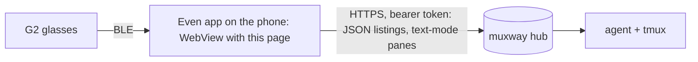
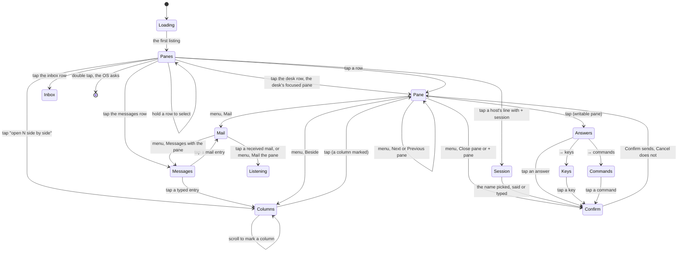

# Architecture

A muxway client for Even Realities G2 glasses. It speaks the hub's
[protocol v1](https://github.com/notmarkopadjen/muxway/blob/main/docs/protocol/v1.md)
and nothing else: listings and events as JSON, pane content in text mode,
where the hub's wrapping and charset folding are what the glasses want.

## Where it sits



An Even Hub app is a web page. The Even app loads it in a WebView, gives
it a bridge to the glasses (the Even Hub SDK), and shows the page itself
on the phone. The phone does the network: the page calls the hub directly
over HTTPS with `Authorization: Bearer`, and the hub answers the CORS
preflight such a page needs. The glasses see only what the page draws.

## Protocol features used

| Call | How | For |
|---|---|---|
| `GET /v1/me` | `Accept: application/json` | the phone pane's **test**: the token's name, whether the hub has a transcriber |
| `GET /v1/panes`, `GET /v1/hosts` | JSON | the pane list every 10 s and on every event: `mode`, `command`, `title`, `alias`, `cwd` (for a writer under a preview root: the folder after the name), `attention` (with a question's `choices` and its `text`), `activity` (working within ten seconds), `talk` (the partners of the last ten minutes, for the group's bar and Beside), `mail` (the unread count after the name), `later` and `later_at` (the owner parked the pane: `zz`, last in the list), `pane_id` (with the host, what the app knows a pane by: the page and the columns follow it when the host renumbers and close when it is gone), `session`, `window_index`, `width`, `height` and `last` (a split's window and direction, the close confirmation's words); hosts online or not, each with `later`, `sessions`, `close`, `mail` and `keys` where its agent parks, starts sessions, closes panes, holds mail or takes the key grammar |
| `GET /v1/desk` | JSON, `If-None-Match` / `ETag` | the **desk row** at the top of the list: the view the owner's other clients share, read with every listing and never written here; the row opens the desk's focused pane (the first of its panes the listing has when none is focused; a window desk's focused pane, else the window's first), or says `nothing to open` |
| `GET /v1/inbox` | JSON | the inbox page, every pane that waits, oldest first, then the parked ones, and *Go to*, its first awake entry; read with every listing |
| `GET /v1/talk` | JSON, `?limit=50` once, then `?after=N&limit=100` | the messages page and the `» messages · mail n` row; read with every listing |
| `GET /v1/panes/{address}/mail` | JSON | the mail page, read when it opens and with every listing while it is open |
| `POST /v1/panes/{address}/mail` | JSON `{"text"}` | a mail to the open pane or back to a sender, from the voice or the phone, confirmed |
| `POST /v1/panes/{address}/close` | `{}` | *Close pane*, confirmed |
| `POST /v1/windows/{host}/{session}/{window}/panes` | JSON `{"direction"}` | *+ pane*, confirmed; the new pane opens from the answer |
| `POST /v1/hosts/{host}/sessions` | JSON `{"name"}` | a session from the host's line, confirmed; its first pane opens |
| `GET /v1/panes/{address}` | text mode, `?lines=50..500&width=400&charset=latin1` (or `utf-8`), `If-None-Match` / `ETag`, `Accept: text/plain`; the answer's `Muxway-Pane` names the pane that answered | the open pane and the columns: unwrapped rows the app wraps by pixels, in the glyphs the font has; rows named as another pane's are not drawn and the listing is asked for at once |
| `POST /v1/panes/{address}/input?read=1` | JSON `{"text"}` or `{"key"}`, one request per piece, with the pane read's `lines`, `width` and `charset`; `Accept: text/plain`; the answer is the read's (`200` with the rows, `ETag`, `Muxway-Pane`) or `204` from a hub before the echo | answers, the suggestion, the phone's text, a spoken reply; a `200` is drawn as the pane's screen at once, checked as a read is; a `204` reads the pane at once as before |
| `POST /v1/panes/{address}/answer` | JSON `{"choice"}` | a question's choice, to the process that asked |
| `POST /v1/panes/{address}/later` | JSON `{"later": true}` or `false` | the menu's Later and Wake; the wake when a parked pane is opened |
| `GET /v1/events` | JSON long poll: `?limit=50` for the cursor and the recent events, then `?after=N&wait=25&limit=50` | notifications, with a question's `choices`; what was working at start; a `desk` event asks for the listing, which reads the desk |
| `GET /v1/transcribe` | `204` or `404` | whether **Say it** is offered |
| `POST /v1/transcribe` | `audio/wav`, 16 kHz mono, up to 60 s | the spoken reply's text |

Every call carries `Authorization: Bearer <token>`, `credentials: omit`,
`cache: no-store`, and relies on the hub's CORS answers for bearer-token
pages. Addresses in paths are the listing's, checked against the
protocol's grammar and escaped segment by segment. Nothing else of the
protocol (files, resize, shares, admin) is used.

## Source layout

| Path | What |
|---|---|
| `src/main.ts` | boot: the bridge, settings, the phone pane, the app |
| `src/app.ts` | the page stack, gestures, polling of the open pane and the list, the events long poll, answers |
| `src/views.ts` | what every page says and draws: the pane list, the inbox, the messages, the mail, the columns, the pane, the answers, the voice pages |
| `src/glasses.ts` | the two page kinds, the hint, bordered blocks, image containers, the OS menu, in-place upgrades, clamping |
| `src/bitmap.ts`, `src/charts.ts`, `src/raster.ts` | the four-grey raster, the bar, timeline and sparkline charts, a bitmap cut into image containers |
| `src/api.ts` | the calls: listings in JSON, pane content in text mode, caps, timeouts, ETag, errors in words |
| `src/protocol.ts` | the listings' JSON, the harness a pane runs, a question's choices, pane names, URL and token rules |
| `src/lens.ts` | the Claude Code lens ([lenses](features/lenses.md)) |
| `src/answers.ts` | the fixed answers and the console keys ([screens](features/screens.md)) |
| `src/commands.ts` | the command row as rows: the core's lists by the hub's command ([screens](features/screens.md#answers-and-confirmation)) |
| `src/voice.ts` | the microphone: frames, meter, the WAV ([spoken replies](features/spoken-replies.md)) |
| `src/text.ts` | the measured font, wrapping and fitting by pixels, clamping by bytes, filters |
| `src/settings.ts`, `src/phone.ts`, `index.html` | the phone pane ([phone pane](features/phone-pane.md)) |
| `app.json`, `scripts/pack.sh` | the Even Hub manifest and the package ([install](features/install.md)) |
| `tests/unit/` | `node --test` on the pure modules |
| `tests/e2e/` | the harness, the suite and the Playwright phone tests ([testing](testing.md)) |

## The display

576 x 288, four greys, one proportional font with one size: a line is
28 px and holds about sixty average glyphs. The firmware's rules shape
the whole design:

- a page with a list container spends scrolls on its own highlight and
  reports taps, but not where the highlight is, so a long press on it
  names no row; a page without one hands scrolls and the long press to
  the app. So the pane list is drawn by the app with a cursor of its own,
  the pane is a text page the app pages itself, and the answers are the
  OS's lists;
- a page holds at most eight text containers, the hint among them:
  seven blocks, so the pane list is one block of nine rows at the
  font's pitch with the cursor as a mark, and there is no head line;
  three columns are the most (four would be ten containers), and the
  inbox, the messages and the mail are pages of the same kind, their
  cursor moving by entry;
- a menu holds ten entries at most, so the pane page's menu is pruned
  to what applies and Bottom reads the pane again in place of Refresh;
- an OS list holds twenty rows, so the answers keep eight fixed answers
  and open the console keys and the program's commands as lists of
  their own;
- the glasses refused a page with an 8 px wide picture that the
  simulator took, so no picture thinner than 16 px is sent; where the
  window sits is said in words;
- a text container shorter than its text hides the overflow, so every
  line is wrapped by the app with the font's measured advance widths and
  the blocks are whole lines;
- an oversize row or block rejects the whole page without a word, so
  every row is clamped by pixels and by bytes before it is sent (a list
  row is at most 63 bytes);
- a text change is a flicker-free in-place upgrade; a layout change is a
  rebuild during which input is dropped, so each page kind keeps one
  geometry;
- a create or rebuild with a pane's eight lines in its body was refused
  the same silent way (seen on the device on 2026-11-06: a pane the app
  had read was refused, one it had not read was taken and its text
  followed as an upgrade), so a create or rebuild carries only the
  blocks that are one line of at most 96 bytes; every longer block goes
  in as a space and its text follows as an in-place upgrade right after
  the page is accepted, before the pictures; the limit's figure is not
  known, the trace (the phone's switch) shows the sizes;
- two containers that overlap reject the page the same silent way, and
  the simulator does not mind, so a page that is fine there can be
  refused on the glasses; a toast grows the hint upward by its padding,
  so every block of every page ends at the banner's top (`BANNER_Y`),
  not at the hint's;
- the container that takes the gestures scrolls its text on a scroll,
  however little room it has (the hint moved with every scroll on the
  device, 2026-11-03, boxed to one line or not), so on a page without
  an OS list a block with nothing to show takes them: an unseen block of
  16 × 28 px in the top right corner, on every such page, as tall as its
  one blank line, since the device reports a scroll only when the text
  it scrolls is at an edge and a shorter box leaves room for a silent
  one (the first scroll in a new direction was lost on the device,
  2026-11-06, with a 16 px square); the rule under a title took them
  from 2026-11-03 to 2026-11-06, when the device was found refusing the
  pane and the columns for it (#41's symptom again,
  `rebuildPageContainer refused` on every move to them, while the list
  with the corner block drew at once), so a bordered block two pixels
  high is a line only; the hint is a box with exactly one line inside,
  the banner's shape, and its top edge is the rule above the footer on
  every page;
- a bordered text container two pixels high draws as a rule, and a
  title row 26 px high shows its text whole (both seen on the device on
  2026-11-03), which is how the pane view has a line under its title
  without losing a line of the pane;
- pictures go over Bluetooth in tiles and are slow next to text, so
  titles are text and the only picture left is the loudness graph;
- the font drops glyphs it lacks silently, so pane text is asked from the
  hub in Latin-1 by default and the app's own glyphs are ones known to
  render (`⏎` and `↑` are not among them, so the answers spell out Enter,
  Up and Down).

Every page is a **body** from the top of the glasses down to a **hint**
line (dimmest) naming the gestures that work there; on a dash page a
block with nothing to show takes the gestures. Pictures, four greys in
image containers of at most 288 x 144, carry what text cannot: the
loudness graph while listening. A picture is pushed once and skipped
while its key is unchanged; a page the wearer has left stops its pushes.
A 240 x 140 bar chart is 34 KB of pixels.

## Screens



See [screens](features/screens.md) for each page.

## Requests

```mermaid
sequenceDiagram
    participant W as Wearer
    participant A as App
    participant H as Hub
    A->>H: GET /v1/events?after=12&wait=25 (held up to 25 s)
    loop every 3 s while following
        A->>H: GET /v1/panes/alice-laptop/work/0.0?lines=200&width=400&charset=latin1, If-None-Match
        H-->>A: 304, or 200 with the rows
    end
    H-->>A: event: permission on work/1.0
    A->>A: toast, mark, list read
    W->>A: tap, pick "y, Enter", Confirm
    A->>H: POST input?read=1&lines=200&width=400&charset=latin1 {"text":"y"}
    H-->>A: 200, the rows with y typed, Muxway-Pane
    A->>H: POST input?read=1&… {"key":"Enter"}
    H-->>A: 200, the rows after Enter, Muxway-Pane
    A->>A: the rows drawn with the flash; the next read when the timer says
```

- `fetch` with a 20 s abort, 45 s for the long poll; at most 256 KiB of
  a body is read; control characters are dropped from everything shown.
- One read of the pane and one of the list in flight at a time. The pane
  is read every *follow* seconds (1 to 30, default 3) while the view is at
  the bottom and the app is in the foreground; paused, it is not read
  until the view is at the bottom again. The list is read every 10 s,
  on every event, and at once when a read answers `404` for a pane the
  listing still names there (the host renumbered). What is read is held
  by the pane's key (`paneKey`: the host and `pane_id`), and after every
  listing the pages are reconciled: a pane at a new address is followed,
  a pane gone while its host is there closes its pages with a word. A
  read whose `Muxway-Pane` is not the pane's id is a stranger's answer
  (the host renumbered since the listing): nothing of it is taken, and
  the listing is asked for at once. An input asks for the screen with
  `?read=1`, and its `200` is taken exactly as a read's answer, so a
  key's echo is on the page one round trip after the last piece; a
  `204` (a hub or host before the echo) reads the pane at once as
  before. The follow timer is not touched by an input.
- A spoken clip goes to `POST /v1/transcribe` as a 16 kHz mono WAV, at
  most 60 s, and the text comes back for review before it is typed.
- `401` forgets the token at once and stops polling: a refused token is
  tried exactly once. `429` pauses for ten seconds. A network error
  doubles the events loop's wait up to a minute.
- Foreground exit stops every timer; foreground enter and any gesture
  start them again.

## Build

TypeScript and Vite, the Even Hub SDK at run time and nothing else.
`scripts/build.sh` type-checks and builds `dist/`; `scripts/pack.sh` puts
the hub's origin into the manifest's network whitelist and packs the
`.ehpk`. Versions are pinned exactly and the lock file is committed.
