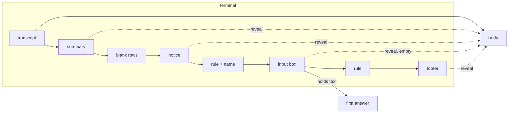

# The Claude Code lens

The Claude Code lens of the Java ME client, ported to the glasses: it
reshapes the rows of a pane that runs Claude Code so that only the
conversation is on the screen. A terminal that is eight lines tall would
otherwise show nothing but Claude's chrome.

Claude Code draws, from the bottom of the terminal up:

```
● pong                                                             transcript
✻ Crunched for 58s · done 8:36 AM                                  summary of the turn
                                                                   blank rows
                           ↓ Update installed · Restart to apply   notice, right-aligned
─────────────────────────────────────────────────── demo ─         rule, with the session name
❯ say only the word pong, nothing else                             input box
────────────────────────────────────────────────────────────────   rule
  ⏵⏵ auto mode on (shift+tab to cycle) · ← 5 agents                footer
```

The lens:

- finds the last two **rules**: rows of `─`, `━` or `═` (three or more)
  or of twenty or more `-` or `=` once the hub spelt them in Latin-1. The
  bottom one is clean; the top one may carry the session name, text up
  to half as long as the line. Rules are never shown;
- hides the **footer** (everything after the bottom rule), the
  **notices** (blank rows and rows starting with eight spaces right above
  the top rule) and the **summary** (the one row above those that starts
  with a spinner mark and names a duration such as `58s` or `5m 27s`);
- hides the **input box**. When it holds more than the prompt mark or
  Claude's own hint (`Try "..."`), that is Claude's suggestion of what to
  say next, and it becomes the **first answer** on the answers page
  ([screens](screens.md)): the text in quotes, which sends it and
  `Enter`. The body keeps the whole height;
- drops the **blank rows** between the transcript and the chrome.

On a pane whose program is `claude` (the list's command column) the lens
is forced: it does the same when it finds the rules and guesses when it
does not (the last row among the final eight that starts with `❯` or
`> ` is the box). On other programs it applies only when it finds the
two rules, else the rows are shown as they are, so a plain shell never
loses a row.

**Reveal all** in the menu shows everything in place, without the rules
or the blank rows; **Lens on** hides it again. The phone pane's **Claude
Code lens** switch turns the lens off for every pane.



## Text: Latin-1 by default

The firmware font drops glyphs it lacks without a trace, and Claude Code
draws with many it lacks (`❯ ✻ ⎿`). The app therefore asks the hub for
`charset=latin1`: the hub spells rules as `-`, the prompt as `>`, bullets
and spinner marks as `*`, and folds the letters Latin-1 lacks (the core's
text-mode page has the table). Every character that arrives is one the
font has. **Unicode** is a setting on the phone pane for those who prefer
the real glyphs and accept the gaps. The app decodes every answer by the
charset in its `Content-Type`, reads anything that is not well-formed
UTF-8 as Latin-1, and the lens understands both spellings.

## Security

A hub or proxy can craft rows that look like Claude Code's chrome:
thousands of rules, a 400-column rule, a footer after a fake rule, control
characters in the box. The lens runs over rows the app has already
stripped of control characters and capped at 256 KiB, and it can only
hide rows after the last rule, the empty box between the rules, the blank
and right-aligned rows above the top rule and one summary row above
those; forced, at most the rows after the last prompt row among the final
eight. Reveal all shows everything it hid. The worst a crafted screen
does is hide its own last rows until the wearer picks Reveal all.

What the box holds is shown as an answer and sent only when the wearer
picks it and confirms. It goes back to the same pane, cleaned of control
characters and cut at 4096 bytes, so a crafted box can type into its own
program what the program could have typed itself, and nothing more. The
end-to-end suite has these cases (S05).
