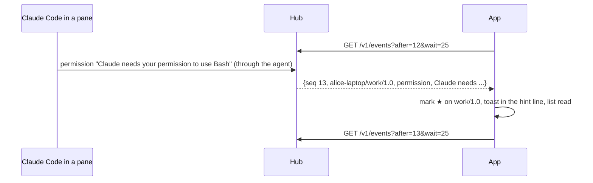

# Notifications

An AI coding agent in a pane tells muxway when it needs its owner: its
hooks run `muxway notify` on the host, or the host's watcher reads its
screen (see the core's notifications feature, which has hooks for Claude
Code, Codex, Gemini, Antigravity, Copilot and OpenCode). The glasses
show it, and when a process asked a question with fixed answers
(`muxway ask`), offer the answers.

- While the app is in the foreground it keeps one **long poll** on
  `GET /v1/events` with `wait=25`, and starts the next as the last
  returns. The first call, without `after`, only takes the cursor, so old
  events are not replayed as new.
- An event of kind `question`, `permission`, `idle` or `done` sets the
  pane's **mark** (`★ ● ○`) in the list and the pane's title, shows a
  **toast** in the hint line for ten seconds, brightest (`★ build: Claude
  needs your permission to use Bash`), reads the list again, and reads the
  pane again when it is the open one. `working` clears the mark and
  gives the row the word *working* while the pane moves.
- A `question` may carry **choices** (`"choices": ["yes", "no"]`, from
  `muxway ask`): the toast cannot be touched, but the pane's answers page
  leads with them, and a confirmed choice goes back through `POST
  /v1/panes/{address}/answer` ([screens](screens.md#answers-and-confirmation)).
- The pane's menu entry **Go to: *name*** opens the pane that has waited
  longest, a question or a permission before the rest; the
  [inbox](screens.md#the-inbox) lists them all in that order.
- Attention and its choices also come with every pane list, so the marks
  are right after a restart, before any event.

Out of scope, each its own feature later: notifications while the app is
not open (an Even Hub app runs only while open), and sounds.

## Security considerations

- The hub delivers only events for panes the token may read; the app
  cannot see more than it could list.
- Event text is sanitised by the hub and again here: control characters
  dropped, at most 200 characters, fitted to the line. A hostile hub's
  10 KiB line is one toast. Choices are taken only from a `question`,
  two to eight of them, each 1 to 40 clean characters without `|`,
  distinct; a list that breaks a rule is no list.
- The cursor is a number; anything else restarts the poll without one.
- A failed poll waits five seconds and doubles up to a minute; `401`
  forgets the token and stops.
