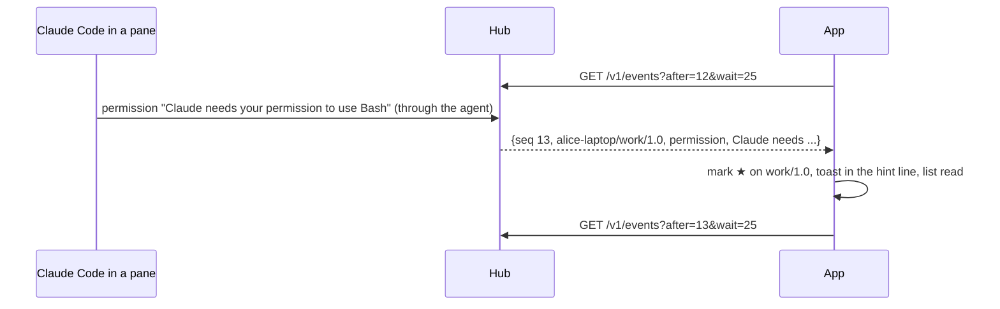

# Notifications

An AI coding CLI in a pane tells muxway when it needs its owner (see the
core's notifications feature: Claude Code hooks run `muxway notify`). The
glasses show it.

- While the app is in the foreground it keeps one **long poll** on
  `GET /v1/events` with `wait=25`, and starts the next as the last
  returns. The first call, without `after`, only takes the cursor, so old
  events are not replayed as new.
- An event of kind `question`, `permission`, `idle` or `done` sets the
  pane's **mark** (`★ ● ○`) in the list and the pane's title, shows a
  **toast** in the hint line for ten seconds, brightest (`★ build: Claude
  needs your permission to use Bash`), reads the list again, and reads the
  pane again when it is the open one. `working` clears the mark.
- The pane's menu entry **Go to: *name*** opens the pane with the newest
  attention; on the list that pane is the first row.
- Attention also comes with every pane list, so the marks are right after
  a restart, before any event.

Out of scope, each its own feature later: notifications while the app is
not open (an Even Hub app runs only while open), and sounds.

## Security considerations

- The hub delivers only events for panes the token may read; the app
  cannot see more than it could list.
- Event text is sanitised by the hub and again here: control characters
  dropped, at most 200 characters, fitted to the line. A hostile hub's
  10 KiB line is one toast.
- The cursor is a number; anything else restarts the poll without one.
- A failed poll waits five seconds and doubles up to a minute; `401`
  forgets the token and stops.
