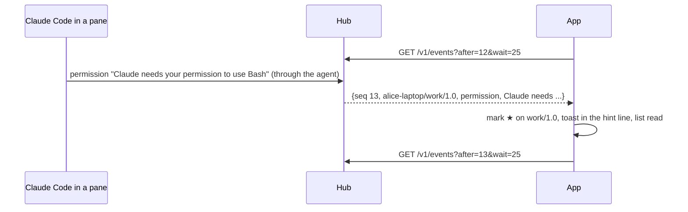
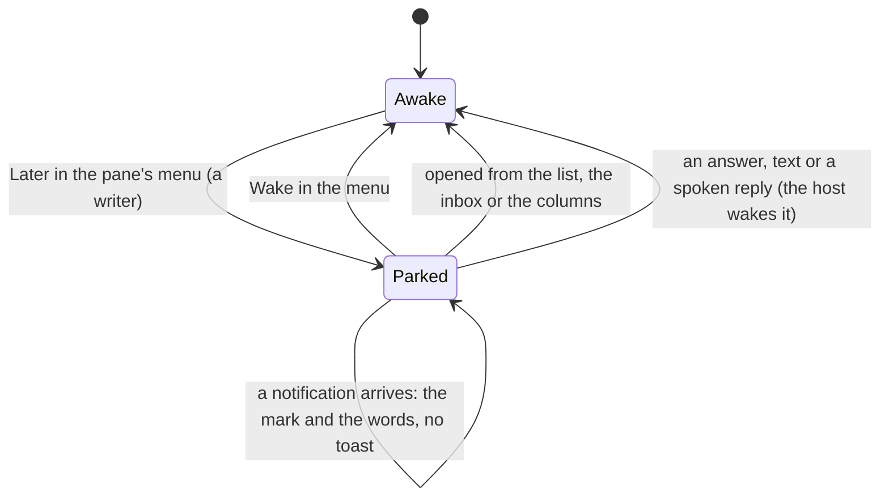

# Notifications

An AI coding agent in a pane tells muxway when it needs its owner: its
hooks run `muxway notify` on the host, or the host's watcher reads its
screen (see the core's notifications feature, which has hooks for Claude
Code, Codex, Gemini, Antigravity, Copilot and OpenCode). The glasses
show it, and when a process asked a question with fixed answers
(`muxway ask`), offer the answers.

- While the app is in the foreground it keeps one **long poll** on
  `GET /v1/events` with `wait=25`, and starts the next as the last
  returns. The first call, without `after`, takes the hub's recent
  events for the cursor and for what was working: a pane whose last
  event among them said `working` is working before its next event, as
  the guideline has every client do on start; nothing among them draws
  a toast.
- An event of kind `question`, `permission`, `idle` or `done` sets the
  pane's **mark** (`★ √ ○`) in the list and the pane's title, shows a
  **toast** in the hint line for ten seconds, brightest (`★ build: Claude
  needs your permission to use Bash`), reads the list again, and reads the
  pane again when it is the open one. `working` clears the mark and
  gives the row the word *working*. An `idle` on a harness whose screen
  still moves draws no toast and shows working: Claude is at its prompt
  but its background tasks still print, so the pane is not waiting on
  you; the words follow once the screen is still ([lenses](lenses.md)).
- The pane page leads with the notice's text for a question or a
  permission, and the [inbox](screens.md#the-inbox) carries the text and
  a question's choices under every row.
- A `question` may carry **choices** (`"choices": ["yes", "no"]`, from
  `muxway ask`): the toast cannot be touched, but the pane's answers page
  leads with them, and a confirmed choice goes back through `POST
  /v1/panes/{address}/answer` ([screens](screens.md#answers-and-confirmation)).
- The pane's menu entry **Go to: *name*** opens the hub's inbox's first
  awake entry: the pane that has waited longest by the hub's clock, a
  question, a permission, idle or done alike, parked panes skipped. The
  inbox is read with every listing, so the entry is there before its
  page was ever opened.
- Attention and its choices also come with every pane list, so the marks
  are right after a restart, before any event.
- A message between panes, typed or mailed, is **not** a notification:
  no toast, no row in the inbox, no count in the hint. The list shows the
  panes that talk as one group and the unread mail after a pane's name
  ([screens](screens.md#the-pane-list-the-main-screen)).

Out of scope, each its own feature later: notifications while the app is
not open (an Even Hub app runs only while open), and sounds.

## Later

**Later** is the owner's own mark on a pane, kept by the host's agent
and seen by every muxway client (the core's notifications feature): the
owner has looked, decided not now, and wants the pane out of the way
without losing it. The listing carries `"later": true` and `later_at`
on a parked pane, with whatever attention it has underneath.

- A parked pane's mark is `zz` (the glasses' font has no moon) and its
  state word `later`, with the attention after it where there is one:
  `zz build · Claude · later · needs permission` (the pane page's state,
  with room for a few words, says `later · permission`). It sorts after every
  other pane in the list, and the [inbox](screens.md#the-inbox) lists
  it after every awake pane, counted with the rest in the `◆ inbox · n
  waiting` row.
- A notification on a parked pane sets the mark and the words and reads
  the list again, but draws **no toast**: the owner said later.
- The pane's menu offers **Later** on an awake pane and **Wake** on a
  parked one, `POST /v1/panes/{address}/later`, for a writable pane on
  a host whose agent parks (`hosts[].later`); a read-only pane and an
  older host have no entry. The state flashes `parked` or `woken`, or
  the hub's refusal in words. The inbox page's menu has the same entry
  for the entry under its cursor, and says the words in the hint.
- Opening a parked pane from the list, the inbox or the columns is the
  owner coming back: the app wakes it first, when it may. *Go to* skips
  parked panes.
- The name is not slanted: the Even Hub text container takes text and a
  grey, no font style, so, as the clients' guideline allows where the
  font has no italics, the mark alone says it.

## Security considerations

- The hub delivers only events for panes the token may read; the app
  cannot see more than it could list.
- Event text is sanitised by the hub and again here: control characters
  dropped, at most 200 characters, fitted to the line. A hostile hub's
  10 KiB line is one toast. Choices are taken only from a `question`,
  two to eight of them, each 1 to 40 clean characters without `|`,
  distinct; a list that breaks a rule is no list.
- The cursor is a number; anything else restarts the poll without one,
  after the wait of a failed poll (five seconds, doubling): an answer
  the app cannot read, a body over the 256 KiB cap or a garbled one,
  is asked again in five seconds, never at once, so a hub that answers
  that way is not asked two hundred times a second (S65).
- The recent events at start only set what is working: a hostile fifty
  of them with bad kinds, bad addresses and 4 KiB texts set nothing
  else and draw nothing (S64); fifty with 10 KiB texts are over the cap
  and set nothing at all (S65).
- A failed poll waits five seconds and doubles up to a minute; `401`
  forgets the token and stops.
