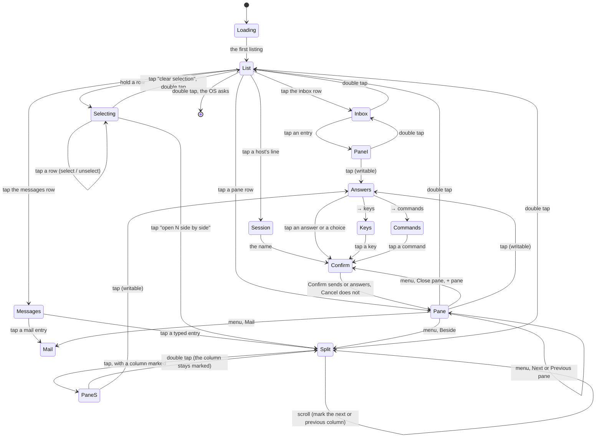

# Screens and gestures

Four gestures reach everything:

| Gesture | Does |
|---|---|
| scroll | moves the cursor on the pane list; by entry on the inbox, the messages and the mail; marks the next or previous column on the columns; moves the highlight in a list; pages the pane |
| tap | opens the row under the cursor (the inbox, the messages and a new session from their rows); on the columns, opens the marked pane; on a pane, its answers (or reads it again when it is read-only); in the inbox, the pane of the entry; in the messages, the mail page or the two panes side by side; on the mail page, mail back |
| hold | on the pane list, starts selection mode with the row under the cursor selected; on a pane, the OS menu ([the pane](#the-pane)); on the inbox, Later or Wake for the entry; on the mail page, Mail and Messages |
| double tap | back one page; leaves selection mode; from the pane list, out of the app, which the OS confirms first |

Every page is text from the top of the glasses down to a **hint** at the
foot, which names the gestures that work on the page. There is no status
line: the list's order and marks say which panes need you. A notification
arrives as a **banner**, the hint's box brighter, for ten seconds; the
result of an answer flashes on the pane for four.



## Loading

```
reading the hub…


reading the hub ··
```

Until the first listing has arrived the list has one row and the hint's
dots move every half second. A failed first read puts the error in the
hint; the row stays. Nothing on the page says what the panes are doing
before the hub has said so.

## The pane list: the main screen

```
  ◆ inbox · 2 waiting
  » messages · mail 3
  ── alice-laptop · online · + session ──
  [x] ★ build · /muxway · Claude · needs permission
  [x] √ bash · tests · done
> │ [ ] ◌ tail · logs · mail 1 · active
  │ [ ] ◐ Codex · api · working
  ── bob-desktop · nothing exposed ──
  → open 2 side by side

◆ 2 · ○ carol-pc offline · ▽ move · ● select · 3 at most · ×× done
```

The list groups by **host**, as every client does: a line per online
host, `── name · online ──`, or `nothing exposed` when none of its panes
is in the listing, with ` · + session` where its agent starts sessions
(a tap on the line asks for a [new session](#new-panes-and-sessions));
offline hosts are named in the hint, `○ carol-pc offline`, and spend no
row. Under its line, one row per pane, those that need you first, the
panes parked for later last, then by address: the mark (`★` asks a
question or needs permission, `√` done, `○` idle, `◐` turning while the
pane works, `◌` nothing reported, `zz` parked for
[later](notifications.md#later)), the name, its mail, the folder, the
program and its status, a **state word**, and `read-only` where the
token cannot write. The program is named as every muxway client names
it ([lenses](lenses.md)): *Claude*, *Codex*, *Gemini*, *Antigravity*,
*OpenCode*, *Copilot*, *aider*, *goose*, *Amp* or *Cursor* for an AI
harness, else the command.

The **name** is the pane's alias when its owner gave it one (`muxway
expose --name review`, or from the web): then the program and what it
says about itself follow as its **status**, `◌ review · Claude ·
fixing the build · working`, `◌ notes · bash · notes.md · active`.
Without an alias the pane is named by what runs in it, the program
before what it says, as the guideline's §1.1 has it: a harness is its
name and its codename is its status, `◐ Claude · fixing the build ·
working`; any other program is named with its title, `◌ vim · notes.md
· active`, `◌ bash · quiet 3m` when the title only repeats the command.
The **folder** is the last segment of the directory the pane works in,
with a slash in front, after the name and the mail: `◌ Claude · /muxway
· fixing the build · working`. The hub gives it (the listing's `cwd`)
only to a token that may write the pane and only under one of the
host's preview roots; a reader, a pane elsewhere and an older agent
show none. It is in only while the whole row fits its width, so a long
codename costs the folder before the state word is cut. The place,
`host/session/window.pane`, has no room in a row of 63 bytes: the host
is its line, and the [pane page](#the-pane) shows the rest.

While anything waits the first row is the way to the
[inbox](#the-inbox), `◆ inbox · 2 waiting`, and the hint starts with
the count, `◆ 2`. While the hub's feed holds anything the next row is
the way to the [messages](messages.md), `» messages`, with ` · mail 3`
while three arrived that were not looked at. The state word says only
what is known:

| The hub said | The row says |
|---|---|
| a question or a permission | `asks a question`, `needs permission` |
| done, idle | `done`, `idle` |
| later, the owner's own mark | `later`, and whatever waits underneath after it: `later · needs permission` |
| a harness: working, in its last event, or its screen changed in the last ten seconds; or idle while the screen still moves | `working` |
| any other program, and the pane wrote something in the last ten seconds | `active` |
| nothing, and the screen has been still for ten seconds or more | `quiet 4m` |

`active` and `quiet` come from the pane's last activity in the listing,
the ten seconds counted at the listing so a word holds until the next
one; `working` is the harness's own word, from its hook or the host's
watcher ([notifications](notifications.md)), or its moving screen: a
Claude Code at work redraws its spinner, one waiting at its prompt is
`quiet` and the age grows; an `idle` notice while the screen still
moves counts as working ([lenses](lenses.md)).

The mark and the word are the whole of a state on the glasses: the
display has no paint for one. A working pane's row and title are drawn
like a quiet pane's, as the core's guideline (§1.2) has it for every
client since 2026-11-02, where the ring and the word carry the state;
the glasses' ring is the half circle, `◐` then `◑`, turned once a
second while the mark is on the screen (the row is upgraded in place,
nothing is rebuilt). The marks are of one size and were found on the
device, whose font draws no check, no ring and no flag: `√` is done,
`◌` is a pane with nothing reported, and the inbox's `◆` stands where
other clients fly a flag. A waiting pane is marked (`★`, `√`, `○`) and
listed first.

The list is drawn by the app, nine rows at a time in one block at the
font's pitch, with a **cursor**, `>`, before the row it is on; the
scroll moves it and the rows slide under it. With more rows than fit
the hint starts with where the window sits, `4–10 of 200`; a host that
is offline is named there first, `○ alice-laptop offline`. A **tap**
opens the pane under the cursor; on a host's line with `+ session` it
asks for a new session's name, on the inbox and messages rows it opens
those pages. A list of two hosts shows five panes at a time where it
showed seven: the inbox row, the messages row and the host lines are
what the rows go to.

Panes that **talked** to each other in the last ten minutes (a write or
a mail that named the pane it came from, partners of partners included,
from the listing's `talk`) form a **group**: their rows are kept
together after the group's first row, and each starts with a bar, `│`,
one bar down the stretch where the web draws a frame in the talk hue.
A pane whose process holds unread **mail** says so right after its
name, `· mail 1`, from the listing's `mail`; the word stands where the
web puts `✉ n`, because the firmware font drops glyphs it lacks and
the envelope has not been seen on the glasses. Nothing is announced
for a message: no toast, no row in the inbox. The messages themselves,
the mail page, mailing a pane and laying the partner beside are on the
[messages and mail](messages.md) page.

A **hold** starts **selection mode** with that pane selected: every pane
row gets a box, `[x]` or `[ ]`, a tap on a row selects or unselects it,
three at most, and a fourth says so in the hint. Two action rows follow
the panes: **open N side by side** (from two selected) and **clear
selection**, which also leaves the mode, as does a double tap. The
selection survives the columns, so a double tap back and a tap reopens
the same view; it is pruned to the listing and forgotten when the app
restarts.

A **double tap** on the list asks the OS to leave the app, which the OS
confirms. Nowhere else leaves the app.

## The inbox

```
> ★ build · Claude · needs permission · 3m
    Claude needs your permission to use Bash
  ★ tests · Codex · asks a question · 40s
    deploy to staging? » yes · no
  zz api · Claude · later · done · 12s

inbox · 3 waiting · ▽ move · ● open · ≡ later · ×× back
```

Every pane that waits for you, on every host the token reads, **oldest
first**, then the panes parked for [later](notifications.md#later),
oldest parking first: `GET /v1/inbox`, read with every listing. An
entry is its row, the mark, the name (the program too for a named
pane), the attention in words (`later` first on a parked pane, `zz
build · Claude · later · needs permission · 3m`) and how long it has
waited, or has been parked, then under it the notice's **text** and a
question's **choices** after `»`, cut to the row; a pane without either
is one row. Twenty entries at most, drawn by the app as the list is,
nine rows at a time with a cursor that moves by entry. A **tap** opens
the pane of the entry, where a tap leads to the answers as from the
list, and a **double tap** comes back to the inbox, then to the list;
opening a parked pane wakes it. The **menu** (hold) has **Later** on an
awake entry and **Wake** on a parked one, for a writer on a host that
parks; the words `parked` or `woken` go to the hint. With nothing
waiting the page says so. The pane menu's **Go to** takes the first
awake entry: the pane that has waited longest by the hub's clock, a
question, a permission, idle or done alike, parked panes skipped.

## Side by side

```
» ★ build · claude       √ tests · bash
● Bash(make test)        $ make test
  ok                     ok
  ...                    $
▽ next pane · ● open build · ×× the list
```

The selected panes in the list's order, two or three columns, each a
title line with its mark, name and program, and the last eight lines
through the lens wrapped to the column. All of them follow, each with
its own ETag. Titles are text, so the page carries no pictures. A rule
runs under the titles.

Every screen ends the same way: the hint is a box with exactly one
line inside, the banner's shape, and its top edge is the rule above the
footer. A banner is the same box, brighter.

The **scroll marks a column** and opens nothing: forward marks the next
one, or the first when none is marked; back the previous one, or the
last. At either end it stays. The marked column's title starts with `»`
and is brightest, its text too. A **tap** opens the marked pane full,
where the scroll pages and a tap answers as on any pane; with none
marked, the tap reads the columns again. A **double tap** on the open
pane comes back to the columns with the mark kept; on the columns, back
to the list with the selection kept. The columns are three at most:
four would be ten containers where the firmware takes eight. The pane
menu's **Beside** and a typed entry of the [messages](messages.md)
open the columns too, with two panes and nothing marked.

## The pane

```
★ build · /muxway · Claude            needs permission
★ Claude needs your permission to use Bash
  ● Bash(make test)
    ok
  ...


▽ page · ● answer · ≡ menu · ×× back
```

The **title** (the bar when the pane is in a group, mark, name, its
mail, the folder while the title has room, program and status, as the
list's row has them), a rule under it, with the pane's **state** beside
it: the attention in words (`asks a question`, `needs permission`,
`idle`, `done`), on a parked pane `later` with the kind after it as the
hub names it (`later · permission`: the state has room for a few words),
else, while the pane follows at the bottom, its **place**,
`work/1.0` (the host is the list's line; `read-only · work/1.0` on a
pane the token cannot write, `read-only` alone when both do not fit),
`paused · 2 pages up`, `reading…`, or the error (`host offline`, `no
connection`, `not found`); after an answer the state flashes what
happened for a few seconds (`sent y, Enter`, `read only`), and after
the menu's Later or Wake `parked` or `woken`. For a question or a
permission the body leads with the **notice's text**, the mark and the
words as the toast said them, and the pane's lines follow, seven
instead of eight. The body is the last lines of the pane, `GET
/v1/panes/{address}` in text mode with `lines` (setting, default 200)
and `width=400`, wrapped by the app to the body's width, through the
[lens](lenses.md): eight lines, down to the hint's edge. Claude Code's
input box is not drawn; what it holds is the first answer.

- **Following**: at the bottom, the pane is read every *follow* seconds
  with `If-None-Match`, and a `304` costs nothing on the glasses.
- **Scroll up** pages back and pauses following; **scroll down** pages
  forward, and past the last page following resumes.
- **Tap** opens the answers on a writable pane; on a read-only pane it
  reads the pane again (the hint says `refresh`).
- **Menu** (hold), ten entries at most, the firmware's cap, each where
  it applies: **Reveal all** / **Lens on** (the lens on); **Bottom**,
  which reads the pane again and goes to its end (Refresh has no entry
  of its own: a following pane is read every *follow* seconds, and a
  tap on a read-only pane reads it again); **Next pane** and **Previous
  pane**, the neighbour in the list's order across hosts, round at
  either end, parked panes skipped (they would only wake); **Later** or
  **Wake** on a writable pane whose host parks
  ([later](notifications.md#later)); **Go to: *name*** when another
  pane waits; **Mail**, the pane's [mail page](messages.md) on a host
  that holds mail; **Beside: *name*** on a pane that talked with
  another, the columns with the two; **Close pane** on a writable pane
  whose host closes panes (`hosts[].close`), through `close build on
  alice-laptop?`, or `end session work on alice-laptop?` for the last
  pane of its session, then back to the list; **+ pane** on a writable
  pane, through `one more pane beside build?`: the window is split
  beside on a pane twice as wide as tall, below otherwise, the web's
  rule, and the new pane opens.
- **Double tap** goes back where the pane was opened from: the columns
  or the list.

## New panes and sessions

**+ pane** is the pane page's menu entry above, not a row of the list
as on the web: the list orders a host's panes by need, so a window's
panes are not neighbours, and a row per window would cost the rows the
glasses do not have; the pane page knows its window.

**+ session** is a tap on a host's line that carries it, for a host
whose agent starts sessions (`hosts[].sessions`). The name page offers
`» glasses-1`, the first of `glasses-1`, `glasses-2`, … that is no
session of the host, and `» Say it` when the hub transcribes; the
phone's **send ⏎** while the page is open gives the name too. A spoken
or typed name is folded to the hub's grammar: lowercase, spaces made
dashes, anything outside `a-z 0-9 _ -` dropped, 32 at most; what folds
to nothing is `not a session name`. Then Cancel / Confirm, `start
session scratch on alice-laptop?`; Confirm posts `POST
/v1/hosts/{host}/sessions` and the session's first pane opens. The
hub's refusals read `that name exists`, `too many there`, `locked out,
wait` (one creation or close per two seconds), `read only`.

## Answers and confirmation

```
» yes
» no
» "run the tests again"
» Say it
Enter
y, Enter
n, Enter
1 · Claude Code's first choice
2 · second choice
3 · third choice
Esc
Ctrl-C
→ keys
→ commands: Claude Code's
answer build · ▽ choose · ● pick · ×× back
```

When a process in the pane asked a **question with fixed answers**
(`muxway ask` on the host; the listing and the event carry its
`choices`), the choices lead the list, `» yes`, `» no`. Picking one opens
the confirmation (`answer yes to build?`); Confirm posts the choice to
`POST /v1/panes/{address}/answer`, which hands it to the process that
asked and types nothing into the pane. The hub refuses a choice it did
not offer (`not one of the choices`) and a question that has been
answered or has ended (`no question there now`); the words flash on the
pane like every result. The choices are the ones the pane had when the
answers opened.

When Claude Code suggests what to say next, its input box holds the
suggestion, and on a pane the hub says runs `claude` the list opens with
it in quotes: picking it sends that text and `Enter`. It is taken from
the pane when the answers open, and the confirmation sends exactly that.
When the hub has a transcriber the next row is **» Say it**, which leads
to the [spoken reply](spoken-replies.md) pages.

Then the eight answers used most, in this order: `Enter`, `y, Enter`,
`n, Enter`, `1 · Claude Code's first choice`, `2`, `3`, `Esc`, `Ctrl-C`.
`y, Enter` and `n, Enter` send the letter and then `Enter`; `1`, `2` and
`3` send the digit alone, which is how Claude Code takes a choice on a
question or a permission prompt; the rest are the protocol's keys
(`Enter`, `Escape`, `C-c`). The OS list holds twenty rows, and eight
choices, the suggestion, Say it and the eight are nineteen, so two rows
open lists of their own:

- **→ keys**: the console keys, `Up`, `Down`, `Left`, `Right`,
  `PageUp`, `PageDown`, `Home`, `End`, `Tab`, `Shift-Tab`, `Enter`,
  `Esc`, the protocol's names; the six in the middle only on a host
  whose agent takes the key grammar (`hosts[].keys` is 2).
- **→ commands**: the command row as rows, for the program the hub
  names in the listing's `command` and never from a title: Claude
  Code's slash commands (`claude`), Codex's (`codex`), Antigravity's
  (`agy`), a shell's starters (`bash`, `zsh`, `fish`, `sh` and their
  kind), from the core's lists in their order, twenty at most, the
  ones that only fill the line and wait for more (`/rename`,
  `/mention`, a goal) left out, since the glasses type no rest. The
  row is absent for any other program. A command is sent as its text
  and `Enter`, two requests, as `y, Enter` is.

Each key and command is confirmed as every answer (`send PageUp to
build?`, `send /compact to build?`). Free text beyond the suggestion
comes from the [phone pane](phone-pane.md) or your voice.

A tap on a fixed answer opens the confirmation, a two-row list with
**Cancel** first and highlighted, **Confirm** second, the question in the
hint (`send y, Enter to build?`). Confirm posts to
`POST /v1/panes/{address}/input`, one request per piece, goes back to
the pane, reads it at once and flashes the result. A double tap on
either page goes back without sending. The same two rows ask before
anything else the glasses do to a host: a mail, a pane closed, a pane
or a session started.

The suggestion's confirmation is the page the [spoken
reply](spoken-replies.md) uses: `send this to build?` over the whole
text in a box, a tap sends it and `Enter`, a double tap goes back. A
suggestion too long for that box is not offered.

```
send this to build?
┌────────────────────────────────────────────┐
│ run the tests again                        │
└────────────────────────────────────────────┘
● send + Enter · ×× back
```

## Security considerations

- The glasses send only the answers above, each after a confirmation, or
  a transcript read back first; a mis-tap cannot send `Ctrl-C` to a
  running build. Keys are the protocol's names.
- A choice is a write with the rules of input: the hub checks the write
  grant and the pane's mark, and the host's agent checks the choice
  against the list it gave, so the glasses can send the asking process
  nothing it did not offer. The choices themselves are checked on
  arrival (two to eight, each 1 to 40 characters, no control characters,
  no `|`, distinct) and dropped as a whole otherwise, so a hostile hub
  cannot put a row on the page that the firmware refuses or that hides
  what it does. The glasses offer them only on a pane the hub lists as
  writable; a proxy that lies about that earns a `403 read only`.
- The inbox shows what the token may read, as the pane list does, and
  is read with the same bearer header and caps.
- The suggestion is the pane's own text sent back to the same pane, only
  when the wearer picks it and confirms it on a page that shows every
  word: what is shown is what is sent, with no cut in between, and a text
  that would not fit (200 bytes) is not offered. It is offered only on a
  pane the hub names `claude`; two rules in a shell's output are not a
  box (see [lenses](lenses.md)). Control characters are removed before it
  is shown or sent, and the log keeps its size, not its words. The hub
  checks the write grant as for every answer.
- Whether a pane may be written to comes from the hub's `mode`; a title
  cannot forge it, and a hub or proxy that lies about the mode gains a
  refused request (`403 read only`). A read-only pane offers no
  suggestion and no commands, and its menu has no Later, Close pane or
  + pane; a proxy that lies about the mode or the host's flags earns
  the refusal in words (S60, S62).
- The commands are the app's fixed strings, chosen by the hub's
  `command`: a title with a forged spark names no commands (S63). The
  keys are the grammar's names. A session's name is folded to the
  grammar on the glasses and checked again by the hub.
- A close, a split and a session each pass Cancel / Confirm and the
  hub's write grant, pane mark and host flags; the hub's one creation
  or close per two seconds reads `locked out, wait`.
- The host lines come from the hosts call and the listing, never from
  a title; a host the hosts call did not name is drawn from its panes.
- Rows are clamped by pixels before they reach the firmware, so a
  hostile title cannot reject the page; the mark and the selection's
  box come from the listing's fields and the wearer's gestures, never
  from the title; a listing of hundreds of panes is nine rows and a
  cursor.
- The selection is a list of addresses the hub returned, held in memory
  only and pruned to every listing; a hostile listing cannot select
  anything.
- Pictures are drawn by the app from numbers it computed; nothing from
  the network is read as an image. The only one left is the loudness
  graph while listening.
- The hint and the state never carry the token or an error body, only
  words.
