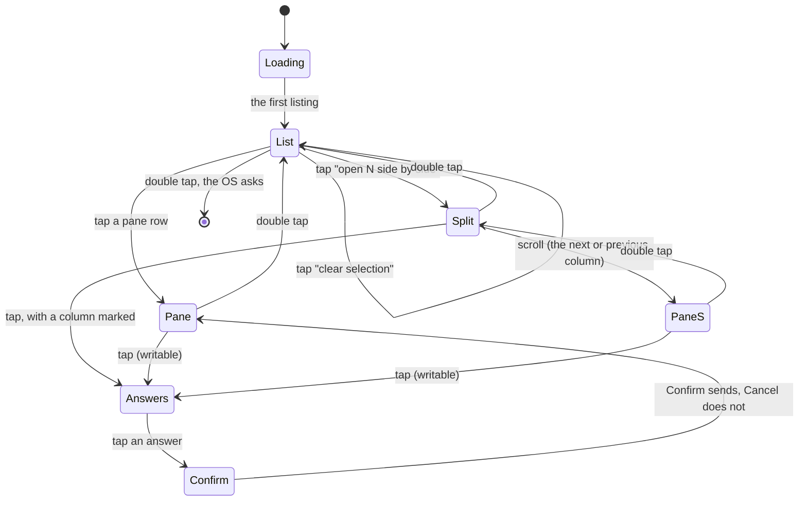

# Screens and gestures

Four gestures reach everything:

| Gesture | Does |
|---|---|
| scroll | moves the cursor on the pane list; opens the next or previous pane from the columns; moves the highlight in a list; pages the pane |
| tap | opens the row under the cursor; on a pane, its answers (or reads it again when it is read-only) |
| hold | on the pane list, selects the row under the cursor, or unselects it; on a pane, the OS menu: Refresh, Reveal all / Lens on, Bottom, Go to: the pane that needs you |
| double tap | back one page; from the pane list, out of the app, which the OS confirms first |

Every page has the same frame. The **status line** at the top says how
many panes need you, how many panes there are, the host and the clock:

```
★ 1  ≡ 3  ● alice-laptop  16:51
```

At the foot a **hint** names the gestures that work on the page. A
notification arrives as a bordered **banner** in its place for ten
seconds; the result of an answer flashes on the pane for four.



## Loading

```
reading the hub ··
reading the hub…


reading the hub…
```

Until the first listing has arrived the list has one row and the status
line's dots move every half second. A failed first read puts the error
in the hint; the row stays. Nothing on the page says what the panes are
doing before the hub has said so.

## The pane list: the main screen

```
★ 1  ≡ 4  ● alice-laptop  16:51
» ★ build · claude · needs permission          ▏
» ● tests · bash · done                        ▏
  · logs · tail · active                       █
  · api · claude · quiet 4m                    █
  → open 2 side by side                        ▏
  → clear selection                            ▏
▽ move · ● open · hold to select · 3 at most · ×× exit
```

One row per pane, those that need you first, then by address: the mark
(`★` asks a question or needs permission, `●` done, `○` idle, `·`
nothing reported), the name, the program, a **state word**, and
`read-only` where the token cannot write. The state word says only what
is known:

| The hub said | The row says |
|---|---|
| a question or a permission | `asks a question`, `needs permission` |
| done, idle | `done`, `idle` |
| nothing, and the pane wrote something in the last minute | `active` |
| nothing, and the pane has been silent for a minute or more | `quiet 4m` |

`active` and `quiet` come from the pane's last activity in the listing.
A Claude Code at work redraws its spinner, so it is `active`; one
waiting at its prompt is `quiet` and the age grows. Neither word claims
that a pane is working: the hub knows a pane's state only when a hook
reported it ([notifications](notifications.md)).

The list is drawn by the app, six rows at a time, with a **cursor** on
the brightest row; the scroll moves it and the rows slide under it, and
a thin **position bar** at the right edge shows where the window sits.
A **tap** opens the pane under the cursor. A **hold** selects it, drawn
with `» ` in front, or unselects it; three at most, and a fourth hold
says so in the hint. With a selection two action rows follow the panes:
**open N side by side** (from two selected) and **clear selection**.
The selection survives leaving the columns, so a double tap back and a
tap reopens the same view; it is pruned to the listing and forgotten
when the app restarts.

A **double tap** on the list asks the OS to leave the app, which the OS
confirms. Nowhere else leaves the app.

## Side by side

```
★ 1  ≡ 4  ● alice-laptop  16:51
█ » ★ build · claude █    ● tests · bash
● Bash(make test)        $ make test
  ok                     ok
> y                      $
▽ next pane · ● answer · ×× the list
```

The selected panes in the list's order, two or three columns, each a
pane: a bold **title band** with its mark, name and program, and the
last lines through the lens wrapped to the column. All of them follow,
each with its own ETag. The **scroll opens a pane**: forward opens the
column after the marked one, or the first when none is marked; back
opens the column before it, or the last. At either end the scroll does
nothing. A **double tap** on a pane opened this way comes back to the
columns with that column **marked**, its band inverted and its text
brightest, and the next scroll goes on from there. A **tap** with a
column marked opens its answers; with none it reads the columns again.
A **double tap** on the columns goes back to the list, the selection
kept.

## The pane

```
★ 1  ≡ 3  ● alice-laptop  16:51
█ ★ build · claude █              needs permission   ▏
  ● Bash(make test)                                   ▏
    ok                                                █
  ...                                                 █
┌────────────────────────────────────────────────────┐
│ > y                                                │
└────────────────────────────────────────────────────┘
▽ page · ● answer · ≡ menu · ×× back
```

The **title band** in bold (mark, name, program) with the pane's
**state** beside it: the attention in words (`asks a question`, `needs
permission`, `idle`, `done`), else `following`, `paused · 2 pages up`,
`reading…`, or the error (`host offline`, `no connection`, `not found`);
after an answer the state flashes what happened for a few seconds (`sent
y, Enter`, `read only`). The body is the last lines of the pane,
`GET /v1/panes/{address}` in text mode with `lines` (setting, default
200) and `width=400`, wrapped by the app to the body's width, through
the [lens](lenses.md). Six lines fit; with a pinned box, four and the box
in its **frame**. At the right edge a thin **position bar** shows where
the window sits in the pane's history, lit for the window, a tick at the
foot while following.

- **Following**: at the bottom, the pane is read every *follow* seconds
  with `If-None-Match`, and a `304` costs nothing on the glasses.
- **Scroll up** pages back and pauses following; **scroll down** pages
  forward, and past the last page following resumes.
- **Tap** opens the answers on a writable pane; on a read-only pane it
  reads the pane again (the hint says `refresh`).
- **Menu** (hold): Refresh, Reveal all / Lens on, Bottom, and Go to:
  *name* when another pane needs you.
- **Double tap** goes back where the pane was opened from: the columns
  or the list.

## Answers and confirmation

```
answer build · ▽ choose · ● pick · ×× back
  » Say it
  Enter
  y, Enter
  n, Enter
  1 · Claude Code's first choice
  2 · second choice
  3 · third choice
  Esc
  Ctrl-C
  Tab
  Shift-Tab
  Up
  Down
```

When the hub has a transcriber the list opens with **» Say it**, which
leads to the [spoken reply](spoken-replies.md) pages.

A fixed set, in that order. `y, Enter` and `n, Enter` send the letter and
then `Enter`; `1`, `2` and `3` send the digit alone, which is how Claude
Code takes a choice on a question or a permission prompt; the rest are
the protocol's keys (`Enter`, `Escape`, `C-c`, `Tab`, `BTab`, `Up`,
`Down`). Nothing else can be sent from the glasses: free text comes from
the [phone pane](phone-pane.md) or your voice.

A tap on an answer opens the confirmation, a two-row list with **Cancel**
first and highlighted, **Confirm** second, the question in the hint.
Confirm posts to `POST /v1/panes/{address}/input`, one request per piece,
goes back to the pane, reads it at once and flashes the result. A double
tap on either page goes back without sending.

## Security considerations

- The glasses send only the answers above, each after a confirmation, or
  a transcript read back first; a mis-tap cannot send `Ctrl-C` to a
  running build. Keys are the protocol's names, text is one to four
  printable characters.
- Whether a pane may be written to comes from the hub's `mode`; a title
  cannot forge it, and a hub or proxy that lies about the mode gains a
  refused request (`403 read only`).
- Rows are clamped by pixels before they reach the firmware, so a
  hostile title cannot reject the page; the mark and the selection's
  `» ` come from the listing's fields and the wearer's hold, never from
  the title; a listing of hundreds of panes is six rows and a cursor.
- The selection is a list of addresses the hub returned, held in memory
  only and pruned to every listing; a hostile listing cannot select
  anything.
- Pictures are drawn by the app from numbers it computed and names it
  cleaned; nothing from the network is read as an image. At most four
  pictures a page.
- The status line, the hint and the state never carry the token or an
  error body, only words.
