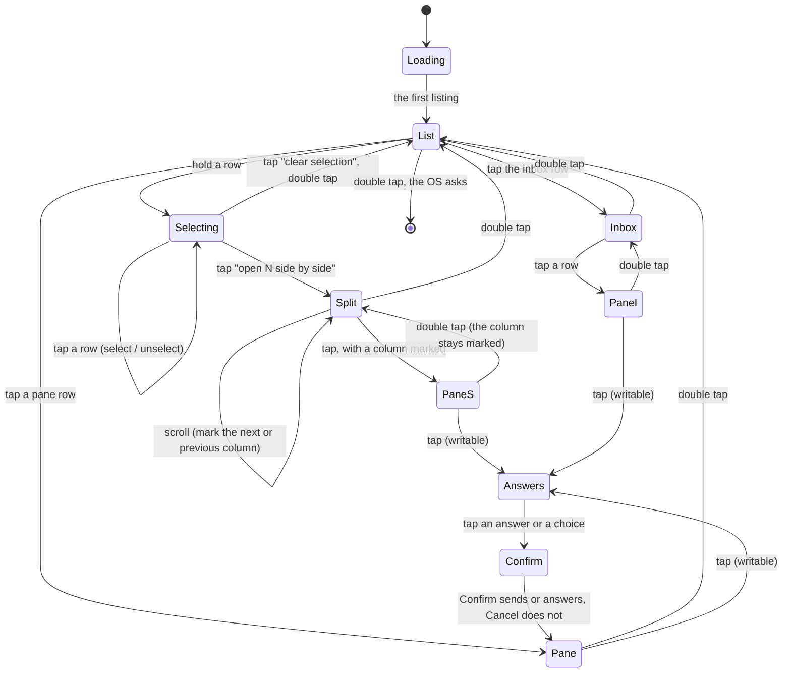

# Screens and gestures

Four gestures reach everything:

| Gesture | Does |
|---|---|
| scroll | moves the cursor on the pane list; marks the next or previous column on the columns; moves the highlight in a list; pages the pane |
| tap | opens the row under the cursor (the inbox from its row); on the columns, opens the marked pane; on a pane, its answers (or reads it again when it is read-only); in the inbox, the pane of the row |
| hold | on the pane list, starts selection mode with the row under the cursor selected; on a pane, the OS menu: Refresh, Reveal all / Lens on, Bottom, Go to: the pane that has waited longest |
| double tap | back one page; leaves selection mode; from the pane list, out of the app, which the OS confirms first |

Every page is text from the top of the glasses down to a **hint** at the
foot, which names the gestures that work on the page. There is no status
line: the list's order and marks say which panes need you. A notification
arrives as a bordered **banner** in the hint's place for ten seconds; the
result of an answer flashes on the pane for four.



## Loading

```
reading the hub…


reading the hub ··
```

Until the first listing has arrived the list has one row and the hint's
dots move every half second. A failed first read puts the error in the
hint; the row stays. Nothing on the page says what the panes are doing
before the hub has said so.

## The pane list: the main screen

```
  ⚑ inbox · 2 waiting
  [x] ★ build · Claude · needs permission
  [x] ● tests · bash · done
> [ ] · logs · tail · active
  [ ] · api · Codex · working
  → open 2 side by side
  → clear selection

⚑ 2 · ▽ move · ● select · 3 at most · ×× done
```

One row per pane, those that need you first, then by address: the mark
(`★` asks a question or needs permission, `●` done, `○` idle, `·`
nothing reported), the name, the program, a **state word**, and
`read-only` where the token cannot write. The program is named as every
muxway client names it ([lenses](lenses.md)): *Claude*, *Codex*,
*Gemini*, *Antigravity*, *OpenCode*, *Copilot*, *aider*, *goose*, *Amp*
or *Cursor* for an AI harness, else the command. While anything waits
the first row is the way to the [inbox](#the-inbox), `⚑ inbox · 2
waiting`, and the hint starts with the count, `⚑ 2`. The state word
says only what is known:

| The hub said | The row says |
|---|---|
| a question or a permission | `asks a question`, `needs permission` |
| done, idle | `done`, `idle` |
| working, in its last event, and the pane still moves | `working` |
| nothing, and the pane wrote something in the last minute | `active` |
| nothing, and the pane has been silent for a minute or more | `quiet 4m` |

`active` and `quiet` come from the pane's last activity in the listing.
A Claude Code at work redraws its spinner, so it is `active`; one
waiting at its prompt is `quiet` and the age grows. `working` is the
harness's own word, from its hook or the host's watcher
([notifications](notifications.md)), and lasts while the pane moves.

The list is drawn by the app, seven rows at a time spread down to the
hint, with a **cursor**, `>`, on the brightest row; the scroll moves it
and the rows slide under it. With more panes than rows the hint starts
with where the window sits, `4–10 of 200`; a host that is offline is
named there first, `○ alice-laptop offline`. A **tap** opens the pane
under the cursor.

A **hold** starts **selection mode** with that pane selected: every pane
row gets a box, `[x]` or `[ ]`, a tap on a row selects or unselects it,
three at most, and a fourth says so in the hint. Two action rows follow
the panes: **open N side by side** (from two selected) and **clear
selection**, which also leaves the mode, as does a double tap. The
selection survives the columns, so a double tap back and a tap reopens
the same view; it is pruned to the listing and forgotten when the app
restarts.

A **double tap** on the list asks the OS to leave the app, which the OS
confirms. Nowhere else leaves the app.

## The inbox

```
★ build · Claude · needs permission · 3m
★ tests · Codex · asks a question · 40s
● api · Claude · done · 12s
inbox · 3 waiting · ▽ choose · ● open · ×× back
```

Every pane that waits for you, on every host the token reads, **oldest
first**: `GET /v1/inbox`, read when the page opens and again with every
listing while it is open. One row per pane: the mark, the name, the
program, the attention in words and how long it has waited. It is an OS
list of up to twenty rows; a **tap** opens the pane of the row, where a
tap leads to the answers as from the list, and a **double tap** comes
back to the inbox, then to the list. With nothing waiting the page says
so. The menu's **Go to** on a pane takes the same first row: the pane
that has waited longest, a question or a permission before the rest.

## Side by side

```
» ★ build · claude       ● tests · bash
● Bash(make test)        $ make test
  ok                     ok
  ...                    $
▽ next pane · ● open build · ×× the list
```

The selected panes in the list's order, two or three columns, each a
title line with its mark, name and program, and the last eight lines
through the lens wrapped to the column. All of them follow, each with
its own ETag. Titles are text, so the page carries no pictures.

The **scroll marks a column** and opens nothing: forward marks the next
one, or the first when none is marked; back the previous one, or the
last. At either end it stays. The marked column's title starts with `»`
and is brightest, its text too. A **tap** opens the marked pane full,
where the scroll pages and a tap answers as on any pane; with none
marked, the tap reads the columns again. A **double tap** on the open
pane comes back to the columns with the mark kept; on the columns, back
to the list with the selection kept.

## The pane

```
★ build · claude                  needs permission
  ● Bash(make test)
    ok
  ...


▽ page · ● answer · ≡ menu · ×× back
```

The **title** (mark, name, program) with the pane's **state** beside
it: the attention in words (`asks a question`, `needs permission`,
`idle`, `done`), else `following`, `paused · 2 pages up`, `reading…`, or
the error (`host offline`, `no connection`, `not found`); after an
answer the state flashes what happened for a few seconds (`sent y,
Enter`, `read only`). The body is the last lines of the pane,
`GET /v1/panes/{address}` in text mode with `lines` (setting, default
200) and `width=400`, wrapped by the app to the body's width, through
the [lens](lenses.md): eight lines, down to the hint. Claude Code's
input box is not drawn; what it holds is the first answer.

- **Following**: at the bottom, the pane is read every *follow* seconds
  with `If-None-Match`, and a `304` costs nothing on the glasses.
- **Scroll up** pages back and pauses following; **scroll down** pages
  forward, and past the last page following resumes.
- **Tap** opens the answers on a writable pane; on a read-only pane it
  reads the pane again (the hint says `refresh`).
- **Menu** (hold): Refresh, Reveal all / Lens on, Bottom, and Go to:
  *name* when another pane needs you.
- **Double tap** goes back where the pane was opened from: the columns
  or the list.

## Answers and confirmation

```
» yes
» no
» "run the tests again"
» Say it
Enter
y, Enter
answer build · ▽ choose · ● pick · ×× back
```

When a process in the pane asked a **question with fixed answers**
(`muxway ask` on the host; the listing and the event carry its
`choices`), the choices lead the list, `» yes`, `» no`. Picking one opens
the confirmation (`answer yes to build?`); Confirm posts the choice to
`POST /v1/panes/{address}/answer`, which hands it to the process that
asked and types nothing into the pane. The hub refuses a choice it did
not offer (`not one of the choices`) and a question that has been
answered or has ended (`no question there now`); the words flash on the
pane like every result. The choices are the ones the pane had when the
answers opened.

When Claude Code suggests what to say next, its input box holds the
suggestion, and on a pane the hub says runs `claude` the list opens with
it in quotes: picking it sends that text and `Enter`. It is taken from
the pane when the answers open, and the confirmation sends exactly that.
When the hub has a transcriber the next row is **» Say it**, which leads
to the [spoken reply](spoken-replies.md) pages.

Then a fixed set, in this order: `Enter`, `y, Enter`, `n, Enter`, `1 ·
Claude Code's first choice`, `2`, `3`, `Esc`, `Ctrl-C`, `Tab`,
`Shift-Tab`, `Up`, `Down`. `y, Enter` and `n, Enter` send the letter and
then `Enter`; `1`, `2` and `3` send the digit alone, which is how Claude
Code takes a choice on a question or a permission prompt; the rest are
the protocol's keys (`Enter`, `Escape`, `C-c`, `Tab`, `BTab`, `Up`,
`Down`). Free text beyond the suggestion comes from the [phone
pane](phone-pane.md) or your voice.

A tap on a fixed answer opens the confirmation, a two-row list with
**Cancel** first and highlighted, **Confirm** second, the question in the
hint (`send y, Enter to build?`). Confirm posts to
`POST /v1/panes/{address}/input`, one request per piece, goes back to
the pane, reads it at once and flashes the result. A double tap on
either page goes back without sending.

The suggestion's confirmation is the page the [spoken
reply](spoken-replies.md) uses: `send this to build?` over the whole
text in a box, a tap sends it and `Enter`, a double tap goes back. A
suggestion too long for that box is not offered.

```
send this to build?
┌────────────────────────────────────────────┐
│ run the tests again                        │
└────────────────────────────────────────────┘
● send + Enter · ×× back
```

## Security considerations

- The glasses send only the answers above, each after a confirmation, or
  a transcript read back first; a mis-tap cannot send `Ctrl-C` to a
  running build. Keys are the protocol's names.
- A choice is a write with the rules of input: the hub checks the write
  grant and the pane's mark, and the host's agent checks the choice
  against the list it gave, so the glasses can send the asking process
  nothing it did not offer. The choices themselves are checked on
  arrival (two to eight, each 1 to 40 characters, no control characters,
  no `|`, distinct) and dropped as a whole otherwise, so a hostile hub
  cannot put a row on the page that the firmware refuses or that hides
  what it does. The glasses offer them only on a pane the hub lists as
  writable; a proxy that lies about that earns a `403 read only`.
- The inbox shows what the token may read, as the pane list does, and
  is read with the same bearer header and caps.
- The suggestion is the pane's own text sent back to the same pane, only
  when the wearer picks it and confirms it on a page that shows every
  word: what is shown is what is sent, with no cut in between, and a text
  that would not fit (200 bytes) is not offered. It is offered only on a
  pane the hub names `claude`; two rules in a shell's output are not a
  box (see [lenses](lenses.md)). Control characters are removed before it
  is shown or sent, and the log keeps its size, not its words. The hub
  checks the write grant as for every answer.
- Whether a pane may be written to comes from the hub's `mode`; a title
  cannot forge it, and a hub or proxy that lies about the mode gains a
  refused request (`403 read only`). A read-only pane offers no
  suggestion.
- Rows are clamped by pixels before they reach the firmware, so a
  hostile title cannot reject the page; the mark and the selection's
  box come from the listing's fields and the wearer's gestures, never
  from the title; a listing of hundreds of panes is seven rows and a
  cursor.
- The selection is a list of addresses the hub returned, held in memory
  only and pruned to every listing; a hostile listing cannot select
  anything.
- Pictures are drawn by the app from numbers it computed; nothing from
  the network is read as an image. The only one left is the loudness
  graph while listening.
- The hint and the state never carry the token or an error body, only
  words.
