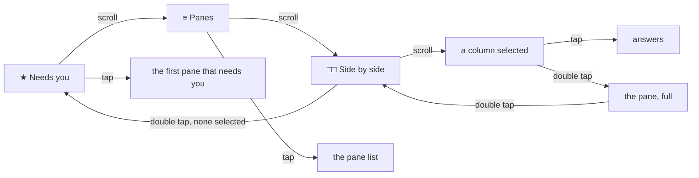

# Screens and gestures

Four gestures and the menu reach everything:

| Gesture | Does |
|---|---|
| scroll | walks the ring; selects a column; moves the highlight in a list; pages the pane |
| tap | opens what is highlighted or selected; on a pane, its answers (or reads it again when it is read-only) |
| tap, then hold | the OS menu: Refresh, Needs you, Panes, Side by side, Two/Three columns, Go to: the pane that needs you, and on a pane Reveal all and Bottom |
| double tap | back one page; expands a selected column; from the columns with nothing selected, the main menu; out of the app from the ring |

Every page has the same frame. The **status line** at the top is the
ring's tab bar, with the page you are on in brackets, then how many
panes need you, how many panes there are, how many columns, the host
and the clock:

```
[★ 1]  ≡ 3  □□ 2  ● alice-laptop  16:51
```

At the foot a **hint** names the gestures that work on the page. A
notification arrives as a bordered **banner** in its place for ten
seconds; the result of an answer flashes on the pane for four.

## The ring: the main menu



### Needs you

```
[★ 1]  ≡ 3  □□ 2  ● alice-laptop  16:51
★ build · claude · needs permission        ▮───────────
● tests · bash · done                        ▮─────
                                           ┊    ┊    ┊  │
★ 1 asks · ● 1 done · 0 idle
bar = time waited, up to 12m
▽ Panes · ● open · ≡ menu · ×× exit
```

One row per pane with attention, brightest when it needs you, and
beside each a **timeline**: a marker where its attention arrived, a
line from there to the right edge, which is now, so the longer the
line the longer the wait. The footer counts and gives the scale. With
nothing pending the footer says so. Tap opens the first pane that needs
you.

### Panes

One row per pane (five; more go to the list), mark, name, program,
`read-only`, and beside each a **bar of recency**: how recently the pane
had activity, full for a minute ago, empty for a day, dimmer for a pane
you cannot write to. The footer counts panes and hosts. Tap opens the
**list**, the same rows as an OS list, nineteen a page.

### Side by side

```
[□□ 2]  ★ 1  ≡ 3  ● alice-laptop  16:51
█ » build · claude █    · tests · bash
● Bash(make test)        $ make test
  ok                     ok
> y                      $
▽ select · ● answer · ×× open the pane · ≡ menu
```

Two or three columns (the menu switches, remembered), each a pane: a
bold **title band** with its mark, name and program, and the last lines
through the lens wrapped to the column. All of them follow. The panes
are the list's, in its order: those that need you first. The **scroll
selects**: the first scroll selects the first column, drawn with its
band inverted and its text brightest; further scrolls move the
selection, and past the last column the columns slide along so the
selected pane is always in view. **Tap** opens the selected pane's
answers. **Double tap** expands the selected pane to the full pane
page; a double tap there comes back to the columns with nothing
selected, and a double tap with nothing selected goes to the main menu.

## The pane

```
[★ 1]  ≡ 3  □□ 2  ● alice-laptop  16:51
█ ★ build · claude █              needs permission   ▏
  ● Bash(make test)                                   ▏
    ok                                                █
  ...                                                 █
┌────────────────────────────────────────────────────┐
│ > y                                                │
└────────────────────────────────────────────────────┘
▽ page · ● answer · ≡ menu · ×× back
```

The **title band** in bold (mark, name, program) with the pane's
**state** beside it: the attention in words (`asks a question`, `needs
permission`, `idle`, `done`), else `following`, `paused · 2 pages up`,
`reading…`, or the error (`host offline`, `no connection`, `not found`);
after an answer the state flashes what happened for a few seconds (`sent
y, Enter`, `read only`). The body is the last lines of the pane,
`GET /v1/panes/{address}` in text mode with `lines` (setting, default
200) and `width=400`, wrapped by the app to the body's width, through
the [lens](lenses.md). Six lines fit; with a pinned box, four and the box
in its **frame**. At the right edge a thin **position bar** shows where
the window sits in the pane's history, lit for the window, a tick at the
foot while following.

- **Following**: at the bottom, the pane is read every *follow* seconds
  with `If-None-Match`, and a `304` costs nothing on the glasses.
- **Scroll up** pages back and pauses following; **scroll down** pages
  forward, and past the last page following resumes.
- **Tap** opens the answers on a writable pane; on a read-only pane it
  reads the pane again (the hint says `refresh`).
- **Menu**: Refresh, Reveal all / Lens on, Bottom, Panes, Side by side,
  and Go to: *name* when another pane needs you.
- **Double tap** goes back where the pane was opened from: the columns,
  the list or Needs you.

## Answers and confirmation

```
answer build · ▽ choose · ● pick · ×× back
  » Say it
  Enter
  y, Enter
  n, Enter
  1 · Claude Code's first choice
  2 · second choice
  3 · third choice
  Esc
  Ctrl-C
  Tab
  Shift-Tab
  Up
  Down
```

When the hub has a transcriber the list opens with **» Say it**, which
leads to the [spoken reply](spoken-replies.md) pages.

A fixed set, in that order. `y, Enter` and `n, Enter` send the letter and
then `Enter`; `1`, `2` and `3` send the digit alone, which is how Claude
Code takes a choice on a question or a permission prompt; the rest are
the protocol's keys (`Enter`, `Escape`, `C-c`, `Tab`, `BTab`, `Up`,
`Down`). Nothing else can be sent from the glasses: free text comes from
the [phone pane](phone-pane.md) or your voice.

A tap on an answer opens the confirmation, a two-row list with **Cancel**
first and highlighted, **Confirm** second, the question in the hint.
Confirm posts to `POST /v1/panes/{address}/input`, one request per piece,
goes back to the pane, reads it at once and flashes the result. A double
tap on either page goes back without sending.

## Security considerations

- The glasses send only the answers above, each after a confirmation, or
  a transcript read back first; a mis-tap cannot send `Ctrl-C` to a
  running build. Keys are the protocol's names, text is one to four
  printable characters.
- Whether a pane may be written to comes from the hub's `mode`; a title
  cannot forge it, and a hub or proxy that lies about the mode gains a
  refused request (`403 read only`).
- Rows are clamped by pixels and by bytes before they reach the firmware,
  so a hostile title cannot reject the page; the mark comes from the
  attention field, never from the title; a listing of hundreds of panes
  is five rows and a list.
- Pictures are drawn by the app from numbers it computed and names it
  cleaned; nothing from the network is read as an image. At most four
  pictures a page.
- The status line, the hint and the state never carry the token or an
  error body, only words.
