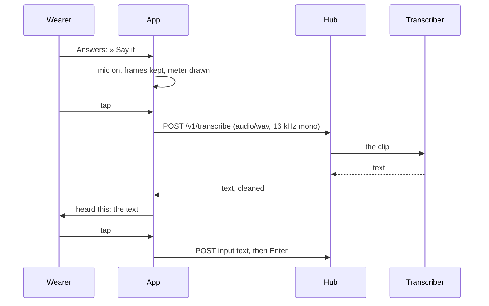

# Spoken replies

Say a reply on the glasses, read it back, send it. The fixed answers
stay; this is the free text that until now only the phone could type.



## On the glasses

On a writable pane, when the hub has a transcriber, the Answers list
opens with **» Say it**. It leads through three pages:

```
test-pane · listening · 4 s          heard this · 4.2 s
                                     run the tests again
  ████████████████
                                     
  4 s · tap when done
● stop · ×× cancel                   ● send ⏎ · ≡ menu · ×× cancel
```

- **Listening**: the microphone opens, frames are kept in memory, the
  meter shows how loud you are and the head counts the seconds. **Tap**
  when done. Four seconds without a frame gives `no audio from the mic ·
  let the Even app use it`; sixty seconds is the longest clip, after
  which the app stops by itself; under half a second is `too short`.
- **Transcribing**: the clip goes to the hub as a WAV; the head says how
  long it was. The hub forwards it to the transcriber its owner set.
- **Heard this**: the text, wrapped. Reading it is the confirmation:
  **tap** sends it and then `Enter`, like the phone's send, and the pane
  is read at once. The menu has **Type without Enter** and **Say it
  again**; a **double tap** cancels and nothing is sent.
- Any failure (the transcriber down, a refusal) is a head line with
  `say it again` in the hint; a tap tries again.

The mic is closed on stop, cancel, back, foreground exit and when the
app ends. Frames and the transcript are dropped after the request;
nothing is stored and nothing of it is logged. The phone log says
`transcribed 4.2 s in 1800 ms`.

## On the phone

**Spoken replies** on the phone pane is on by default; off, the row is
not offered. **save & test** says whether the hub has a transcriber
(`spoken replies available` or `no transcriber on the hub`).

## On the hub

The hub owner configures a transcriber once, with `--stt-url` and its
companions; whisper.cpp on the hub's own machine keeps audio at home,
and `--stt-prompt` is where host and project names go so they are heard
right. The core's `docs/features/transcription.md` has the details. The
glasses probe `GET /v1/transcribe` when the app starts and when settings
change, and offer the row only on a `204`.

## Security considerations

- The clip leaves the phone only for the hub, over HTTPS with the bearer
  token, and the hub forwards it only to the transcriber its owner
  chose. The glasses never talk to a speech-to-text provider.
- The hub needs a write grant for a clip, so a read-only token cannot
  spend the owner's transcriber; the text itself goes through the input
  endpoint with the pane's own checks, as anything typed does.
- The transcript is text from a third party: the hub cleans and caps it,
  the app cleans it again, shows it before sending, and sends it only as
  input text, which refuses control characters. A hub that lies about
  having a transcriber and then fails gets an error line and nothing is
  sent (S25); one that answers escapes and 10 KiB gets them cleaned and
  cut (S26).
- The microphone opens only on **» Say it**, and the manifest says so.
