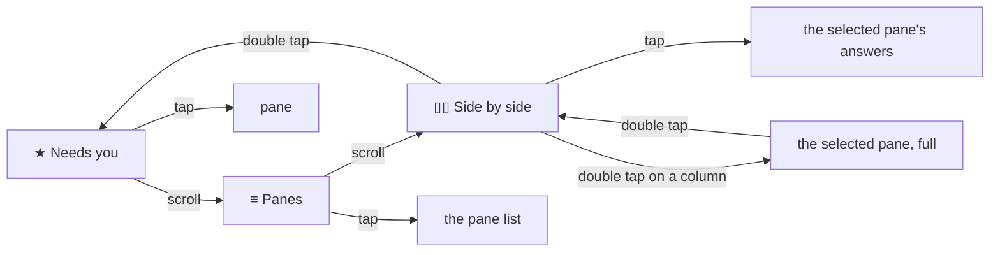
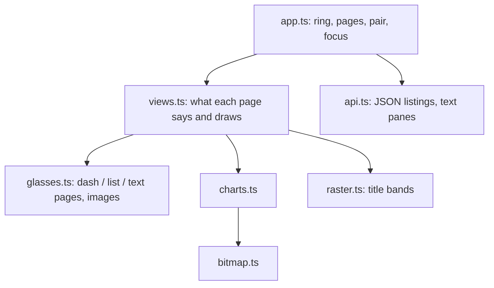

# Feature: the dashboard look, and two panes side by side

> Status: implemented 2026-10-24.

## 1. Goal

The first client is usable and plain: text in one weight, no pictures,
one pane at a time. The owner's earlier app on the same glasses
shows what the display can do: a status line that doubles as a tab
bar, a ring of dashboards walked by the scroll, rows with a bar chart
lined up beside them, bold titles, bordered boxes, a loudness graph
while recording. This feature gives muxway that look, with its own
content, and adds the view the owner asked for most: **two panes side
by side**, in two columns, with the scroll moving between them.

Out of scope: colour (the display has four greys), pictures of a pane
(a terminal rendered pixel by pixel; text stays text), more than two
columns.

## 2. Design

### The kit, ported from the earlier app

- `bitmap.ts`: a four-grey raster (rectangles, frames, rules, hatching,
  lines), one byte per pixel, at most 288 x 144 per image container, up
  to four containers a page, pushed again after every rebuild and
  skipped when its key is already on the glasses.
- `charts.ts`: bar rows lined up with text rows, a timeline of how long
  each row has waited, a sparkline, a progress bar.
- `raster.ts`: text the firmware font cannot do, drawn in the WebView's
  canvas, bold and a size up, anti-aliased onto the two middle greys,
  cut into image tiles: the **title band** of a page.
- `glasses.ts` gains the **dash** page kind: free-positioned text blocks
  (with an optional 1 px border, sharp corners) and image containers,
  no list, so the scroll reaches the app; every call to the bridge in
  one queue; a page that moved on stops the pushes of the one before it.

### Every page

- **Status head** instead of a title: `[≡ 3]  ★ 1  ● alice-laptop  16:51`: the
  ring's tabs with the current one in brackets, panes that need you,
  the host's state (`●` online, `○` offline), the clock. The same line
  on every page, which is how one knows where one is.
- **Hint line** at the foot, as now, dimmest.
- **Toast**: a bordered banner over the hint, brightest, the pane's
  name bold.
- **Flash** (the result of an answer): in the head's place for four
  seconds, as now.

### The ring (scroll walks it, tap goes in, double tap leaves the app)

1. **Needs you**: one row per pane with attention, `★ name · program ·
   kind`, and beside it a **timeline bar**: how long it has waited (the
   attention's time from the listing), the newest at the right edge.
   Footer: `★ 1 asks · ● 2 done · 0 idle`, and `nothing needs you`
   when so. Tap opens the first.
2. **Panes**: one row per pane (up to five, the rest in the list), mark,
   name, program, and beside it a **bar of recency**: how recently the
   pane had activity, full for a minute ago, empty for a day. Footer:
   hosts online and offline, panes in all. Tap opens the list as now.
3. **Side by side**: two or three columns (a menu choice, remembered),
   each a pane: a bold **title band** (name, program, mark), the last
   lines through the lens wrapped to the column, both or all three
   following with their own ETags. The panes are the list's, in its
   order (needs-you first). Here the **scroll selects**: it moves a
   1 px **frame** from column to column, and past the last column on to
   the next pane, the columns sliding along so the selected one is
   always in view. **Tap** opens the selected pane's **answers**, as a
   tap on a single pane does. **Double tap** expands the selected pane
   to the full pane page, where the scroll pages up and down as today;
   a double tap there comes back to the columns, with the frame where
   it was. A double tap on the columns goes back to the ring's first
   page, the main menu. The menu reaches Side by side from anywhere,
   and switches two and three columns.

### The pane

- A bold **title band** (name, program; the attention in words at the
  right), the body under it (seven lines), the pinned box **framed**,
  and a **position bar** at the right edge: a thin image, the buffer
  from top to bottom, the window's span lit, a tick at the bottom while
  following.
- Gestures unchanged.

### Spoken replies

- **Listening**: the **loudness graph**, a sparkline of the last
  fourteen seconds of frames across the width, the seconds, and a
  **progress bar** of the sixty-second cap under it; the head says
  `listening`.
- **Heard this**: the transcript in a framed box under a bold band, the
  seconds at the right.
- **Transcribing** and errors: a bordered box with the line.

### Data: two modes, one hub

The bars need what text mode does not carry: `activity`, `attention.at`,
`alias`. The hub already serves every endpoint in two contracts, chosen
by the request's `Accept` header: **JSON** by default, for modern
devices, and **text mode** on `Accept: text/plain`, for retro devices
that cannot parse JSON (the Java ME client, a 2002 phone). Nothing
changes on the hub and nothing changes for the Java ME client. This
client, a modern device, reads the listings (`GET /v1/panes`,
`GET /v1/hosts`, `GET /v1/events`) as JSON and keeps **text mode for
pane content**, where the hub's wrapping and charset folding are what
the glasses want. The repository's rule in AGENTS.md section 7 says so.

### Structure

A page's pictures are a few kilobytes of pixels each (a 240 x 140 bar
chart is 34 KB as bytes, a title band 284 x 30 is 9 KB); the queue pushes
only what changed, in order, and gives up on a page the wearer has left.

## 3. Protocol and API changes

None on the hub. The client reads the listings' JSON, which v1 has.

## 4. Security analysis

- No new network, no new endpoint, no new permission. The same data is
  read in JSON instead of text mode; JSON is parsed with the platform's
  parser and every string shown goes through the same cleaning and
  fitting as before.
- Pictures are drawn by the app from numbers it computed (ages, levels)
  and from names it already cleaned; the title band draws a cleaned
  string into a canvas. Nothing from the network is interpreted as an
  image.
- A hostile listing cannot grow a page: at most five rows on a
  dashboard, four images a page, every row clamped as before.
- Two panes side by side are two reads with two ETags, within the
  token's rate limit by far. The pair and the kept columns are stored
  with the settings (addresses only).
- The loudness graph is computed from frames already in memory and
  dropped with them; nothing more is kept.

## 5. Privacy check

Screenshots from the simulator against the test hub only; the fixtures
are the synthetic ones. No real names in code, docs or tests.

## 6. Test plan

| # | Test | Kind | Expected |
|---|------|------|----------|
| S30 | A listing of 200 panes, titles of 300 characters, an `activity` a year ahead and one negative, an `attention.at` of 0 | e2e-security | five rows on the dashboard, bars clamped, the page accepted |
| S31 | Pane JSON with a 1 MiB title and nested junk | e2e-security | parsed or skipped, the app keeps polling |
| U30 | Bitmap primitives, charts (bar lengths, timeline positions, sparkline range), the pair window and the focus rules | unit | as specified |
| F30 | The ring: Needs you, Panes, Side by side, back to Needs you by scrolling | UI | head brackets move; screenshots of each |
| F31 | Needs you with two panes waiting: rows and bars, tap opens the first | UI | screenshot `needs-you` |
| F32 | Side by side: two panes follow, `echo` in each shows in its column; the scroll moves the frame; past the last column the columns slide to the next pane; tap opens the selected pane's answers | UI | screenshots `split`, `split-second`, `split-slid`, `split-answers` |
| F33 | Double tap expands the selected pane, scroll pages it, double tap returns to the columns with the frame kept; double tap on the columns reaches Needs you; three columns from the menu | UI | screenshots `split-full`, `split-back`, `split-three` |
| F34 | The pane's title band, framed pinned box and position bar while paging | UI | screenshots `pane-band`, `pane-paged` |
| F35 | Listening with the tone: the sparkline is drawn (the screenshot's lit pixels grow), the progress bar advances; heard this in its box | UI | screenshots `listening-graph`, `heard-box` |
| F36 | Toast as a banner | UI | screenshot `toast-banner` |

The screenshots of the listing (`scripts/store-shots.sh`) are retaken.

## 7. Documentation

`docs/features/screens.md` (rewritten for the ring, the dashboards, the
split view), `docs/features/spoken-replies.md` (the graph),
`docs/ARCHITECTURE.md` (the kit, the image budget), `AGENTS.md` section 7
(JSON listings), `README.md`, the store listing's description and
screenshots.

## 8. Implementation steps

1. `bitmap.ts`, `charts.ts`, `raster.ts` with unit tests; the dash page
   kind and image pushes in `glasses.ts`.
2. JSON listings in `api.ts` and `protocol.ts`, with the fields the bars
   need; `AGENTS.md`.
3. The status head, the ring, Needs you and Panes dashboards.
4. Side by side: the pair window, focus, keep, swap, the two readers.
5. The pane's band, frame and position bar; the toast banner.
6. The loudness graph and the heard box.
7. Tests, docs, screenshots, run, record.

## Decisions

- 2026-10-24: plan approved. The hub keeps serving both contracts on
  the same endpoints (JSON by default, text mode on request), so retro
  devices keep theirs and this client reads listings as JSON; no
  endpoint is renamed. Side by side works as the owner described: the
  scroll selects a column, a tap opens its answers, a double tap
  expands it and brings it back, a double tap on the columns goes to
  the main menu. Two or three columns.

---

## Review (after implementation)

Done against the plan, the security rules and the privacy rules.

- [x] Diff matches the plan, deviations explained here
- [x] Security rules (AGENTS.md section 2) hold
- [x] Privacy check passed: `scripts/prepush-check.sh` clean and diff read
- [x] Docs and diagrams updated

Deviations:

- **The selected column is marked by its band inverted and its text
  brightest, not by a frame.** A border is part of a block's geometry,
  so a frame that moves would be a rebuild per scroll, during which the
  firmware drops the next input; the band is a picture and the text a
  brightness, both upgraded in place.
- **The toast is the hint line itself, bordered and bright**, not a
  banner over it; the hint has the foot of the page anyway.
- **The main menu by double tap.** The owner's description had both
  "expand the selected pane" and "back to the main menu" on the double
  tap in the columns. Returning from an expanded pane clears the
  selection, so the sequence reads as described: select, double tap
  expands, double tap returns, double tap leaves for the main menu.
- **A picture over 288 x 144 made the firmware refuse the whole page**,
  seen in the simulator's log, not in the trace: the position bar
  (8 x 168) and the progress bar (560 x 8) are tiled now, the renderer
  drops a picture it cannot send and says so, and the harness fails a
  test whose simulator log shows a refused page. The trace runs ahead
  of the glasses by a rebuild and its pictures, so a screenshot waits a
  moment, an expectation only counts pages drawn after the last gesture,
  and a tap or scroll tick the simulator swallowed is sent again.
- **S31**: a 1 MiB title puts the listing over the app's 256 KiB cap, so
  the listing is cut and parsed as empty rather than parsed with the
  one pane; the test takes either, and that the app keeps polling.
- The listings' "activity" bar is on a log scale (full a minute ago,
  empty a day ago), since a linear day shows every live pane as full.

## Test run

69 tests, all passing at `4873524`: 27 end-to-end in the simulator (11
security, 15 features, the phone pane in Chromium), 41 unit, and the
search of every log for the run's tokens and keys. Recorded as
[test run #4](https://github.com/notmarkopadjen/muxway-glasses-even/issues/4).
The run before it, at `13f66c1` with the first build of this feature,
had nine failures, all from the two pictures the firmware refused; the
simulator's log, not the trace, gave them away. The run at `75cb1d2`
([#5](https://github.com/notmarkopadjen/muxway-glasses-even/issues/5))
lost two tests to a scroll sent before the first listing was in; the
harness now waits for it, and the run at `4d37bd2` is green again
([test run #6](https://github.com/notmarkopadjen/muxway-glasses-even/issues/6)), 69 tests.
