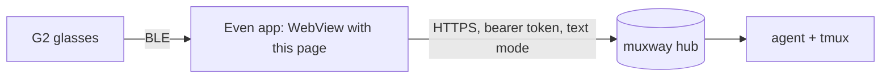
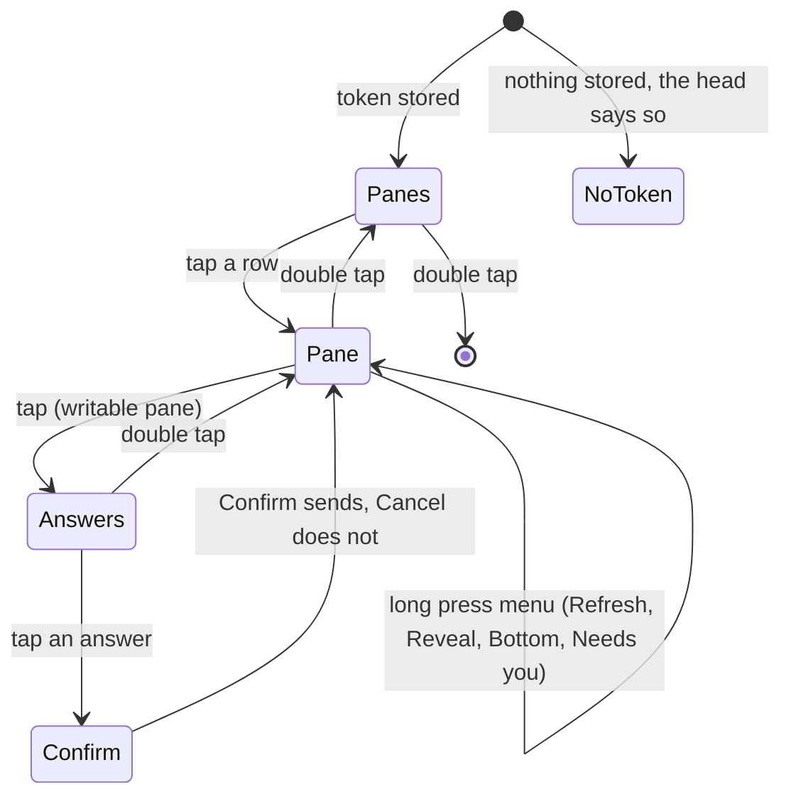
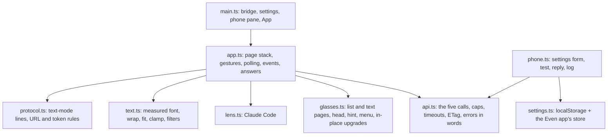

# Feature: the first glasses client

> Status: implemented 2026-10-24.

## 1. Goal

A muxway client for Even Realities G2 glasses: glance at the panes the
token may see, read the last lines of one, answer it from a fixed set of
replies, and be told when an AI coding CLI in a pane needs you. The pane
list, the pane and the notifications are on the glasses; settings and
free-text replies are on the paired phone, in the same app's phone pane.

The app is an Even Hub app: a web page the Even phone app loads in a
WebView and that draws on the glasses through the Even Hub SDK. It speaks
the hub's protocol v1 in **text mode** and nothing else.

Out of scope, each its own feature later: notifications while the app is
not open (an Even Hub app runs only while open), spoken replies through
the glasses' microphone, a pixel-exact monospace rendering of a pane as an
image, several hubs, mouse input, resizing.

## 2. Design



The phone does the network: the WebView calls the hub directly over HTTPS
with `Authorization: Bearer`. No relay. The hub needs one compatible
addition for that, CORS on the client endpoints (section 3).

### The display

576 x 288, four greys, one proportional font with one size (a line is
28 px, about 60 average glyphs; a list shows about six rows and holds
twenty, each at most 63 bytes). The facts about the firmware come from the
owner's earlier work on the same hardware and are checked again on the
simulator here:

- a page without a list container hands scrolls to the app; a page with
  one spends them on its own highlight and reports taps only;
- a text container shorter than its text hides the overflow, so the app
  wraps and pages every line itself, with the font's measured advance
  widths;
- an oversize row or block rejects the whole page silently, so every row
  is clamped by pixels and by bytes before it is sent;
- text changes are flicker-free in-place upgrades; layout changes are a
  rebuild, during which input is dropped, so every page kind keeps one
  fixed geometry;
- the font drops glyphs it lacks without a trace, so the glasses show only
  glyphs known to render (`★ ● ○ ▶ ▽ ≡ × · » → │ ─ █`), and pane text is
  asked from the hub in Latin-1 by default (section "Text").

Every page has the same frame: a **head** line (brightest), a **body**, and
a **hint** line (dimmest) naming the gestures that work here.

### Screens



**Panes** (list page). `GET /v1/panes` in text mode, one row per pane:
`<mark> <name> · <command>`, with ` · read-only` when the token may not
write. The name is the title the program gave the pane, or
`session/window.pane` when the title says nothing, as the other clients
do. The mark is the pane's attention: `★` question or permission (needs
you), `●` done, `○` idle, `·` nothing. Panes that need you sort first,
then by address. Head: `muxway · 3 panes · 1 needs you`, or the error
(`offline`, `token refused: set it on the phone`). Hint:
`▽ choose · ● open · ×× exit`. The list is read again every 10 s and on
every event. More than nineteen panes: the twentieth row is `→ next`.

**Pane** (text page). Head: `★ build · claude · needs permission` (mark,
name, program, state: the attention kind in words, else `following`,
`paused · 2 pages up`, `offline`, `read-only`). Body: the last lines of the
pane from `GET /v1/panes/{address}?lines=200&width=400` in text mode,
wrapped by the app to the width in pixels, shaped by the lens (below),
eight lines on screen. While **following** (the view is at the bottom) the
pane is read every 3 s (setting, 1 to 30) with `If-None-Match`, and a
`304` costs nothing on the glasses. Scroll up pages back through the rows
and pauses following; scroll down pages forward, and past the last page
following resumes. Tap opens Answers on a writable pane and reads the pane
again on a read-only one. Long press opens the OS menu: **Refresh**,
**Reveal all** / **Lens on**, **Bottom**, **Panes**, and **Needs you:
<name>** when some pane does. Double tap goes back to Panes.

When the lens pins the input box (someone typed into Claude Code's box at
the terminal) the body is six lines and the pinned rows are a second,
brightest block of two lines under it. The two geometries are the only
ones the page has.

**Answers** (list page) on a writable pane. A fixed set, in this order:

| Row | Sends |
|---|---|
| `⏎ Enter` | key `Enter` |
| `y ⏎`, `n ⏎` | text `y` or `n`, then `Enter` |
| `1`, `2`, `3` | text `1`, `2`, `3`: Claude Code's choices on a question or permission, picked by the digit |
| `Esc`, `Ctrl-C`, `Tab`, `Shift-Tab`, `↑`, `↓` | keys `Escape`, `C-c`, `Tab`, `BTab`, `Up`, `Down` |

Head: `answer build`. Nothing else can be sent from the glasses: free text
comes from the phone pane. Tap a row to go to **Confirm**, a two-row list,
`Cancel` first and highlighted, `Confirm` second, head `send y ⏎ to
build?`. Confirm posts to `POST /v1/panes/{address}/input`, one request
per piece, returns to the pane, reads it at once and flashes the result in
the head for a few seconds: `sent y ⏎`, or the refusal in words (`read
only`, `host offline`, `not found`, `locked out`). A double tap on either
page goes back without sending.

**Notifications.** While the app is open it keeps one long poll on
`GET /v1/events?after=<cursor>&wait=25` in text mode and starts the next
one as the last returns (the first call, without `after`, only takes the
cursor). An event of kind `question`, `permission`, `idle` or `done`
updates the pane's mark everywhere, re-reads the open pane when it is
that pane, and shows a **toast** in the hint line for ten seconds,
brightest: `★ build: Claude needs your permission to use Bash`. `working`
clears the mark. The menu's **Needs you** entry jumps to the pane with the
newest attention. Attention also comes with every pane list, so the marks
are right after a restart too.

**Phone pane** (`index.html`, the page the Even app shows on the phone).
Retro and terminal-first, as every muxway UI: monospace, phosphor green on
black, box-drawing frames, sharp corners. It holds **Settings** (hub URL,
token in a password field that is empty once stored, follow seconds,
lines, text Latin-1 or Unicode, lens auto or off), **Test connection**
(`GET /v1/me`, shows the token's name and grants, never the token),
**Reply** to the pane open on the glasses (a text box with **Send** = text
then Enter and **Type** = text alone; control characters removed first),
and a short **log** of status codes, sizes and timings, never content or
secrets.

**Text.** The hub is asked for `charset=latin1` by default: every character
that comes back is one the firmware font has, so nothing drops silently;
Claude Code's rules arrive as `-`, its prompt as `>`, bullets as `*`,
which the lens understands. **Unicode** is a setting for those who prefer
the real glyphs and accept the gaps. The app decodes by the answer's
`Content-Type`, like the Java ME client.

**Lens.** The Claude Code lens of the Java ME client, ported line for line
to TypeScript (`src/lens.ts`): on a pane whose program is `claude` it
hides the chrome (summary, notices, rules, empty input box, footer), pins
the box when someone typed into it, and drops the blank rows Claude fills
a tall terminal with. **Reveal all** in the menu shows everything in
place. On other programs it applies only when it finds Claude's two rules,
else the rows are shown as they are. The feature page repeats the rules.

### Structure



**Requests.** `fetch` with a 20 s abort (45 s for the long poll), one pane
read in flight at a time, at most 256 KiB of a body read, control
characters dropped from everything shown, status codes mapped to words.
A `401` forgets the token at once and stops polling, so a refused token
is tried exactly once (the hub locks an address out after ten failures).
A `429` waits ten seconds; a network error doubles the interval up to
60 s. Foreground exit stops the timers; foreground enter and any gesture
start them again.

**Build and packaging.** TypeScript, Vite, the Even Hub SDK; nothing else
at run time. `npm ci` from a committed lock file with exact versions:
`@evenrealities/even_hub_sdk` 0.0.15, `vite` 5.4.x, `typescript` 5.7.x,
and for development `@evenrealities/evenhub-cli` 0.1.14,
`@evenrealities/evenhub-simulator` 0.9.5, `playwright` 1.64.1.
`scripts/build.sh` type-checks and builds `dist/`; `scripts/pack.sh
<hub url>` writes the hub's origin into the manifest's network whitelist
(the Even app allows an app only the hosts its manifest names) and packs
the `.ehpk` for the Even Hub portal. The committed `app.json` names
`https://hub.example.com` and a placeholder package id.

**Storage.** One JSON record under one key in `localStorage` and in the
Even app's key/value store (which survives a WebView wipe), as the owner's
earlier app does. The token is in it.

## 3. Protocol and API changes

**In the core repository, a compatible addition to v1: CORS on the client
endpoints.** A WebView page has an origin of its own (`null` for a packed
app, a dev server while developing), so the browser sends a preflight for
`Authorization` and refuses the answer without these headers:

```
OPTIONS /v1/panes
  -> 204
     Access-Control-Allow-Origin: *
     Access-Control-Allow-Methods: GET, POST
     Access-Control-Allow-Headers: Authorization, X-Muxway-Token, Content-Type, Accept, If-None-Match
     Access-Control-Max-Age: 600
GET /v1/panes (any response)
     Access-Control-Allow-Origin: *
     Access-Control-Expose-Headers: ETag
```

Only on `/v1/hosts`, `/v1/panes`, `/v1/panes/...`, `/v1/events`,
`/v1/windows/...` and `/v1/me`; never on `/v1/auth/...`, `/v1/pair` or
`/v1/agent`, and never `Access-Control-Allow-Credentials`. A browser does
not send or store cookies on a request answered with `*`, and
`X-Muxway-Client`, which the session cookie needs, is not an allowed
header, so a page on a foreign origin can use a bearer token it holds and
nothing a signed-in browser holds. Documented in `docs/protocol/v1.md`
with an end-to-end test of its own in the core (preflight answered, no
credentials header anywhere, auth endpoints without CORS, a cookie with
an `Origin` still refused). The change is made from a worktree on the
core's `main` and committed on its own.

The client uses `GET /v1/me`, `GET /v1/panes`, `GET /v1/panes/{address}`,
`POST /v1/panes/{address}/input` and `GET /v1/events`, text mode.

## 4. Security analysis

- **The glasses hold a token that can type into a shell.** It lives in the
  Even app's storage on the phone, readable by anyone with the unlocked
  phone and the app. Advice in the docs: a token per pair of glasses,
  scoped to the panes it needs, read-only unless answering is the point,
  short-lived, revoked on loss. The token is never shown after saving,
  never logged, never in a URL, never in an error message.
- **A refused token is final**: `401` deletes it and the head says so.
  Nothing retries it, so the app cannot lock its own network out.
- **Hub URL rules**: `https` required; `http` only for loopback; no user
  info, query or fragment. A URL that fails is refused on the phone pane
  with the reason.
- **Settings from the page URL**: only when the page is served from
  loopback (the simulator and the test harness), so a sideloaded or
  packed app never takes a token from a URL. Anything else is refused and
  the phone pane says so.
- **Untrusted server content**: text mode is already stripped by the hub,
  and a proxy or a hostile hub can still send anything. The app reads at
  most 256 KiB, drops control characters, clamps every row by pixels and
  bytes before it reaches the firmware, and decodes by the declared
  charset with Latin-1 as the fallback that can decode any byte. A pane
  title cannot forge a mark or a mode: the mark comes from the attention
  column and the mode from the mode column, and the title is shown after
  them, cut to fit.
- **The lens** can only hide the rows the Java ME feature page lists, and
  Reveal all shows everything; the hostile screens of that client's suite
  (a 400-column rule, a thousand rules, control characters in the box, a
  fake footer) are in this suite too.
- **Typing**: the glasses send only the fixed answers above, after a
  confirmation; the phone sends what was typed with control characters
  removed and at most 4096 bytes. Keys are the protocol's names, nothing
  else. A write to a read-only pane is refused by the hub (`403`) and
  shown as `read only`; the Answers page is not offered on such a pane in
  the first place, from the mode column, and a proxy that lies about the
  mode gains only a refused request.
- **Events**: text is sanitised by the hub and sanitised again here; a
  10 KiB or control-laden line from a hostile hub becomes one fitted
  toast. The cursor is a number; anything else restarts without `after`.
- **CORS** (section 3) opens the bearer-token endpoints to pages on other
  origins, which is what any browser-hosted client needs; it cannot be
  used with the session cookie, and the token endpoints already rate
  limit and lock out.
- **Logging**: the phone pane's log and the console carry status codes,
  byte counts and timings. The test harness searches every log for the
  tokens and keys of the run (S99) and for the pane content and event
  text of the run.
- **Dependencies**: the Even Hub SDK (the only way to the glasses), Vite
  and TypeScript at build time, the Even CLI and simulator and Playwright
  for development and tests. All pinned exactly, lock file committed.

## 5. Privacy check

Examples use `hub.example.com`, `alice-laptop`, `work/0.0`, synthetic
pane content and the Java ME client's synthetic Claude Code screen. The
manifest names a placeholder host and package id. Screenshots come from
the simulator against the test hub only.

## 6. Test plan

End-to-end in the Even Hub simulator on a headless display, driven
through its automation API (input, glasses screenshot, console), against
a hub, agent and tmux server built from the core repository, behind a
small loopback proxy that records every request and can misbehave on
purpose. The app is served from `dist/` by the harness. Every step takes
a screenshot of the glasses; the app posts every page it draws to the harness
when started with `?trace=<id>` from loopback, which is what the
assertions read. The phone pane is tested with Playwright in
Chromium, with a screenshot per step and a trace per test.

| # | Test | Kind | Expected |
|---|------|------|----------|
| S01 | Wrong and revoked token | e2e-security | head says `token refused`, the token is forgotten, exactly one `401` per token at the proxy, no further requests |
| S02 | Token never in a URL, a log or on screen | e2e-security | proxy paths, console, phone log and traces searched: not found |
| S03 | Read-only token | e2e-security | no Answers page (tap reads instead), hint without `answer`; a direct `POST` is `403` |
| S04 | A 1 MiB body, bytes that are not UTF-8, control characters | e2e-security | shown cut and clean, the app keeps running and polling |
| S05 | Hostile Claude Code screen (400-column rule, a thousand rules, fake footer, escapes in the box) | e2e-security | nothing crashes, the lens hides at most the chrome, Reveal all shows every row |
| S06 | Hostile events: escapes, 10 KiB text, a cursor that is not a number | e2e-security | toast fitted and printable, polling continues without `after` |
| S07 | Pane titles with tabs, 300 characters, a forged `★` and a forged `write` | e2e-security | rows clamped, the mark and mode from their own columns, the page accepted (screenshot shows the list) |
| S08 | Phone reply with a newline and ESC | e2e-security (Playwright) | the hub receives printable text only |
| S09 | Hub URL `http://` on the internet, user info, query; a token from the URL on a non-loopback origin | unit + Playwright | refused with the reason |
| S99 | Every log of the run searched for tokens, keys, pane content and event text | e2e-security | not found |
| U01 | Lens on the fixture screens: rules, no rules, empty box, typed box, summary, reveal | unit | as the Java ME suite |
| U02 | Wrap and fit by pixels, clamp by bytes, control filter, text-mode line parsing, URL and token rules, answers table | unit | as specified |
| F10 | Pane list with marks and read-only; nineteen rows and `→ next` | UI | screenshots `panes`, `panes-2` |
| F11 | Open a pane; `echo hello` in tmux shows within the follow interval; `304` between | UI | screenshots `pane`, `pane-hello` |
| F12 | Scroll up pages back and pauses following; down past the end follows again | UI | head says `paused · 1 page up`, then `following` |
| F13 | Answers: `y ⏎` confirmed appears in the pane; Cancel sends nothing; `Ctrl-C` stops `sleep 100` | UI | screenshots `answers`, `confirm`, `pane-after` |
| F14 | Claude Code lens on the fixture: chrome hidden, box pinned when typed, Reveal all | UI | screenshots `lens`, `lens-pinned`, `lens-reveal` |
| F15 | `muxway notify --kind permission` on another pane: toast within 2 s, `★` first in the list, menu entry, `working` clears | UI | screenshots `toast`, `panes-attention` |
| F16 | Phone pane: save settings, test connection, reply Send and Type | UI (Playwright) | screenshots per step, trace |
| F17 | Hub down, host offline, back again | UI | head says so, recovers |
| F18 | Foreground exit stops polling, enter resumes | unit | timers as specified (the simulator sends no foreground events) |

## 7. Documentation

- `README.md`: what it is, install (pack with your hub, beta install),
  first start, the gestures.
- `docs/ARCHITECTURE.md`: components, screens, requests, build, with
  the diagrams above.
- `docs/features/screens.md`: Panes, Pane, Answers, Confirm, the menu,
  the gestures, the two geometries.
- `docs/features/notifications.md`: the long poll, marks, toasts, the
  menu entry, what is out of scope.
- `docs/features/lenses.md`: the lens rules, Reveal all, Latin-1.
- `docs/features/phone-pane.md`: settings, test, reply, log, storage.
- `docs/features/install.md`: the manifest whitelist, `pack.sh`, the
  portal's beta path, the dev QR path.
- `docs/testing.md`: the simulator and Playwright specifics.
- In the core: `docs/protocol/v1.md` gains CORS.

## 8. Implementation steps

1. Scaffold: `package.json` with pinned versions and lock file,
   `tsconfig`, Vite config, `app.json`, `index.html`, `scripts/build.sh`,
   `scripts/pack.sh`, `.gitignore` for `node_modules`, `dist`, `*.ehpk`.
2. Core: CORS on the client endpoints, protocol page, end-to-end test;
   its own commit from a worktree.
3. Pure modules with unit tests: `text.ts`, `protocol.ts`, `lens.ts`,
   `answers.ts`.
4. `api.ts`, `settings.ts`, `phone.ts` and the phone pane's look.
5. `glasses.ts` and `app.ts`: pages, gestures, polling, events, answers.
6. Harness: core, proxy, static server, simulator, Playwright, run
   directory, report; `scripts/e2e.sh`; security tests, then features.
7. Docs, CI workflow (core token, apt packages, Node, Go, Playwright's
   Chromium), full run, record.

## Decisions

- 2026-10-24: plan approved. The glasses reach the hub directly, with
  CORS added to the hub's bearer-token endpoints in the core repository
  (not a relay). Every answer from the glasses goes through Cancel /
  Confirm.

---

## Review (after implementation)

Done against the plan, the security rules and the privacy rules.

- [x] Diff matches the plan, deviations explained here
- [x] Security rules (AGENTS.md section 2) hold
- [x] Privacy check passed: `scripts/prepush-check.sh` clean and diff read
- [x] Docs and diagrams updated

Deviations:

- **The trace goes to the harness, not the console.** The simulator's
  console drops lines under load (a page's `SHOW` line vanished while
  the glasses showed the page), so the app, started with `?trace=<id>`
  from loopback, posts every drawn page to the server that serves it.
- **S08, the phone's reply with control characters, is a unit test** of
  the filter (`typed`), and the reply's network path is the one the
  glasses' answers take (F13). A plain browser has no Even bridge, so
  the reply box cannot be driven end to end outside the Even app; the
  Playwright test checks that it says so.
- **F18 runs as a unit test** against a stand-in bridge and hub, as
  planned; the simulator sends no foreground events.
- **A fresh home per simulator.** The WebView keeps `localStorage` per
  origin across runs, so the harness gives every simulator its own
  `HOME` and XDG directories; without that, one test's settings reached
  the next.
- **Wrapping is one pass.** The first version measured the rest of the
  row at every break and took minutes on a 256 KiB row (S04).
- **The phone pane names the unconfigured state** (`set the hub and
  token on the phone`) instead of a refused token when nothing is stored.
- The simulator's menu is opened with its `context_menu` action; the
  harness drives Reveal all through it (S05, F14).

## Test run

44 tests, all passing at `b5ee75e`: 16 end-to-end in the simulator (7
security, 8 features, the phone pane in Chromium), 28 unit, and the
search of every log for the run's tokens and keys. Recorded as
[test run #1](https://github.com/notmarkopadjen/muxway-glasses-even/issues/1);
the run directory `test-runs/20261024-122126-b5ee75e` holds the logs,
30 glasses and phone screenshots and the Playwright trace. The core's
CORS change is `e96cdfd` on the core's `main`, with its own test.
