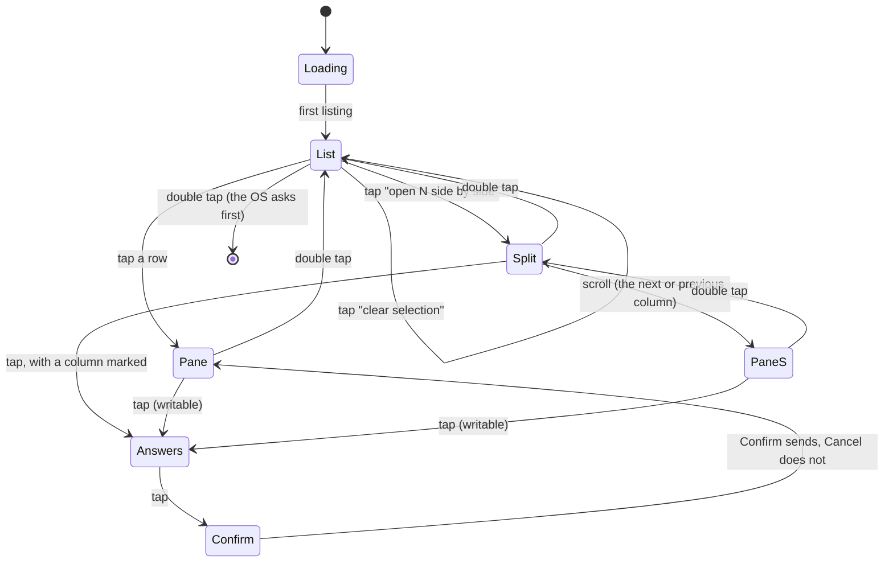
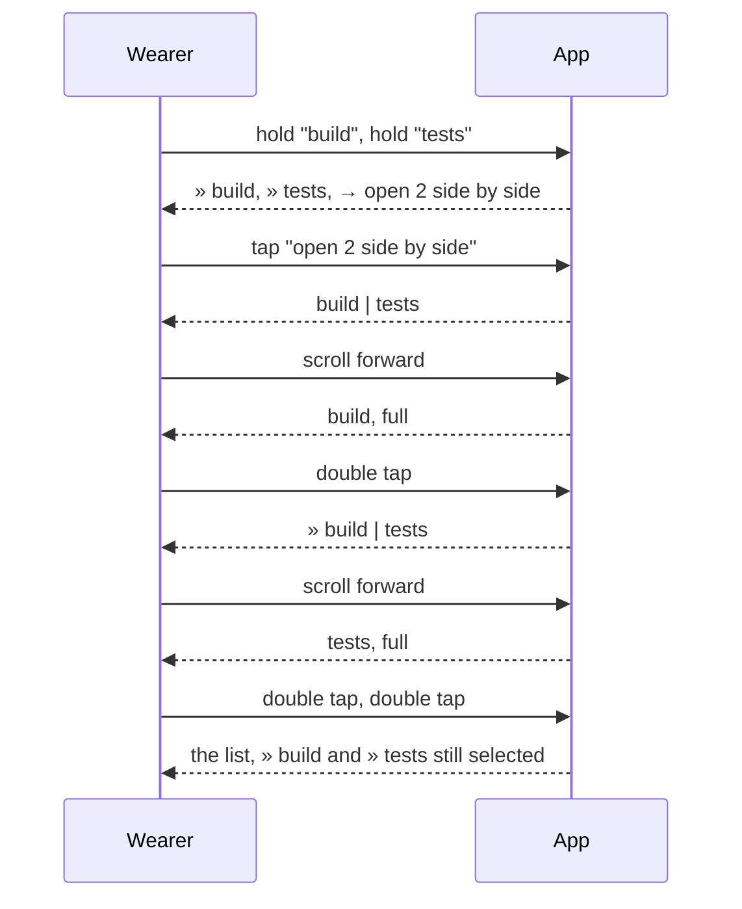

# Feature: the pane list first, panes picked by holding

> Status: planned 2026-10-24, after the owner wore version 0.3.0.

## 1. Goal

The ring of dashboards with a tab bar was carried over from the Build
Agents app and does not suit this one. On the glasses the owner wants
one thing on the main screen: **the panes**, and to get into one. Three
reports from the real device drive the change:

1. *"Nothing needs you. Five panes working quietly"* while two panes had
   finished. The hub knows a pane's state only when a Claude Code hook
   reported it; a pane with no attention is **unknown**, not working, and
   the page claimed otherwise. Until the first listing is in, nothing on
   the screen said that the information was not there yet.
2. A tap on the home page left the app, and the owner was never sure
   whether it crashed or meant to. Side by side showed two panes always,
   the scroll slid a third in, a double tap warned about leaving and then
   left the app: once there, the owner was stuck.
3. The menu-plus-dashboards concept is wrong for muxway.

This feature replaces the ring with a **pane list** as the only main
screen, **holding** a row to pick panes for a side-by-side view, honest
state words, and a loading state. Out of scope: anything new on the hub,
the lens, spoken replies, the phone pane.

## 2. Design

### The screens

### Loading

Before the first listing has arrived the list has one row,
`reading the hub…`, and the head says `reading the hub ·`, `··`, `···`
in turn every half second: the spinner. A failed first read puts the
error in the hint and stops the dots; the row stays. A tap or hold on
the row does nothing.

### The pane list: the main screen

An OS list, nineteen rows a page, the same rows for every pane, sorted
as before (those that need you first, then by address), with a **state
word** that says only what is known:

| Pane | Row |
|---|---|
| asks a question / needs permission | `★ build · claude · needs permission` |
| done | `● tests · bash · done` |
| idle | `○ build · claude · idle` |
| no attention, output in the last minute | `· logs · tail · active` |
| no attention, no output for a minute or more | `· build · claude · quiet 4m` |
| read-only, any of the above | `… · read-only` |

`active` and `quiet Nm` come from the pane's `activity` (the hub's
`window_activity`, already in the listing). A Claude at work redraws
its spinner, so it is `active`; a Claude at its prompt is `quiet` and
grows older. Neither word claims anything a hook did not say.

A **selected** row is prefixed `» `. Under the panes, when something is
selected:

- `→ open 2 side by side` (or 3) when two or three are selected;
- `→ clear selection`.

Head: `★ 1  ≡ 5  ● alice-laptop  16:51` (needs you, panes, host, clock).
Hint: `● open · hold to select · ×× exit`; with a selection,
`● open · hold to select · 3 at most`. The list has **no OS menu**, so a
hold reaches the app. More than nineteen panes page as before with
`→ next N more`.

### Gestures on the list

- **Tap** a pane row: that pane, full.
- **Hold** a pane row: toggle its selection. A fourth is refused, the
  hint says `three panes at most` for a moment.
- **Tap** `open N side by side`: the split view with the selected panes,
  in list order.
- **Tap** `clear selection`: no selection.
- **Double tap**: leave the app. `shutDownPageContainer(1)`: the OS asks
  first, which is the "warning" the owner saw and is right at the root
  and nowhere else.

### Side by side

The selected panes, two or three columns, drawn as today (bold title
band, the last lines through the lens, each with its own ETag). The
selection is kept on the list, so a double tap back and a tap reopens
the same view.

- **Scroll** enters one pane: forward opens the column after the marked
  one (the first column when none is marked), back opens the column
  before it (the last when none is marked). At either end the scroll
  does nothing.
- **Double tap** on the pane opened this way goes back to the columns
  with that column **marked** (band inverted, text brightest). The next
  scroll goes on from there.
- **Tap** on the columns with a column marked: its answers, as on the
  pane; with none, the columns are read again.
- **Double tap** on the columns: the list, selection kept.

### The pane

As today: band, state, body, pinned box, position bar, the scroll pages,
the tap answers. The menu keeps Refresh, Reveal all / Lens on, Bottom
and Go to: *name*; Panes and Side by side leave it, the double tap does
that. Double tap goes back where the pane was opened from.

### Gone

The ring and its three dashboards, the tab bar, the status head's
brackets, the timeline and recency charts, the `columns` setting (the
count is how many panes were held), the menu entries Needs you, Panes,
Side by side, Two/Three columns. The toast banner, the flash, the
notification's Go to entry stay.

### Structure

`app.ts`: the view stack is `list | split | pane | answers | confirm |
listen | heard`; `selected: string[]` (addresses, at most three, dropped
when a pane leaves the listing); `marked: number` (the split's column,
-1 for none); `loaded` for the first listing; a half-second ticker while
loading. `views.ts`: `listPage` grows the state words, the selection and
the two action rows; `splitPage` takes the selected panes and the mark;
the dashboards, `window` and `statusHead`'s tabs go. `glasses.ts`
unchanged. `settings.ts` drops `columns`.

## 3. Protocol and API changes

None. The listing's `activity` field, which v1 has, is read for the
state word.

## 4. Security analysis

- No new network, endpoint, permission or dependency. The same listing
  is read; one field more is shown, as a number of minutes computed by
  the app.
- The selection is a list of addresses the hub returned, kept in memory,
  never stored, and pruned to the listing on every read. A hostile
  listing cannot select anything: the wearer's hold does.
- A long press is one more gesture from the same source as the tap; no
  text crosses a trust boundary. The two action rows are the app's own
  strings; a pane row is clamped as before (490 px, 63 bytes), with the
  state word included, so a hostile title cannot push the word off or
  forge a mark.
- Leaving the app goes through the OS's own confirmation.
- Nothing new is logged; the log keeps status codes, sizes and timings.

## 5. Privacy check

Screenshots from the simulator against the test hub only; fixtures are
synthetic (`alice-laptop`, `build`, `tests`). No real names in code,
docs or tests.

## 6. Test plan

| # | Test | Kind | Expected |
|---|------|------|----------|
| S30 | A listing of 200 panes, titles of 300 characters, an `activity` a year ahead and one negative, an `attention.at` of 0 | e2e-security | nineteen rows and `→ next`, every row within 63 bytes, the page accepted, `quiet` never negative |
| S07 | Forged marks and `»` in titles | e2e-security | the mark and the selection prefix are the app's, the title's copies are inside the name |
| U30 | `rowLabel` state words (attention, active, quiet ages, read-only), the selection's action rows, the split's next and previous column | unit | as specified |
| F30 | Loading: the `reading the hub…` row and the dots before the listing; the list once it is in; double tap asks the OS to leave | UI | screenshots `loading`, `list` |
| F31 | Two panes waiting: first in the list with their words; one done, one quiet; tap on the top row opens it | UI | screenshot `list-attention`, `first-pane` |
| F32 | Hold selects two rows, `open 2 side by side` appears, both columns follow, `echo` shows in each; hold a third and a fourth: three at most; clear selection | UI | screenshots `list-selected`, `split`, `list-three`, `list-cleared` |
| F33 | From the columns a scroll opens the first pane, double tap returns with it marked, a scroll opens the second, double tap, double tap reaches the list with the selection kept; tap with a column marked opens its answers | UI | screenshots `split-first`, `split-marked`, `split-second`, `split-answers` |
| F10, F15 | Rewritten for the list as the first page | UI | as before |

The listing's screenshots (`scripts/store-shots.sh`) are retaken.

## 7. Documentation

`docs/features/screens.md` (rewritten), `docs/ARCHITECTURE.md` (the
screens diagram), `docs/store-listing.md` and `README.md` (the gestures),
`docs/features/notifications.md` if it names the ring.

## 8. Implementation steps

1. `views.ts`: state words, the list with selection and action rows,
   the split from a selection with a mark, the head without tabs; drop
   the dashboards.
2. `app.ts`: the new stack, the hold, the selection, the split's scroll,
   loading and the dots, exit with confirmation; `settings.ts`.
3. Unit tests.
4. Harness: a `hold(index)` gesture; the suite's helpers and F10, F15,
   F30 to F33, S30 rewritten.
5. Docs and screenshots; run; record.

## Decisions

- 2026-10-24: the owner asked for exactly this on the glasses: the pane
  list as the main menu, tap enters, hold selects, open or clear under
  the list, scroll in the columns enters a pane, back to the columns,
  back to the list. "Do it like this, and then we will discuss more."
- The scroll in the columns opens a pane rather than moving a mark, as
  the owner described; the mark only remembers where the last scroll
  went.

---

## Review (after implementation)

Done against the plan, the security rules and the privacy rules.

- [x] Diff matches the plan, deviations explained here
- [x] Security rules (AGENTS.md section 2) hold
- [x] Privacy check passed: `scripts/prepush-check.sh` clean and diff read
- [x] Docs and diagrams updated

Deviations:

- **The pane list is drawn by the app, not by the OS list.** The long
  press arrives as a bare system event, and the OS list never reports
  where its highlight is (the simulator moved it seventeen rows without
  a word), so a hold on an OS list cannot name a row. The list is a dash
  page with six row blocks, a cursor the app moves on the scroll and a
  position bar; a tap and a hold act on the cursor's row. Moving the
  cursor is a text upgrade, not a rebuild.
- **Six rows, not nineteen.** The firmware takes eight text containers a
  page, the head and the hint among them: the simulator refused a page
  with seven rows. `MAX_BLOCKS` says six now.
- **No paging rows.** The cursor walks every pane; the window slides
  under it, so `→ next N more` is gone.
- **A fourth hold is told in the hint's banner** for three seconds, the
  same way a notification is shown.

## Test run

(filled in below)
