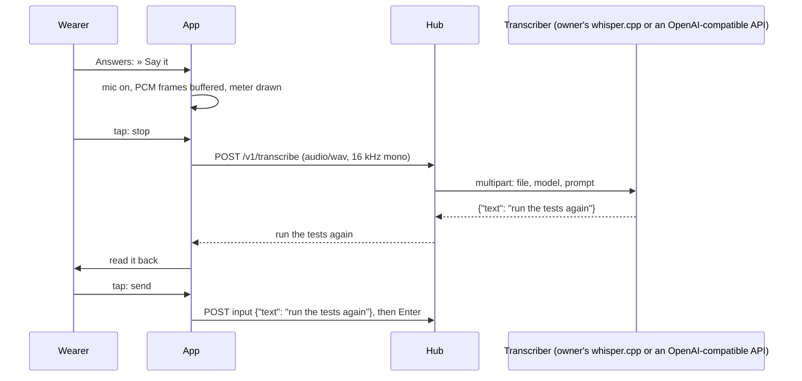

# Feature: spoken replies

> Status: implemented 2026-10-24.

## 1. Goal

Answer a pane with your voice: say it on the glasses, read the transcript
back, send it. The fixed answers stay; this is the free text that until
now only the phone could type. The pattern is the one the owner's earlier
app for the same glasses uses and likes: the microphone opens only on that action, the
clip goes to a server the owner runs, the transcript comes back for
review before anything is sent, and the glasses never talk to a
speech-to-text provider themselves.

Out of scope: speaking commands to the app (every gesture stays a
gesture), on-device recognition, and languages other than what the
owner's transcriber knows.

## 2. Design



**Where the transcriber lives: in the hub.** The owner's earlier app has a
relay of its own for this; muxway already has a server the owner runs
and the glasses already trust, so the hub forwards the clip. The hub
owner configures it once (`--stt-url`, an OpenAI-compatible
`/v1/audio/transcriptions`, which whisper.cpp's server also speaks;
`--stt-key-file`, `--stt-model`, `--stt-prompt` for the vocabulary the
transcriber would otherwise guess at: project and host names). A hub
without it answers that there is no transcriber and the glasses do not
offer the action. The glasses' manifest keeps one whitelisted host.

**On the glasses.** On a writable pane, when the hub has a transcriber,
the Answers list opens with a first row **» Say it**. It leads to:

- **Listening** (text page): head `listening · 4 s`, body a level meter
  (a line of `█` as long as the sound is loud, under it the seconds and
  `tap when done`), hint `● stop · ×× cancel`. The microphone opens with
  the SDK's `audioControl(true, glasses)`; the host pushes 16 kHz mono
  16-bit PCM as `audioEvent` frames, buffered up to 60 s. No frame
  within four seconds: `no audio from the mic · let the Even app use
  it`. Full: stops by itself.
- **Transcribing**: head `transcribing 4 s of audio…`, the WAV posted to
  the hub. Clips under half a second are refused as too short.
- **Heard this** (text page): the transcript wrapped as the body, hint
  `● send + Enter · ≡ menu · ×× cancel`. Tap sends the text and then `Enter`,
  as the phone's send does, and the pane is read at once. Menu: **Type
  without Enter**, **Say it again**. Double tap cancels; nothing was
  sent. Reading the transcript is the confirmation; there is no second
  Cancel/Confirm page, which the owner's app also skips here.
- Any error (no transcriber, too large, the transcriber down) is a line
  in the head of a page with **Say it again** and Cancel.

The phone pane gets a **Spoken replies** switch (on by default) and the
hint that the vocabulary is the hub's `--stt-prompt`. The glasses probe
`GET /v1/transcribe` when settings change and once per start; the row
appears only when it answers `204`.

**New code.** `src/voice.ts` (the recorder: open, frames, meter, WAV,
caps, as in the owner's app), the three pages in `app.ts`, the probe and
the call in `api.ts`, the manifest's `g2-microphone` permission with its
justification.

## 3. Protocol and API changes

In the core repository, a compatible addition to v1:

```
GET  /v1/transcribe            -> 204 when the hub has a transcriber, 404 not_found otherwise
POST /v1/transcribe            Content-Type: audio/wav, body at most 4 MiB
                               -> 200 {"text": "run the tests again"}   (text mode: the text, one line)
                               -> 400 bad_input (not a 16 kHz mono 16-bit WAV, or shorter than 0.5 s)
                               -> 403 read_only (the token has no write grant at all)
                               -> 404 not_found (no transcriber)
                               -> 413 too_large
                               -> 429 rate_limited (more than one clip per five seconds per token)
                               -> 502 provider_unavailable (the transcriber failed or timed out, 90 s)
```

The hub sends the clip as multipart `file`, `model` and `prompt` to the
configured URL with the key as a bearer token, takes `text` from the
answer, drops control characters and cuts it to 4096 bytes (what input
takes), and returns it. Nothing is stored. The audit log gets one line:
token, bytes, seconds, result, never the text. `muxway hub serve` gains
`--stt-url`, `--stt-key-file` (mode 600), `--stt-model` (default
`whisper-1`), `--stt-prompt`. Documented in `docs/protocol/v1.md` and a
feature page `docs/features/transcription.md`, with end-to-end tests
against a stand-in transcriber (as the sign-in tests use a stand-in
provider). Its own commit from a worktree, as the CORS change.

## 4. Security analysis

- **The clip leaves the phone**: to the hub over HTTPS with the bearer
  token, and from the hub to the transcriber the owner chose. The hub
  never sends audio anywhere unless `--stt-url` is set; with a remote
  provider the owner has chosen to send audio there. The feature page
  says so and shows the local whisper.cpp option first.
- **Grant**: a write grant on at least one pane, because the transcript
  exists to be typed; a read-only token cannot spend the owner's
  transcriber. The typing itself goes through the input endpoint with
  the pane's own checks, unchanged.
- **Abuse of the transcriber**: 4 MiB per clip, one clip per five
  seconds per token on top of the general rate limit, 90 s timeout, the
  provider's answer read up to 64 KiB. The WAV header is checked before
  anything is forwarded.
- **Untrusted transcript**: text from a third party is cleaned (control
  characters) and capped by the hub, cleaned again by the app, shown
  before it is sent, and sent only through the input endpoint, which
  refuses control characters anyway. A transcript cannot carry a key or
  an escape sequence into the pane.
- **Microphone**: opened only on `» Say it`, closed on stop, cancel,
  back, foreground exit and app stop; frames are kept in memory and
  dropped after the request; never stored, never logged, never on the
  phone pane. The manifest declares `g2-microphone` with that sentence.
- **Logging**: the hub logs bytes, seconds and the result; the app's log
  says `transcribed 4 s in 1.8 s`. The test suite searches every log for
  the test transcript.
- **Dependencies**: none new on either side (the hub uses the standard
  library's multipart writer).

## 5. Privacy check

The vocabulary prompt in the owner's own hub is configuration, not
code; the docs show `--stt-prompt "alice-laptop, muxway, tmux"`. Tests
use a stand-in transcriber answering a fixed sentence; the WAV fixtures
are generated tones.

## 6. Test plan

| # | Test | Kind | Expected |
|---|------|------|----------|
| S20 | `POST /v1/transcribe` without, with a read-only, with a revoked token | e2e-security (core) | 401, 403, 401; nothing reaches the stand-in |
| S21 | 5 MiB body, a body that is not a WAV, a 0.2 s clip, 8-bit stereo | e2e-security (core) | 413 / 400, nothing forwarded |
| S22 | Transcriber answers control characters, 1 MiB of text, no JSON, 500, hangs | e2e-security (core) | cleaned and capped text, or 502; the hub stays up |
| S23 | Six clips in five seconds from one token | e2e-security (core) | the sixth is 429 |
| S24 | Hub without `--stt-url` | e2e-security (core) | GET 404, POST 404, nothing logged |
| S25 | No transcriber: the Answers list has no Say it row; a hub that lies `204` and then fails | e2e-security (glasses) | the row is absent; the error is a head line, nothing sent |
| S26 | The hub answers a transcript with escapes and 10 KiB | e2e-security (glasses) | shown cleaned and cut; a tap sends only printable text |
| S27 | Logs searched for the test transcript and the clip's bytes | e2e-security | not found |
| S28 | Hub and app logs never carry the transcript | e2e-security | as S27 |
| U20 | WAV framing, level meter, caps, the recorder state machine | unit | as specified |
| F20 | Say it, frames from the stand-in mic, stop, read back, send | UI | the pane shows the sentence; screenshots `say`, `listening`, `heard`, `sent` |
| F21 | No frames for four seconds | UI | the error page, mic closed (audioControl false seen) |
| F22 | Say it again, Type without Enter, cancel by double tap | UI | second clip replaces the first; text without Enter; nothing sent |
| F23 | Transcriber down | UI | `hub unreachable`-style line, Say it again offered |

The simulator has no microphone on the test display, so the harness
starts it with a loopback-only `?mic=tone` that makes the recorder take
its frames from a generated tone instead of the bridge; the recorder's
own path from `audioEvent` is a unit test, and the real microphone is
tried on the device.

## 7. Documentation

- `docs/features/spoken-replies.md`: the flow, the pages, the switch,
  the hub's side in one paragraph, security considerations.
- `docs/features/screens.md`: the Say it row and the three pages.
- `README.md`, `docs/ARCHITECTURE.md`: a line each.
- In the core: `docs/protocol/v1.md` and
  `docs/features/transcription.md`.

## 8. Implementation steps

1. Core: the endpoint, flags, stand-in transcriber for tests, protocol
   and feature page; commit from a worktree.
2. `voice.ts` with unit tests; `api.ts` probe and call.
3. The three pages and the Say it row; manifest permission; phone switch.
4. Harness: the tone mic, the stand-in transcriber behind the proxy,
   the tests above.
5. Docs; full run; record.

## Decisions

- 2026-10-24: plan approved. The hub transcribes (`POST /v1/transcribe`
  forwarding to the owner's transcriber), not a relay. Reading the
  transcript back is the confirmation: a tap sends it with Enter.

---

## Review (after implementation)

Done against the plan, the security rules and the privacy rules.

- [x] Diff matches the plan, deviations explained here
- [x] Security rules (AGENTS.md section 2) hold
- [x] Privacy check passed: `scripts/prepush-check.sh` clean and diff read
- [x] Docs and diagrams updated

Deviations:

- **The hub's clip slot is taken only for a real clip.** A refused body
  (not a WAV, too short, too large) costs nothing, so a client that
  sends something broken is not then locked out for five seconds.
- **The hub cuts its transcriber's answer at 64 KiB**; a transcriber
  that answers a megabyte gets `502`, not a cut text (S22 was adjusted:
  ten kilobytes are cut to 4096 bytes, a megabyte is refused).
- **The app caps the transcript itself** (`typed`: no control
  characters, 4096 bytes), because a hub that lies about having a
  transcriber may also lie about the text; without it the input
  endpoint refused the 10 KiB and S26 saw `refused by the hub`.
- **S27 and S28 are one check**: the run's secret search covers the
  logs, and F20 reads the hub log for the test sentence.
- **The firmware font has no `⏎` and no `↑ ↓`**, seen on the listing's
  screenshots: the answers now spell out Enter, Up and Down, and a list
  shows five whole rows instead of a sixth one cut by the hint.
- The tone mic flag is read before the settings loader strips the page
  URL, which it does when settings arrive in the query.
- The hostile proxy modes forward `OPTIONS`, since the browser's
  preflight on the transcribe path has to be answered for the probe to
  succeed at all.

## Test run

54 tests, all passing at `c962e68`: 20 end-to-end in the simulator (9
security, 11 features, the phone pane in Chromium), 33 unit, and the
search of every log for the run's tokens and keys. Recorded as
[test run #3](https://github.com/notmarkopadjen/muxway-glasses-even/issues/3).
The run before it at `ef8c4a0` was red
([#2](https://github.com/notmarkopadjen/muxway-glasses-even/issues/2)):
the transcriber probe made a refused token's one round into three
requests. The core's endpoint is `51e965c` on the core's `main`, with
tests 20 to 24 there.
