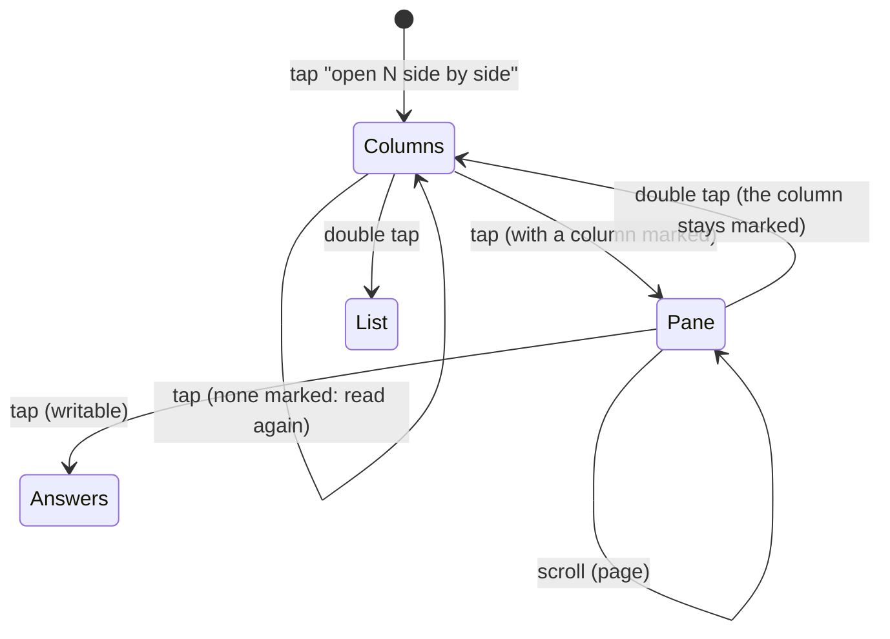

# Feature: the suggestion as an answer, no head, columns picked before scrolled

> Status: planned 2026-10-25, after the owner wore version 0.4.2.

## 1. Goal

Four reports from the real glasses:

1. **The suggested reply takes half the pane.** Claude Code shows its
   predicted next prompt dim in the empty input box. The hub's text mode
   has no dim, so the lens takes it for typed text and pins it in a
   bordered box: two lines, the border and a gap, three of the pane's six
   lines. The owner wants it gone from the screen and offered as the
   first answer.
2. **The head says nothing useful.** `★ 0  ≡ 3  ● alice-laptop  16:51`
   on every page. It goes.
3. **A scroll on the columns opens a pane at once.** The owner wants the
   scroll to pick a column first and the pane to open only when asked.
4. **The columns' title bands are slow, and there is room for one more
   line.** Each band is a picture, sent in tiles over Bluetooth.

Out of scope: anything on the hub, the list's rows and words, spoken
replies, the phone pane.

## 2. Design

### The suggestion becomes the first answer

The lens keeps finding the input box as today, but nothing is pinned on
the pane or in the columns any more: the body gets the whole height. What
the box holds, cleaned to printable text and joined into one line, is
kept as the pane's **offer**. The answers page then starts with it:

```
» "run the tests again"
» Say it
Enter
y, Enter
…
```

Picking it goes through the confirmation like every answer
(`send "run the tests…" to build?`) and sends the text, then Enter. The
offer is taken from the reading when the answers open; the confirmation
sends that snapshot, never a newer reading. An empty box, or Claude's own
`Try "…"` hint, offers nothing, as the lens decides today. The offer row
is clamped like every row (63 bytes); the text sent is capped at 4096
bytes like the phone's typed text.

**Question A, decided.** The text mode cannot tell a dim suggestion from
text someone typed on the laptop and did not send. The owner: the box is
where the suggestion appears, and it is the one to offer. The answer
types the text and Enter, which is right for a suggestion (Claude shows
one only in an empty box) whether or not Tab takes it.

### No head

The head container goes from every page. On a dash page the hint takes
over as the container that catches gestures. Everything moves up 34 px,
and one text container is free:

| Page | Before | After |
|---|---|---|
| list | 6 rows | 7 rows |
| pane | 6 lines, 3 with a suggestion | 8 lines |
| columns | 6 lines | 8 lines and the title |
| answers, confirm | OS list from 34 px | OS list from the top |

What the head said moves where it is needed: the loading dots go into
the hint (`reading the hub ···`); a host that is offline is named in the
list's hint (`○ alice-laptop offline`); the needs-you count is already
the list's order and its `★` marks; the clock goes.

### The columns: a scroll picks, a tap opens



- **Scroll** moves the mark: forward to the next column (the first when
  none is marked), back to the previous one (the last when none). At an
  end it stays.
- **Tap** with a column marked opens that pane full, where the scroll
  pages as on any pane and a tap answers. With none marked, the columns
  are read again.
- **Double tap** on the pane comes back to the columns with the mark
  kept; on the columns, back to the list with the selection kept.
- Hint: `▽ pick a pane · ● refresh · ×× the list`, with a mark
  `▽ next pane · ● open build · ×× the list`.

Today a tap with a column marked opens its answers; it opens the pane
instead, and the answers are a tap away from there (**question B**, the
owner: open the pane).

### Text titles

The columns' bands become one text line each, `★ build · claude`, the
marked column's `» ★ build · claude` at full brightness and its body
brighter, the others dimmer: no pictures on the columns page at all. Three
columns are three titles and three bodies, six of the seven containers.

**Question C**, the owner: text on the pane page too, and on the heard
page; the bold band goes from the code. The only picture left is the
level graph.

**Question D**, the owner: there is a dark band under the pane and above
the hint that should be filled. In the 0.4.2 screenshots the pane's
body ends about 30 px above the hint (the head, the band's 4 px gap and
whole lines below them) and the list's six rows end 56 px above it. Now
the title is one 30 px text line at the top, the pane and the columns
take eight 28 px lines that end 4 px above the hint, and the list's
seven rows are spread at 36 px down to the hint.

## 3. Protocol and API changes

None. The input box was already read from the pane's text.

## 4. Security analysis

- **The offer is pane text sent back to the same pane.** A hostile
  program can put any text in its own box, and a wearer who picks it
  and confirms sends it to that program only, which could have typed it
  itself. It cannot reach another pane: the answer goes to the pane the
  answers were opened for, and that pane's write grant is checked by the
  hub as for every answer. Control characters and escapes are removed
  before it is shown or sent (the `typed` rule: printable text, 4096
  bytes), so it cannot carry a key the whitelist does not have.
- The confirmation shows what will be sent, from the same snapshot.
- Nothing new is logged: the log keeps that an answer was sent, its kind
  and size, not the text.
- No new endpoint, permission or dependency. One gesture changes meaning
  (scroll on the columns) and opens nothing that could write.

## 5. Privacy check

Fixtures are synthetic (`alice-laptop`, `build`, `run the tests again`);
screenshots from the simulator against the test hub only.

## 6. Test plan

| # | Test | Kind | Expected |
|---|------|------|----------|
| S40 | A box with escapes, a newline, a tab and 10 KiB; a box made to look like a rule and a forged `»` | e2e-security | the offer row clamped and clean, the text sent printable and within 4096 bytes (or only Tab and Enter), no write to any other pane, nothing of it in any log |
| S41 | A read-only pane with a suggestion | e2e-security | no offer, no answers |
| U40 | The lens: the offer from a box with a suggestion, none from an empty box or `Try "…"`, nothing pinned | unit | as specified |
| U41 | The columns: the mark moves and stops at the ends; text titles; seven lines | unit | as specified |
| F41 | A pane with a suggestion: the body fills the page, the answers start with the offer, confirm sends it, the pane shows it sent | UI | screenshots `pane-full`, `answers-offer`, `offer-sent` |
| F42 | No head on the list, the pane, the columns and the answers; seven list rows; the dots in the hint while loading; an offline host in the hint | UI | screenshots `list-7`, `loading-hint`, `host-offline` |
| F33 | Rewritten: scroll marks the first and second column without opening one, tap opens the marked pane, a scroll pages it, double tap back with the mark, double tap to the list with the selection kept | UI | screenshots `split-marked`, `split-second`, `split-open`, `split-back` |
| all | Every test that waited for the head waits for the page's name in the trace | harness | the suite green |

The listing's screenshots (`scripts/store-shots.sh`) are retaken.

## 7. Documentation

`docs/features/screens.md` (no head, the columns' gestures, the offer),
`docs/ARCHITECTURE.md` (the screens diagram), `docs/features/lenses.md`
(nothing pinned, the offer), `docs/store-listing.md` and `README.md`.

## 8. Implementation steps

1. The owner's answers recorded here.
2. `lens.ts`, `views.ts`, `app.ts`: the offer instead of the pinned box,
   the offer row on the answers page and its confirmation.
3. `glasses.ts`, `views.ts`: no head, the hint catches gestures, the
   geometry up 34 px, seven list rows, the dots and the offline host in
   the hint; the page keeps its name for the trace only.
4. `app.ts`, `views.ts`: the columns' scroll marks, the tap opens, text
   titles; the pane's title per question C.
5. Unit tests, the harness and the suite; docs and screenshots; run,
   record, version 0.5.0, pack with the personal id and upload.

## Decisions

- 2026-10-25: the owner asked for the suggestion as the first answer and
  not on the screen, no head, the columns picked before one is scrolled,
  faster titles and one more row.
- 2026-10-25: the owner answered the four questions: the box is the
  suggestion; a tap on a marked column opens the pane; text titles on
  the pane too; fill the dark band above the hint.

---

## Review (after implementation)

Done against the plan, the security rules and the privacy rules.

- [x] Diff matches the plan, deviations explained here
- [x] Security rules (AGENTS.md section 2) hold
- [x] Privacy check passed: `scripts/prepush-check.sh` clean and diff read
- [x] Docs and diagrams updated

Deviations:

- **No F40.** A real Claude Code in a throwaway tmux showed no
  suggestion within half a minute after a turn, so Tab could not be
  tried; the owner's answer settled the keys anyway.
- **S40 and S41 folded into existing tests.** The hostile box is S05,
  which now opens the answers, sends the offer and checks the posts, the
  pane they went to and the console; the read-only case is a unit test
  (U40), since a read-only pane has no answers page to reach.
- **F41 and F42 folded in.** The offer on the fake Claude screen is F14
  (eight lines, nothing pinned, the offer first, sent); no head, seven
  rows and the dots in the hint are F10, F30 and S30; the offline host
  in the hint is a unit test.
- **Eight lines in the columns, not seven,** once the band's 4 px gap
  went with the picture.

## Test run

76 tests, all passing at `9c7d338`: the end-to-end suite in the
simulator (security first, then the features, the phone pane in
Chromium), 48 unit tests, and the search of every log for the run's
tokens and keys. Recorded as
[test run #9](https://github.com/notmarkopadjen/muxway-glasses-even/issues/9).
The listing's screenshots are retaken from that run; the answers shot
now comes from the lens test, so it shows the suggestion first.
