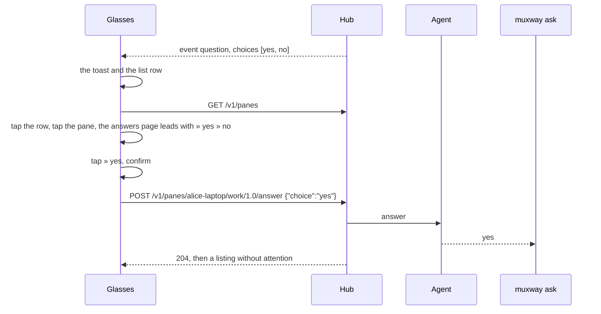
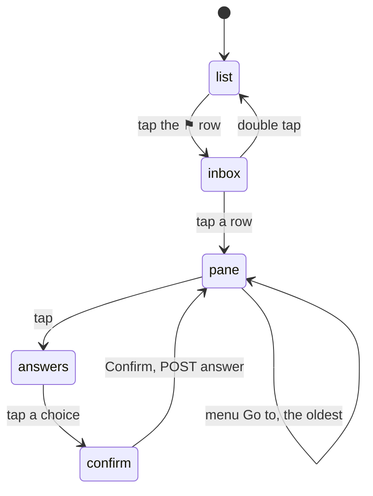

# Feature: every harness, a question's choices and the inbox on the glasses

> Status: draft, awaiting the owner's review. Follows the core's
> `docs/plans/2026-10-31-agent-orchestration.md` (muxway#181, merged as
> PR #183), whose plan left the native clients to their own repositories.

## 1. Goal

The core now names every AI harness in a pane, lets a process in a pane
ask a question with fixed answers (`muxway ask`, answered with `POST
/v1/panes/{address}/answer`) and lists what waits across hosts in one
call (`GET /v1/inbox`). On the glasses a pane is Claude's or nothing
(`runsClaude`), a question shows its text and nothing to pick, and "Go
to" takes the pane that waited the shortest, where the core says the
oldest. This plan gives the glasses the three things in the way a glance
and four gestures allow:

- **every harness named**: the pane list and the pane page name Codex,
  Gemini, Antigravity, OpenCode, Copilot, aider, goose, Amp and Cursor
  from the command, or the title under an interpreter, as the web does;
  *working* applies to any of them;
- **choices**: a question's choices are the first rows of the answers
  page; one tap, the usual confirm, and the choice goes to the asking
  process through `/answer`, nothing typed;
- **the inbox**: a row at the top of the pane list while anything waits,
  `⚑ 2 wait`, opens the inbox page: every waiting pane on the hub, oldest
  first, with its kind, text and how long; a tap opens the pane. "Go to"
  on the pane page takes the oldest, as the web's `o` does.

Out of scope: per-harness marks as glyphs (the firmware font drops what
it lacks, and a row has 63 bytes; the name says who), lenses that reshape
the other harnesses' screens, answering from the toast (it cannot be
touched), and the phone pane (free text stays as it is).

## 2. Design

### Naming

`lens.ts` gets `agentOf(pane)` with the web's table
(`web/src/term/describe.ts`): by command `claude` `codex` `gemini` `agy`
`opencode` `copilot` `aider` `goose` `amp` `cursor-agent`; by the title
under `node` `bun` `deno` `python` `python3` `uv` for Gemini,
Antigravity and Copilot; Claude also by its spark. `runsClaude` stays for
the lens that reshapes Claude's screen. `rowLabel` names the harness in
the command's place (`★ build · Codex · asks a question`), the pane page's
title the same; the working state (`⟳`, the event `working` or a screen
that moved) applies to any named agent. The state mark at the row's start
stays the state's (`★ ● ○ ·`).

### Choices

`Pane` and `Event` gain `choices: string[]` from `attention.choices` and
the event's `choices`: two to eight, each 1 to 40 characters, cleaned,
without `|`, else dropped. The answers page (`answersPage`) lists them
first, `» yes`, `» no`, before the suggestion, *Say it* and the keys;
`onSelect` on one leads to the confirm page as every answer does, and
`send` posts `api.answer(address, choice)` instead of pieces. `errorWords`
learns `409` (*no question there now*) and `400 bad_input` on an answer
(*not one of the choices*). On a read-only pane the rows are not offered
(the hub would refuse; the page already reads it again instead of
answering).

### The inbox

`api.inbox()` reads `GET /v1/inbox` as JSON (the glasses take listings as
JSON, see AGENTS.md §7; the guideline's glasses cell says so). A new view
`{ kind: 'inbox' }` and `inboxPage`: an OS list of up to 20 rows, oldest
first, `★ build · Codex · asks a question · 3m` with the text wrapped into
the hint; a tap opens the pane, double tap goes back. It is reached from
the pane list: while anything waits its first row reads `⚑ 2 wait`
(the cursor starts on the first pane as today, so one scroll up and a
tap). The hint line of the pane list carries `⚑ 2` before the offline
hosts. `needsYou()` picks the **oldest** attention, so the menu's "Go
to" and the inbox's first row agree with the web's `o`.

### Guideline rows

In the core's `docs/ui-guideline.md` §1.6 the Glasses / MIDP column
changes: the inbox row to *glasses: the `⚑ n` row at the top of the pane
list opens the inbox page, a tap opens the pane; MIDP: `Inbox` on the
list's menu, `9` on the pane*; open the oldest to *glasses: the menu's
"Go to"*; answer a question to *glasses: the choices lead the answers
page; MIDP: the inbox row's choices*.

## 3. Protocol and API changes

None to the protocol. Newly used by this client: `attention.choices` and
an event's `choices`, `GET /v1/inbox`, `POST /v1/panes/{address}/answer`,
all v1 and compatible; `docs/ARCHITECTURE.md`'s protocol table lists them.

## 4. Security analysis

- **An answer is a write**: the hub checks the write grant and the pane's
  mark, the agent checks the choice against the list it gave; the glasses
  send the choice exactly as the listing carried it and offer it only on a
  writable pane. The confirm page stands before it as before every send.
- **Choices from the hub** are capped and cleaned on parse (count,
  length, printable, no `|`), so a hostile hub or relay cannot draw a row
  that breaks the page or hide a control character in it; the hostile
  proxy test feeds nine and long ones.
- **The inbox** shows what the token may read, as `/v1/panes` does; the
  call carries the same bearer header and caps.
- Nothing new is logged; the phone pane's log keeps status codes and
  sizes only. No new dependency.

## 5. Privacy check

Fixtures are synthetic (`alice-laptop`, *deploy to staging?*); the
simulator shots come from the test hub.

## 6. Test plan

| # | Test | Kind | Expected |
|---|------|------|----------|
| S40 | an answer with a read-only token, and on a read-only pane | e2e-security | `403`, the words on the hint; the ask still waits |
| S41 | the proxy feeds nine choices, a 41-character one, one with a control character | e2e-security | dropped: no choice rows, the page intact |
| S42 | an answer when nothing waits | e2e-security | `409`, *no question there now* |
| U | `parsePanes` and `parseEvents` take `choices` within the limits; `agentOf` names every harness; `needsYou` picks the oldest | unit | as the tables say |
| F40 | `muxway ask` answered: the toast, the row, `» yes` first on the answers page, confirm, exit 0 | e2e | the sequence; the row clears |
| F41 | the inbox: two waiting panes on two hosts, the `⚑ 2 wait` row, the page oldest first, a tap opens the pane | e2e | shots `inbox-row`, `inbox` |
| F42 | a Codex pane is named *Codex* in the list and works through the watcher | e2e | the row and `⟳` |

## 7. Documentation

`docs/features/screens.md` (the inbox page, the `⚑` row, the choice rows,
the gesture table), `docs/features/notifications.md` (choices, oldest
first), `docs/features/lenses.md` (every harness named),
`docs/ARCHITECTURE.md`, the README (the Claude-only sentence), the core's
`docs/ui-guideline.md` §1.6.

## 8. Implementation steps

1. `agentOf`, `rowLabel`, the pane title, working for any agent; unit tests.
2. `choices` on `Pane` and `Event`; `api.answer`; the answers page rows,
   confirm, send; `errorWords`.
3. `api.inbox`, the inbox view and page, the `⚑` row and hint;
   `needsYou` oldest.
4. Docs and the guideline rows.
5. e2e tests; the run; version 0.6.0.

---

## Review (after implementation)

- [ ] Diff matches the plan, deviations explained here
- [ ] Security rules (AGENTS.md section 2) hold
- [ ] Privacy check passed: `scripts/prepush-check.sh` clean and diff read
- [ ] Docs and diagrams updated

## Test run

Link to the recorded run: result, commit, logs, screenshots.
