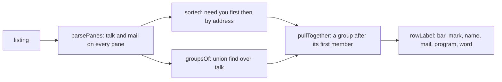
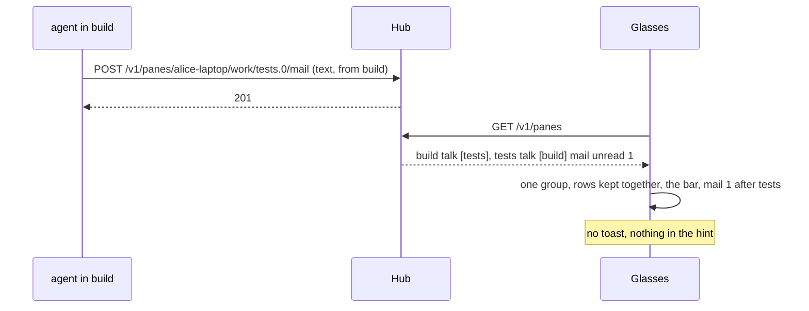

# Feature: talk groups and mail counts on the glasses

> Status: proposed, implemented for review with the pull request. Follows
> the core's `docs/plans/2026-10-31-pane-talk.md` and
> `docs/plans/2026-11-01-mail.md` (muxway#193), whose plans left the
> native clients to their own repositories; this is muxway-glasses-even#28.

## 1. Goal

The core's listing now says two more things about a pane: who it talked
with in the last ten minutes (`talk`: the partners among the panes the
token may read) and whether its process holds unread mail (`mail`: the
count and when the newest came). The web draws the panes that talk as
one group in the talk hue, like a browser's tab group, and `✉ n` after
the name of a pane with mail; nothing pops up for a message. The glasses
show neither yet.

This plan gives the glasses both, from the listing alone and in the way
a 576 px monochrome display with one font allows:

- **groups**: panes that talked to each other lately, partners of
  partners included, are kept together in the pane list and each row of
  a group starts with a bar, `│`, so the stretch reads as one block; the
  pane's title carries the bar too;
- **mail**: a pane whose process holds unread mail says so after its
  name, `· mail 2`, in the list, on the pane and on a column;
- **no notification per message**: no toast, no event, nothing in the
  hint.

Out of scope, each a follow-up in this repository when the glasses get
them: the messages feed (`GET /v1/talk`, text mode available), a
messages page, mailing the open pane (`POST /v1/panes/{address}/mail`,
never typed) and laying the partner beside (the core's
`docs/ui-guideline.md` §1.6). Also out of scope: colour (the display is
four greys, so the talk hue has no place here) and `✉` itself, see §2.

## 2. Design

### What the row can carry

A list row is at most 63 bytes and 490 px of a proportional font that
drops glyphs it lacks without a trace (`docs/ARCHITECTURE.md`). The
app's own glyphs are therefore ones known to render, and `│` is among
them (19 px, measured). `✉` is not known to render, and the G2 was never
attached to a run, so the mail mark is a word: `mail 2`, in the place
the guideline gives `✉ n`, right after the name. Once the glyph is seen
on the glasses the word can become the glyph in one line; the same
holds for `⚑`, which went in on the simulator's word.

### Parsing

`protocol.ts`: `Pane` gains `talk: string[]`, the partners' addresses
from the listing's `talk` (each passed through the address grammar,
distinct, at most 32 kept; `pane_id`, `at` and `way` are read past, the
glasses need only who), and `mail: number`, the unread count from
`mail.unread` (a positive integer, at most 999; anything else is 0). A
`talk` or `mail` that is not an array or an object is no talk and no
mail; the pane is still a pane.

### Groups

`groups.ts`: `groupsOf(panes)` is the core's union-find
(`web/src/term/groups.ts`): every pane is joined with each partner, a
pane whose partners are all out of the listing forms no group, and a
group is numbered by its first member in the panes' order.
`pullTogether(rows, groups)` puts a group's members right after its
first member in the rows' order, everything else keeping its place.

`sorted()` in `views.ts` sorts as today (those that need you first, then
by address) and then pulls the groups together, so a group whose member
waits is pulled up to it and the inbox row, the waiting rows and the
hint's count are what they were.



### Rows and titles

`rowLabel` starts a member's row with `│ `, before the selection box
when there is one, so a group is one bar down the list, and puts
`· mail n` right after the name when the pane holds unread mail:

```
  ⚑ inbox · 1 waiting
  ★ test-pane · bash · asks a question
> │ · build · mail 1 · Codex · working
  │ · tests · Claude · active
  · logs · bash · quiet 3m
```

Two groups listed one after the other would read as one bar; with seven
rows on screen and groups pulled to their first member that is rare, and
accepted (the web keeps air between frames, the glasses have no air to
give). The pane's title and a column's title start with the bar and
carry the mail the same way: `│ · build · mail 1 · Codex`. The inbox's
rows do not change: what waits is the question, not the mail.



## 3. Protocol and API changes

None to the protocol. Newly read by this client: the listing's `talk`
and `mail`, both v1 and compatible, absent from older hubs (then no
group and no mail, as today). The glasses read the listing as JSON, which
is where the two fields are; text mode does not carry them, as the
protocol says.

## 4. Security analysis

- **Nothing new is written.** The two fields are read and drawn; no call
  is added.
- **Who may see whom.** The hub names a partner only among the panes the
  token may read, so a group cannot hint at a pane the glasses could not
  list. The app checks each partner against the address grammar and
  drops a partner that is not in the listing, so a hostile hub cannot
  make a lone pane wear a bar.
- **The row budget.** A hostile listing with 600 partners, a partner of
  300 characters, a count of a billion or a count that is a string is
  parsed within caps (32 partners, 999 mails) or ignored; every row is
  still clamped to 490 px and 63 bytes before it is sent, so the page is
  not refused. The hostile-list test feeds all of them.
- **No notification.** A message cannot make the glasses light up: no
  event is read for it and the hint does not count it.
- Nothing new is logged; no new dependency.

## 5. Privacy check

Fixtures are synthetic (`alice-laptop`, `build`, `tests`, *run the tests*);
simulator shots come from the test hub.

## 6. Test plan

| # | Test | Kind | Expected |
|---|------|------|----------|
| S50 | the proxy gives one pane 600 partners, one of 300 characters, one not in the listing, a mail count of a billion, a negative one and a string; a lone pane with a partner that is not listed | e2e-security | rows within 63 bytes, the page accepted, the lone pane without a bar, the count clamped or absent |
| U | `parsePanes` takes `talk` and `mail` within the caps and ignores junk; `groupsOf` joins partners of partners and leaves a lone pane out; `sorted` keeps a group together after its first member; `rowLabel` and the pane title carry the bar and the mail | unit | as the tables say |
| F50 | a write from `build` to `tests` with its origin, then a mail: the two rows kept together with the bar, `mail 1` after `tests`, `test-pane` without a bar, the pane's title with both, no toast | UI | shots `talk-list`, `talk-pane` |

The suite runs on the Even Hub simulator; the G2 is not attached.

## 7. Documentation

`docs/features/screens.md` (the list's bar and mail, the title),
`docs/features/notifications.md` (no notification for a message),
`docs/ARCHITECTURE.md` (the listing's `talk` and `mail` in the protocol
table), the README (one line under the pane list). In the core,
`docs/ui-guideline.md` §1.4 says the glasses follow up on `✉ n`: its
glasses cell should read *a word, `mail n`, until the glyph is seen on
the G2*, and the strip and list rows name the bar; that is the core's
own change.

## 8. Implementation steps

1. `talk` and `mail` on `Pane`; unit tests.
2. `groups.ts`; `sorted` pulls together; unit tests.
3. The bar and the mail on the rows and the titles; unit tests.
4. Docs.
5. S50, F50; version 0.7.0.

---

## Review (after implementation)

- [ ] Diff matches the plan, deviations explained here
- [ ] Security rules (AGENTS.md section 2) hold
- [ ] Privacy check passed: `scripts/prepush-check.sh` clean and diff read
- [ ] Docs and diagrams updated

## Test run

Owed: the box the change was made on had no disk for a run; the pull
request's CI runs the suite against the core's `main`.
