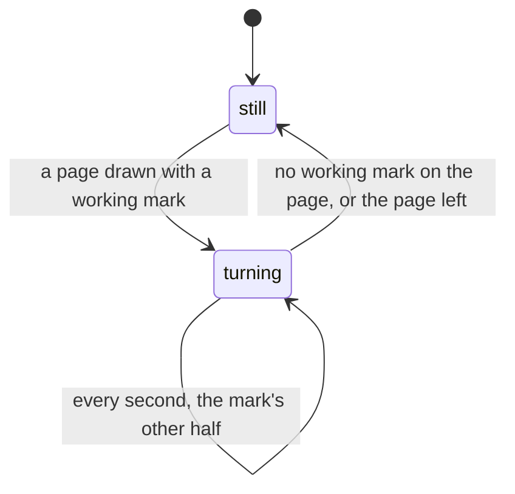

# Feature: marks of one size, and a working mark that turns

> Status: proposed. The owner's wish of 2026-11-03: the list's `·` for a
> pane with nothing reported is too small beside `★ ● ○`; every mark the
> same size, a turning one for working, a check for done, a hollow
> circle for idle. muxway-glasses-even#43.

## 1. Goal

The list, the columns, the pane's title, the inbox and the toast draw a
pane's state as one glyph before its name. Today the glyphs are `★`
(asks a question, needs permission), `●` (done), `○` (idle) and `·`
(nothing reported), and a working pane has no glyph of its own, only the
word. The owner finds the dot too small next to the circles and wants
the marks of one size, with working, done and idle told apart at a
glance, as the core's lens does with its ring, check and `z`.

The firmware font drops glyphs it lacks without a trace, so the set was
found on the device: on 2026-11-03 the owner read three sampler builds
and reported what drew. There is no check mark, no snowflake, no ring
and no flag in the font. There are the geometric shapes, the two half
circles, and Latin-1 whole. The marks:

| State | Mark | Word |
|---|---|---|
| asks a question, needs permission | `★` | `asks a question`, `needs permission` |
| done | `√` | `done` |
| idle | `○` | `idle` |
| working | `◐` and `◑`, turned once a second | `working` |
| nothing reported | `◌` | `active`, `quiet 4m`, or none |

The inbox row and the hint's count lose the flag, which the font does
not draw: `◆ inbox · 2 waiting` and `◆ 2 ·`. The toast keeps the mark of
its kind.

Out of scope: the store screenshots, which show the old marks and are
taken in a later round; colour, which the display lacks; the core
guideline's own glyphs, which the web and Android keep.

## 2. Design

`src/views.ts`: `markOf(p, now)` replaces the `MARK` table keyed by
attention: the attention's mark when there is one, else `◐` or `◑` by
the second of `now` while the pane works (the same rule as the word,
`stateWord`), else `◌`. The row, the column title, the pane title, the
inbox row and the toast call it. `INBOX` and the hint's count carry `◆`.

The turn: a page is redrawn every second while a working mark is on
it, from a timer the app starts when it draws one and stops when none
is left or the page is left. A redraw that changes only a row's text is
an in-place upgrade (`docs/ARCHITECTURE.md`): the glasses receive the
rows that changed, nothing is rebuilt and nothing flickers, as the
sampler showed. The list's reads stay at their ten seconds; the turn
costs one short row per second per working pane.

The core guideline (§1.2, the lens) gets a line that the glasses draw
these glyphs where the web draws its ring, check and letters: a docs
pull request in the core repository, opened with this one.

## 3. Protocol and API changes

None. `working` and the attention kinds are read as before.

## 4. Security analysis

None: what a pane's state is comes from the listing and the events as
before; the marks are the app's own glyphs, never the hub's text. The
timer runs only while a page with a working mark is on the glasses and
stops with the page, so a hub that claims a thousand working panes
makes the list turn its seven rows, nothing more (S30 holds the budget).

## 5. Privacy check

The plan, the docs and the tests name the test environment's panes and
the guideline's `alice`; no host, person or secret. The sampler builds
were the owner's and are not kept.

## 6. Test plan

| # | Test | Kind (unit / e2e / e2e-security / UI) | Expected |
|---|------|---------------------------------------|----------|
| 1 | S30, S50: hostile listings | e2e-security | rows within the budget with the new marks; the turn draws seven rows, not a thousand |
| 2 | `markOf` by state and second | unit | `★ √ ○ ◌`; working `◐` on even seconds, `◑` on odd; the attention wins over working |
| 3 | the row, the column title, the pane title, the inbox row and the toast | unit | each carries `markOf`; the inbox row and the hint say `◆` |
| 4 | the timer | unit (app) | starts with a working mark drawn, stops when none is left and when the page is left |
| 5 | F42: a Codex pane working | UI | the row's mark is `◐` or `◑`, and the other half within two seconds; screenshots `list-codex` (both frames), `pane-codex` |
| 6 | F10, F15, F31, F40, F41, F50 and the others that read rows | UI | the rows with the new marks, `◆ inbox · 2 waiting` first while panes wait |

## 7. Documentation

`docs/features/screens.md` (the list's marks, the inbox row, the hint),
`docs/features/notifications.md` (the toast's mark), `docs/features/lenses.md`
(the glasses' working mark), the core's `docs/ui-guideline.md` §1.2 by
its own pull request, this plan.

## 8. Implementation steps

1. This plan.
2. `markOf`, the inbox's diamond, the unit tests, the docs; one commit.
3. The turn's timer and its test; one commit.
4. The end-to-end rows and F42's two frames; one commit.
5. The core's guideline line, a pull request there.
6. The run on the pull request, recorded; a build for the owner's device.

---

## Review (after implementation)

- [x] Diff matches the plan, deviations explained here
- [x] Security rules (AGENTS.md section 2) hold
- [x] Privacy check passed: `scripts/prepush-check.sh` clean and diff read
- [x] Docs and diagrams updated

Deviations: none. The turn is decided from the page itself (a row or a
title carrying a half circle), so a pane whose name carries one turns
its list for as long as it is listed; the redraws change nothing, so
nothing is sent to the glasses for it. The columns page and the pane
page now take the clock, as the list did, for their titles' marks. A
local run of the sixteen tests that read rows passed before the full
suite and the pull request's run.

## Test run

Link to the recorded run: result, commit, logs, screenshots.
