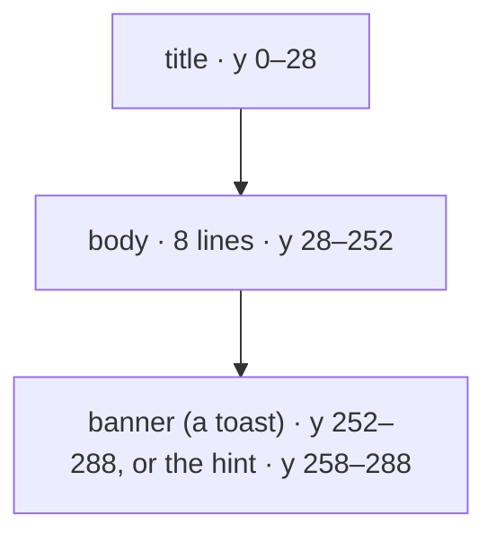

# Feature: every page ends above the banner

> Status: proposed. muxway-glasses-even#41: on the G2 the pane page does
> not appear until the next gesture.

## 1. Goal

On the device with 0.7.0, the owner taps a row and nothing happens; the
next tap opens the answers, which exist only on the pane page. A double
tap on the answers seems to do nothing; the next one goes back to the
list. After a spoken reply the heard page stays until the ring is
pressed again. In every case the page the app had moved to was the pane
page, and it showed only after one more gesture. The simulator shows it
at once, so the suite is green.

Since the banner change (#33) a toast's hint grows upward by
`2 * BANNER_PAD` = 6 px and starts at y = 252. The pane page's body
block, eight lines from y = 30, ends at 254; the columns page's the
same. Two pixels overlap. The firmware refuses a page whose containers
overlap, without a word (`docs/ARCHITECTURE.md`); the simulator does
not mind. A toast is up for ten seconds after every `done`, `idle`,
question or permission of any pane the token sees, which with several
Claude Code panes on one host is most of the time, so the pane page is
refused whenever a toast is showing, and the next gesture's redraw
succeeds once the toast has gone or the page has changed.

The goal: no block of any page reaches under the banner, and a test
that keeps it so. Out of scope: anything else the device may refuse;
if the pane page still fails with this fix, the phone pane's log
(`rebuildPageContainer refused`, a `createStartUpPageContainer` code)
decides the next step. The other change to that page since 0.5.1, the
menu's *Go to* entry, is the next suspect then.

## 2. Design

`src/views.ts`: the title row is `LINE_H` (28 px) high instead of 30,
so the body's eight lines run from y = 28 to 252, the banner's top. The
columns' titles and bodies follow from the same constants. The
confirmation and heard boxes already end at 238, the list's rows at
252, the listening page's blocks far above. Nothing moves on the
simulator that a test can see except the title's height and the body's
top.

`src/glasses.ts` exports the banner's top, `BANNER_Y = HINT_Y - 2 *
BANNER_PAD`, and the views use it where they fit blocks to the hint:
`BODY_LINES` and `BOX_ROWS` are counted down to it, so a later change
to the padding cannot bring the overlap back.

## 3. Protocol and API changes

None.

## 4. Security analysis

None: layout only. No input, endpoint or grant changes.

## 5. Privacy check

The plan, the test and the issue name only the test environment's panes
and the owner's report; no host, person or secret.

## 6. Test plan

| # | Test | Kind (unit / e2e / e2e-security / UI) | Expected |
|---|------|---------------------------------------|----------|
| 1 | security | — | none new; S01–S50 run as they are |
| 2 | every page's blocks end at or above the banner's top | unit | the list, the columns, the pane (with eight lines), the confirmation, the heard, listening, transcribing and error pages: `y + h <= BANNER_Y` for every block, with a toast and without |
| 3 | the pane keeps eight lines and the title one row | unit | `BODY_LINES` is 8, the title block's height `LINE_H` |
| 4 | F15 (the banner) and F11 (a pane opened from the list) | UI | unchanged; the screenshots show the banner and the pane |
| 5 | the device | by hand | the owner loads the build: a tap on a row shows the pane at once, also while a banner is up; a double tap on the answers returns to the pane; a spoken reply returns to the pane |

## 7. Documentation

`docs/ARCHITECTURE.md` (the banner's row among the page rules), this
plan. `docs/features/screens.md` says eight lines and stays right.

## 8. Implementation steps

1. This plan.
2. `BANNER_Y`, the title at `LINE_H`, the views counted down to it, the
   unit tests, one commit.
3. The run on the pull request, recorded; a build for the owner's
   device with his hub; the review below.

---

## Review (after implementation)

- [x] Diff matches the plan, deviations explained here
- [x] Security rules (AGENTS.md section 2) hold
- [x] Privacy check passed: `scripts/prepush-check.sh` clean and diff read
- [x] Docs and diagrams updated

Deviations: none. The list's row pitch and the footer are counted down
to the banner too, which changes nothing today (they ended at 252) and
keeps them there. The confirmation page is an OS list without blocks,
so the geometry test leaves it out. F11, F13, F15 and F20 passed locally
with the unit tests (20261103-183829-d73693d) before the pull request's run.

## Test run

Run 20261103-184224-988ac01, the pull request's own e2e check, recorded
as [issue #48](https://github.com/notmarkopadjen/muxway-glasses-even/issues/48):
100 tests passed, none failed, against the core's main; the logs,
screenshots and traces are the workflow run's artifact. The owner
checked the build on the device the same day: a tap shows the pane at
once, the answers return to it, a spoken reply returns to it.
