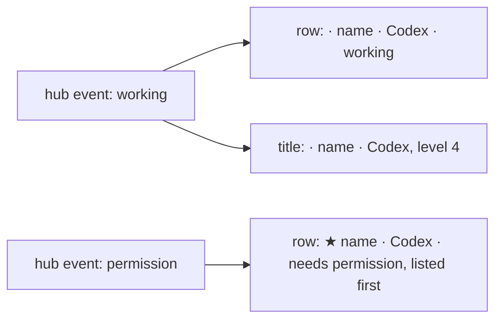

# Feature: a working pane is plain on the lens

> Status: proposed. Parity with the core's "Focus marks on the strip and
> the tile header, and a working pane unpainted" (muxway#210), whose
> decision the guideline's §1.2 records; this is muxway-glasses-even#36.

## 1. Goal

On 2026-11-02 the owner decided that the lens's **working** state is
plain everywhere: the turning ring and the word carry it, the dim paint
goes. **Waiting** keeps its inverted paint. The core's web client made the
change in muxway#210 and the native clients were to follow in their own
issues; #36 is the glasses' one.

The glasses never painted a working pane dim. The display gives a block
of text one of four greys, and the app spends them on the cursor, the
selection and the hint, never on a pane's state: a working pane's row is `· build · Codex · working`, its title
`· build · Codex`, both at the same strength as a quiet pane's, and only
the word says what the pane is doing. So nothing on the lens has to
change its paint. What this plan does is make the rule the glasses'
own, so the decision is written where the glasses' states are described,
pinned by a test that would catch a dim working row or title if one
were ever added, and recorded in a run.

Out of scope: the ring `⟳` (the firmware font is not known to draw it,
and `docs/features/lenses.md` already says the glasses draw no mark for
a harness beyond the name); the pane page's state field, which says what
the app is doing with the pane (`following`, `paused`) and does not
carry the lens word, so a working pane's title says nothing of it until
its row is looked at. Whether that field should say `working` is a
question for the owner, not part of #36.

## 2. Design

No change to the app. The docs say the rule and the tests hold it:

- `docs/features/screens.md`, the list's state table: a sentence after
  it that the word is the whole of a state on the glasses, a working
  pane's row and title drawn like a quiet pane's with the plain `·`,
  and that the decision is the core guideline's (§1.2, 2026-11-02).
- `docs/features/lenses.md`: where the word *working* is introduced,
  that it is plain, as on every client since 2026-11-02.
- `tests/unit/views.test.ts`: a working pane's row and column title
  differ from a quiet pane's only by the word, with the plain mark; the
  inbox never lists a working pane.
- `tests/e2e/run.py` F42: after the working event the row under the
  cursor and the pane's title block are at full strength, level 4, the
  same as before, and the mark the plain `·`; the pictures it takes (`list-codex`, `pane-codex`) show
  the plain working row and title.

## 3. Protocol and API changes

None. The listing and the events are read as before.

## 4. Security analysis

None: no input, endpoint or grant changes. The suite's security tests run
unchanged in the recorded run.

## 5. Privacy check

The plan, the docs and the tests name only the test environment's panes
(`test-pane`, `build`) and the guideline's `alice`; no host, person or
secret.

## 6. Test plan

| # | Test | Kind (unit / e2e / e2e-security / UI) | Expected |
|---|------|---------------------------------------|----------|
| 1 | security | — | none new: nothing crosses a boundary; S01–S50 run as they are |
| 2 | a working pane's row and column title against a quiet pane's | unit | the same text but for the word; the mark `·`; the inbox empty |
| 3 | F42: a Codex pane working, from its event | UI | the row `· test-pane · Codex · working` at level 4 under the cursor; the title block `· test-pane · Codex` at level 4; screenshots `list-codex`, `pane-codex` |

## 7. Documentation

`docs/features/screens.md` (the state table's note), `docs/features/lenses.md`
(the word *working*), this plan.

## 8. Implementation steps

1. This plan.
2. The two doc sentences and the unit test, one commit.
3. F42's title check, one commit.
4. The run on the pull request, recorded; the review below filled in.

---

## Review (after implementation)

- [ ] Diff matches the plan, deviations explained here
- [ ] Security rules (AGENTS.md section 2) hold
- [ ] Privacy check passed: `scripts/prepush-check.sh` clean and diff read
- [ ] Docs and diagrams updated

## Test run

Link to the recorded run: result, commit, logs, screenshots.
