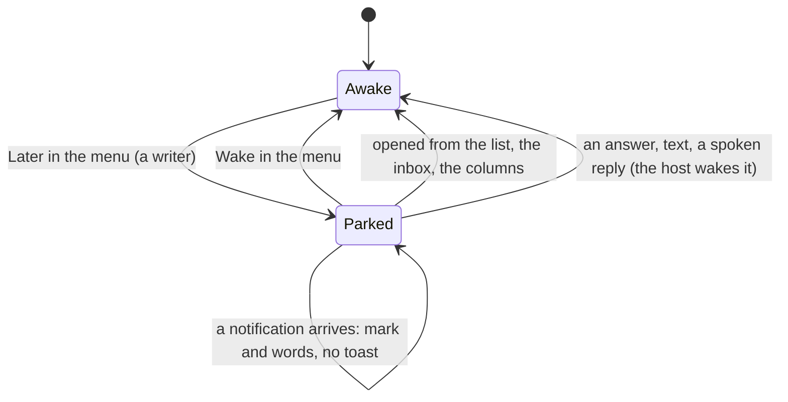

# Feature: later, a pane parked by its owner

> Status: proposed. Parity with the core's "later, a pane parked by its
> owner" (muxway#241, its plan `docs/plans/2026-11-03-later.md`), the
> guideline's §1.2 row *later*, §1.4 *strip*, §1.6 rows *the inbox*,
> *open the oldest waiting pane* and *park the pane for later*; this is
> muxway-glasses-even#55, and #64 (the parked pane's name in italics)
> is decided in §2 below.

## 1. Goal

Several agents call for the owner at once and some can wait. **Later**
is the owner's own mark on a pane, kept by the host's agent, so every
client sees it: the pane stops calling, goes after every other, and
counts among the done rather than the pressing, until the owner opens
it or wakes it on purpose. The glasses show the mark wherever a pane is
named, let the owner park and wake the open pane from its menu, wake a
parked pane by opening it, and keep a parked pane's notification quiet.

Out of scope: a reminder time, later on a window or a host, parking
from the list (the glasses' list has a hold for selection and a tap to
open; the menu is on the pane page, as the guideline's glasses column
says), hiding the pane.

**#64, the parked name in italics.** The glasses cannot: the Even Hub
text container takes text and one of four greys, no font style, and
the firmware font has no slanted letters (the mathematical italic
letters are glyphs it drops, and would cost four bytes each in a row of
63). The guideline's row allows it: *where the font has no italics, the
mark alone stays*. So on the glasses a parked pane's name carries the
mark `zz` and the word `later`, nothing in the letters, and the
screens page says so. The one lever the glasses do have is the grey of
the title block; it is not used, since the guideline paints later
*plain, like quiet* and the owner took the dim off working panes on
2026-11-02. If the owner wants the title block one grey dimmer while
parked as the glasses' stand-in for the slant, that is a guideline
change first and a one-line change here after.

## 2. Design

### What the listing gives

`protocol.ts` reads `later` (true, anything else is false) and
`later_at` (a time, as `attention.at` is read) into the pane, and
`hosts[].later` into the host, so the menu offers *later* only on a
host whose agent parks. `parseInbox` keeps a parked entry without
`attention` (today it drops any entry without one): the hub lists a
parked pane with nothing pending last, and the glasses list it too.

### What every screen shows

| Where | Awake | Parked |
|---|---|---|
| mark | `★ √ ○ ◐ ◌` | `zz` (the glasses' font has no moon; the guideline's own fallback) |
| state word (the row, the pane's state) | the attention in words, `working`, `active`, `quiet 5m` | `later`, then the attention underneath where there is one: `later · needs permission` |
| list order (`sorted()`) | those that need you, those with attention, the rest, by address | after every other pane (rank 3), by address among themselves; a group of panes that talk is still pulled together |
| the first row `◆ inbox · n waiting` and `waiting()` | panes with attention, oldest first | counted with the rest: the awake panes oldest first, then the parked ones by `later_at`; a parked pane with nothing pending counts too, as the hub counts it |
| inbox row | `★ build · Claude · needs permission · 3m` | `zz build · Claude · later · needs permission · 3m` (the age is the attention's, else the parking's), listed last as the hub orders it |
| pane title | `★ build · /muxway · Claude` | `zz build · /muxway · Claude`; the state beside it `later`, or `later · needs permission` |
| notification | toast, mark, list read | mark and list read; **no toast** while the pane is parked; the row shows the kind after `later` |
| *Go to* (the oldest) | the oldest question or permission, else attention | parked panes skipped; the entry is left out when only parked panes wait |
| the pane's menu | Refresh, Reveal all / Lens on, Bottom, Go to | one more entry, **Later** on an awake pane and **Wake** on a parked one, for a writable pane on a host that parks; left out on a read-only pane and on an older host |

### Park and wake

```mermaid
sequenceDiagram
    participant O as Owner
    participant G as Glasses
    participant H as Hub
    O->>G: hold on the pane page, Later
    G->>H: POST /v1/panes/alice-laptop/work/1.0/later {"later": true}
    H-->>G: 204
    G->>G: the state flashes "parked", the list is read again
    H-->>G: GET /v1/panes: "later": true on the pane
    Note over G: the row goes last with zz and later; a notification on it draws no toast
    O->>G: a tap on the parked row (the list, the inbox, the columns)
    G->>H: POST .../later {"later": false}
    G->>G: the pane opens; the row is back in its place
```

- **Later** and **Wake** in the menu call `api.later(address, on)`. On
  `204` the state flashes `parked` or `woken` for a few seconds, as an
  answer flashes `sent y`, and the list is read at once. On an error the
  state flashes the hub's words (`read-only`, `host offline`) as
  `failed()` puts them; nothing else changes until the next listing.
- **Opening wakes.** Opening a parked pane from the list, the inbox or
  the columns is the owner coming back: the app sends the wake before
  the pane page opens, only when the pane is writable and its host
  parks (a reader opens it as it is, with no request that would fail).
  A wake that fails is logged and the pane opens anyway; the listing
  says what the host thinks. *Go to* never opens a parked pane, so it
  sends none.
- **Answers, input, voice** wake the pane on the host side already; the
  glasses send nothing more and the next listing shows it.
- **Events.** `onNotify()` on a parked pane sets the mark and the words
  and reads the list, as today, but draws no toast. Whether the pane is
  parked is read from the last listing; an event that arrives before
  the first listing on a pane the app does not know yet draws its toast
  as today.



### Components touched

- `protocol.ts`: `later`, `laterAt` on the pane, `later` on the host,
  `parseInbox`.
- `api.ts`: `later(address, on)`.
- `views.ts`: `MARK`-like `LATER` mark, `markOf()`, `stateWord()`,
  `sorted()`, `waiting()`, `inboxLabel()`, the pane page's menu
  (`MENU.later`), the state beside the title.
- `app.ts`: `onMenu()` for the new entry, the wake on open, `needsYou()`
  skipping parked panes, `onNotify()` without the toast, the pane
  page's state.
- The phone pane: nothing.

## 3. Protocol and API changes

None to the protocol: `later`, `later_at` and `hosts[].later` are v1
listing fields and `POST /v1/panes/{address}/later` a v1 endpoint, as
the core documents them. Compatible with an older hub or agent: no
`later` in the listing, no `hosts[].later`, so no mark and no menu
entry; `404` from the endpoint is shown as `not found`, which the
glasses never send since the entry is not offered.

## 4. Security analysis

- Abuse: a listing from a hub or a proxy may carry any `later` or
  `later_at`; a boolean is read as itself and anything else as false, a
  time as `attention.at` is read (out of range is 0). The mark and the
  words are the app's own glyphs, never the hub's text. S53 sends the
  hostile values.
- Grants: parking and waking need a write grant and a writable pane,
  which the hub checks; the glasses offer the entry only on a writable
  pane and send the wake only for one, and show the `403` in words if
  it comes. A reader sees the mark and has no entry (S52).
- Input: one boolean in the body, built by the app; nothing typed into
  the pane, nothing from the glasses reaches the pane's process.
- Logged: the app logs `parked <name>` / `woke <name>` and a failure's
  status, as it logs an answer; no pane content.
- Dependencies: none.

## 5. Privacy check

The plan, the docs, the fixtures and the tests name only the test
environment (`alice-laptop`, `test-pane`, `build`); no real host,
person, path or secret. Screenshots from the e2e run only.

## 6. Test plan

| # | Test | Kind (unit / e2e / e2e-security / UI) | Expected |
|---|------|---------------------------------------|----------|
| 1 | S52: a read-only token on a parked pane (parked through the hub by a writer first) | e2e-security | the row shows `zz` and `later`, the pane's menu has no Later or Wake; opening it sends no wake (the proxy sees no `POST …/later`); a direct wake with the token is `403` and the listing still says parked |
| 2 | S53: hostile `later`, `later_at` and inbox from the proxy: `"later": "yes"`, `1`, a `later_at` of a string, of minus one and of 10^18, an inbox entry with `later` and no `attention`, 200 parked panes | e2e-security | only `true` parks; the ages are 0 or clamped; the inbox lists the bare entry; rows within 63 bytes; the page accepted by the firmware |
| 3 | parsePanes with `later` true, false, absent, a string; `later_at`; parseHosts with `later`; parseInbox keeping an entry without attention | unit | as §2 says |
| 4 | `sorted()` with a parked pane that needs you (last, after a quiet one), a parked pane in a group (pulled with it); `markOf()`, `stateWord()`, `rowLabel()`, `inboxLabel()` on a parked pane with and without attention; `waiting()` order and count | unit | the table of §2 |
| 5 | F44: two panes, a permission on the second; its menu's Later: the row last with `zz` and `later · needs permission`, the `◆ inbox · 1 waiting` row stays, no toast on a new `question` on it, *Go to* gone from the first pane's menu; the inbox lists it last with `later`; a tap on it in the list wakes it and opens it, back in its place when the list returns; Wake / Later on the pane page toggles with the flash | UI | screenshots `list-parked`, `pane-parked`, `inbox-parked`, `list-woken` |

## 7. Documentation

`docs/features/notifications.md` (a section *Later*: what wakes, what
does not, the state diagram, the toast kept quiet; #64's decision),
`docs/features/screens.md` (the mark `zz` and the word in the list,
the inbox, the pane's title and state, the menu's entry, the gesture
table), `docs/ARCHITECTURE.md` (the listing fields and the endpoint),
this plan.

## 8. Implementation steps

1. This plan.
2. `protocol.ts` and `api.ts`: the fields, the host flag, the inbox,
   the call; unit tests.
3. `views.ts`: the mark, the words, the order, the count, the inbox
   row, the menu entry; unit tests.
4. `app.ts`: the entry, the wake on open, *Go to*, the quiet toast, the
   state; the harness's park through the hub; S52, S53, F44.
5. The docs.
6. The run on the pull request, recorded; the review below filled in.

---

## Review (after implementation)

- [ ] Diff matches the plan, deviations explained here
- [ ] Security rules (AGENTS.md section 2) hold
- [ ] Privacy check passed: `scripts/prepush-check.sh` clean and diff read
- [ ] Docs and diagrams updated

## Test run

Link to the recorded run: result, commit, logs, screenshots.
