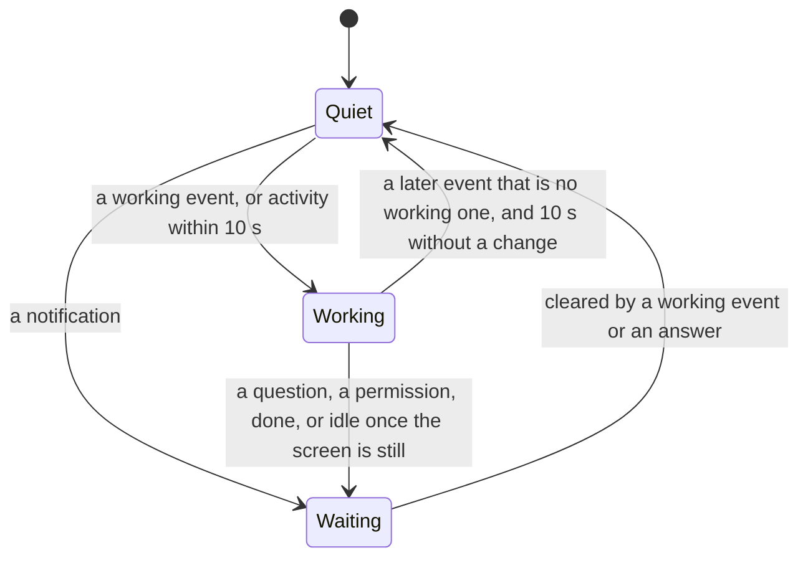

# Feature: messages, mail and the list's missing rows (parity pass of 2026-11-04)

> Status: approved 2026-11-04 ("ok"). One plan for muxway-glasses-even#73 (the messages
> page, the mail page, mailing a pane and mailing back, the partner
> beside) and #74 (host lines, the place, the name's order, + pane,
> + session, close, next and previous, the notice's text, command rows,
> the missing keys, inbox rows with text and choices, the strictly
> oldest Go to, park from a row, the lens timing, the phone pane's
> theme, the store listing and the README), against the core's
> `docs/ui-guideline.md` §1 at 0.8.0. One pull request, one recorded
> simulator run, then a release. The guideline rows for the glasses
> cells land in the core's parity branch; nothing below is bound before
> its row is there, and §9 lists the cells this plan needs.

## 1. Goal

A parity pass on 2026-11-04 checked every row of the guideline's §1
against this client. The glasses have later, pick, the inbox, the
choices, the talk bar and `mail n`; what is left is in the two issues.
This plan gives the glasses all of it in the shape a 576 x 288
monochrome display with one font, eight text containers, rows of 63
bytes and a ten-entry menu allows, and says where that shape bends the
issues' wording and why.

Out of scope, each decided here and not done:

- **Columns of four.** A column is a title block and a body block;
  four columns are eight blocks, a rule and the hint, ten containers
  where the firmware takes eight. Sharing one title block across the
  columns would lose the marked column's brightness, which is the only
  sign of what a tap opens, and a column 138 px wide holds twelve
  glyphs. The glasses keep three (the guideline's *up to four*).
- **Park from a pane row in the list.** The list's hold is selection
  mode, and a list page has no OS menu (the hold is the app's). Park
  and wake from a row are given on the inbox page (§2.6), which is
  where a parked pane is wanted; the pane menu keeps Later and Wake.
- **The reply's thread.** A mail back is a mail to the sender's pane;
  the client API carries no `reply_to`, so the feed shows it as a mail,
  not as a reply (only a pane's own `muxway mail reply` threads).
- **A name for the new pane.** `+ pane` splits and opens the new pane
  as the web does; naming is the alias feature, not this one.

## 2. Design

### 2.1 What the listing and the hosts give

`protocol.ts` reads, on top of what it reads today:

| From | Field | Into | Rule |
|---|---|---|---|
| `GET /v1/panes` | `width`, `height` | `Pane.width`, `Pane.height` | positive integers, else 0: the split's direction |
| | `last` | `Pane.last` | true only; the close confirmation's words |
| `GET /v1/hosts` | `sessions`, `close`, `mail` | `Host.sessions`, `Host.close`, `Host.mail` | true only, as `later` |
| | `keys` | `Host.keys` | `2` or 0: the six keys of §2.8 are offered under 2 |
| `GET /v1/talk` | the feed | `Talk[]` (§2.3) | new parser `parseTalk` |
| `GET /v1/panes/{a}/mail` | the mailbox | `Mail[]` (§2.4) | new parser `parseMailbox` |

`api.ts` gains `talk(after)`, `mailbox(address)`, `mail(address, text)`,
`close(address)`, `split(host, session, window, direction)`,
`session(host, name)`. The hosts' flags decide what is offered, as
`later` does today; a `404` from an older hub is shown in words and
never provoked.

### 2.2 The pane list

```
  ◆ inbox · 2 waiting
  » messages · mail 3
  ── alice-laptop · online · + session ──
  ★ build · /muxway · Claude · needs permission
  │ ◌ Claude · fixing the build · working
  │ ◌ tests · bash · quiet 3m
  ── bob-desktop · nothing exposed ──

◆ 2 · ○ carol-pc offline · ▽ move · ● open · hold to select · ×× exit
```

- **Host lines.** The list groups by host: a line `── name · state ──`
  for every host that is online, its state `online` or
  `nothing exposed` (no pane of it in the listing), and ` · + session`
  on a host whose agent starts sessions (`hosts[].sessions`). Offline
  hosts stay in the hint, as today, and are not drawn as lines: a line
  with nothing under it is a row spent. Under its line a host's panes
  keep the order they have today: those that need you, the rest by
  address, the parked ones last, a group of panes that talk pulled
  together; the order is now within the host. A tap on a host line
  with `+ session` starts a session (§2.10); a tap elsewhere on it
  does nothing; it has no box in selection mode. The line is drawn
  always, also with one host: the guideline groups by host, and the
  line is where `+ session` lives.
- **The messages row.** `» messages` right under the inbox row (or
  first) while the hub's feed holds anything (§2.3), with ` · mail n`
  while n messages arrived that were not looked at. A tap opens the
  messages page. No row while the feed is empty: a hub nobody talks on
  spends no row.
- **The name's order.** An unnamed pane is the program, then what it
  says: `◌ Claude · fixing the build · working`, `◌ vim · notes.md ·
  active`, `◌ bash · quiet 3m` (a title that repeats the command or
  the host adds nothing). A named pane is as today: the alias, the
  folder, the program, its status. The pane's title and a column's
  title follow the row. `paneName()` (the toast, the hints, Go to, the
  phone's *to* line) stays the alias, else what Claude says, else the
  address: the guideline's tab.
- **The place.** `host/session/window.pane` has no room in a row of 63
  bytes; the host is its line, and the pane page's state carries the
  rest (§2.5).
- `+ pane` is not a row: §2.10 says where it is and why.

A list of two hosts and ten panes shows five panes at a time where it
showed seven; the inbox row, the messages row and the host lines are
what the rows go to. The window slides under the cursor as today.

### 2.3 The messages page

`GET /v1/talk` as JSON. The feed is read with every listing: the first
time without `after` (the hub's most recent fifty), then with
`after=next&wait=0&limit=100`. The app keeps at most 200 entries,
oldest first, and the cursor. Nothing is announced for a message: no
toast, no event (the guideline's talk is not a notification); the
count on the messages row is the number of entries newer than the last
one seen when the page was last opened (none at start, as events are
not replayed). Opening the page clears the count.

An entry: `seq`, `at`, `kind` (`text`, `key`, `answer`, `mail`),
`from` (null, or `host`, `address`, `pane_id`, `alias`), `to`, `actor`
(`name`), `text` (200 characters, cleaned, as the hub cuts it),
`bytes`, `id` and `reply_to` for a mail. Addresses pass the address
grammar; an entry whose `to` fails it, or whose `seq` is no integer, is
dropped. Names on the page: the alias in the entry, else the pane's
name from the listing by its `pane_id` (then its address), else the
`session/window.pane` of the address; `from` null is the actor's name
(`reviewer`, cleaned, 32 at most).

```
  review → build · 3m · mail
    run the tests on the branch and tell me what fails
    build → review · 2m · reply
      all green
> tests → build · 1m
    "make test" + Enter
  reviewer → build · 40s · mail
    one more thing: the docs

messages · 4 · ▽ move · ● open · ×× back
```

An app-drawn page like the list: one block of nine rows at the font's
pitch, a cursor, the corner catcher. Each entry is a head row, `from →
to · age`, with ` · mail`, ` · reply` (a mail with `reply_to`),
` · key` or ` · answer` after it, then its text wrapped under it over
at most three rows (a fourth would end in `…`; the hub gave 200
characters at most), a key as its name and a count, an answer as the
choice. A reply is indented one step more than what it answers, when
that mail is on the page. Oldest at the top; the page opens with the
cursor on the newest entry and the window showing it. The scroll moves
the cursor by entry; a **tap** on a mail entry opens the mail page
(§2.4) of the pane it went to, with that mail under the cursor; on a
typed entry lays the two panes side by side: the columns (§2.5's
Beside) with `from` and `to`, when both are in the listing, else the
hint says `a pane is gone`. A double tap goes back.

From the mail page's menu the same page shows one pane's exchanges
(`messages · build`): the entries whose `from` or `to` is that pane, by
`pane_id` first, then by address.

### 2.4 The mail page

`GET /v1/panes/{address}/mail` when the page opens and with every
listing while it is open, for a pane on a host whose agent holds mail
(`hosts[].mail`). What came in is the mailbox: `←`, the sender (the
origin's alias or name as §2.3, else the actor), the age, `unread`
until `read_at`, `replied` when the pane answered it. What went out is
the feed's mail entries from this pane: `→`, the recipient, the age,
and `cut` when `bytes` is more than the text shown (the feed holds 200
characters; reading the recipient's mailbox for the rest is a request
per mail the glasses do not spend). Merged by time, oldest first, the
cursor on the newest. Reading the page marks nothing read: the
process does.

```
> ← review · 3m · unread
    run the tests on the branch and tell me what fails
  → review · 2m · cut
    all green, the docs are updated and the branch is ready for …

mail · build · 1 unread · ▽ move · ● mail back · ≡ menu · ×× back
```

Reached from the pane page's menu entry **Mail** and from a mail entry
in the messages page. A mail's text is cleaned (`clean()`), at most
4000 characters as the agent keeps it, wrapped to at most three rows
with `…`. The menu: **Mail build** (mail the open pane, §2.9), and
**Messages with build** (§2.3). A **tap** on a received mail whose
origin is in the listing and writable for this token is **mail back**
to that pane (§2.9); on any other row the tap does nothing and the hint
says `no pane to mail back`.

### 2.5 The pane page

```
★ build · /muxway · Claude                  work/1.0
★ Claude needs your permission to use Bash
  ● Bash(make test)
    ok
```

- **The notice's text.** For a question or a permission the first line
  of the body is the notice: the mark and the text, as the toast says
  it, cut to the line; the pane's lines follow, seven instead of eight,
  and paging counts seven. Same block, so a notice arriving or clearing
  is an upgrade, not a rebuild. Idle and done keep the state word
  alone, as the guideline's header does.
- **The place and read-only.** The state beside the title says the
  pane's `session/window.pane` while it follows at the bottom
  (`following` goes; the body moving says it), `read-only · work/1.0`
  on a pane the token cannot write, `read-only` alone when both do not
  fit the block; `paused · 2 pages up`, `reading…`, an error, a flash,
  `later · permission` and the attention's words as today, with
  `read-only · ` in front where it fits.
- **The menu**, at most ten entries (the firmware's cap), in this order:
  **Reveal all** / **Lens on** (the lens on), **Bottom** (reads the pane
  again and goes to its end: it takes over Refresh, which leaves this
  menu; a tap on a read-only pane still reads it again, and a
  following pane is read every *follow* seconds), **Next pane**,
  **Previous pane**, **Later** / **Wake** (as today), **Go to: name**
  (§2.7), **Mail** (`hosts[].mail`), **Beside: name** (the pane talks),
  **Close pane** (`hosts[].close`, a writer), **+ pane** (a writer).
  Ten when everything applies. The columns keep Refresh and Go to.
- **Next and previous pane** replace the open pane by its neighbour in
  the list's order across hosts, coming round at either end, parked
  panes skipped (they would only wake, as the Android swipe skips
  them); the page stays, its offset goes to the bottom, the phone's
  *to* line follows. With one pane the entries are left out.
- **Beside** opens the columns with the open pane and its newest
  partner (the listing's `talk`, newest first), the open pane first,
  nothing marked; the pair becomes the list's selection, as a hold
  would have made it, and a double tap comes back to the pane. A pane
  without a partner in the listing has no entry.
- **Close pane** asks on the Cancel / Confirm page: `close build on
  alice-laptop?`, or `end session work on alice-laptop?` when the pane
  is the last of its session (`last`); Confirm posts
  `POST /v1/panes/{address}/close`, goes back to the list and reads it
  at once; a refusal flashes in words (`read only`, `locked out, wait`
  for the one-per-two-seconds limit, `host offline`).
- **+ pane** asks `one more pane beside build?`; Confirm posts
  `POST /v1/windows/{host}/{session}/{window}/panes` with `h` when the
  pane is at least twice as wide as tall (in cells) and `v` otherwise,
  the web's rule, and opens the new pane from the `201` body. `409
  too_many` reads `the window is full`, `429` as above.

### 2.6 The inbox

The inbox becomes an app-drawn page like the list (today an OS list of
one row per pane): an entry is the row it has today, then the notice's
text and a question's choices under it, indented, on one row cut to
the width: `deploy to staging? » yes · no`. A pane without text and
choices is one row. Nine rows show four entries; the cursor moves by
entry, the window slides. A **tap** opens the pane (and wakes a parked
one, as today). The **menu** (hold) has **Later** on an awake entry and
**Wake** on a parked one, for a writer on a host that parks; the entry
label follows the cursor's row, which is a rebuild only when the cursor
crosses between an awake and a parked entry.

```
> ★ build · Claude · needs permission · 3m
    Claude needs your permission to use Bash
  ★ tests · Codex · asks a question · 40s
    deploy to staging? » yes · no
  zz api · Claude · later · done · 12s

inbox · 3 waiting · ▽ move · ● open · ≡ later · ×× back
```

The inbox is now read with every listing, not only while its page is
open: one small JSON request every ten seconds, and the reason is §2.7.

### 2.7 Go to, strictly the oldest

**Go to: name** takes the first awake entry of the hub's inbox: the
pane that has waited longest by the hub's clock, a question, a
permission, idle or done alike, parked panes skipped. Today it prefers
a question or a permission over idle and done and reads the app's own
attention map; the guideline's *open the oldest waiting pane* is the
hub's order. Before the first inbox arrives there is no entry. The
attention map stays for what events bring between listings (a
question's choices, the toast's text).

### 2.8 The answers page

```
» yes
» no
» "run the tests again"
» Say it
Enter
y, Enter
n, Enter
1 · Claude Code's first choice
2 · second choice
3 · third choice
Esc
Ctrl-C
→ keys
→ commands: Claude Code's
```

The OS list holds twenty rows; eight choices, the suggestion, Say it
and twelve fixed answers were twenty-two already. The page keeps the
choices, the suggestion, Say it, and the eight answers used most, then
two rows that open lists of their own:

- **→ keys**: Tab, Shift-Tab, Up, Down, and on a host whose agent
  takes the key grammar (`hosts[].keys` is 2) Left, Right, PageUp,
  PageDown, Home, End, the protocol's names; each confirmed as every
  answer (`send PageUp to build?`).
- **→ commands**: the command row as rows, for the program the hub
  names in the listing's `command`, never from a title: Claude Code's
  slash commands (`claude`), Codex's (`codex`), Antigravity's (`agy`),
  a shell's starters (`bash`, `zsh`, `fish`, `sh`, `dash`, `ash`,
  `ksh`, `tcsh`, `csh`), from the core's lists in their order, twenty
  at most, the ones that fill the line and wait for more (`/rename`,
  `/mention`, `/plan` with a goal) left out, since the glasses type
  no rest. The row is absent for any other program and on a read-only
  pane. A command is confirmed (`send /compact to build?`) and sent as
  the text and `Enter`, two requests, as `y, Enter` is. The hub's
  `from` is not sent: the glasses are not a pane.

### 2.9 Mail the open pane, mail back

Never typed: `POST /v1/panes/{address}/mail` with `{"text"}`. The
target is the open pane (**Mail build** in the mail page's menu) or
the sender of the mail under the cursor (a tap on it, **mail back**).
The text comes from the voice or the phone:

- **Say it**: the listening and heard pages as for a spoken reply, the
  title `heard this · for mail to review`, the hint `● mail · ×× cancel`,
  the menu Say it again only. A tap on the heard page opens the
  Cancel / Confirm page `mail this to review?`, the issue's confirmation
  for every mail; Confirm posts, the pane flashes `mailed review`, the
  mail page is read again. Without a transcriber the hint says `mail:
  say it needs a transcriber, or type it on the phone`.
- **The phone**: the reply box gets a third button, **mail**. The *to*
  line names the target the glasses aim at (`mail to review`, the
  open pane, or the sender under the cursor on the mail page). The
  text goes to the glasses, which show the Cancel / Confirm page with
  the text's first words in the hint (`mail this to review? "run the
  tests…"`) and the whole text in a box above it; Confirm posts.
  *send* and *type only* keep typing into the pane as today.

The hub refuses what it refuses: `403 read_only` when the token may not
write the target, `409 mailbox_full` (`mailbox full`), `404` from an
older host; each in words on the pane. The text is cleaned of control
characters, newlines kept, cut to 4000 characters.

```mermaid
sequenceDiagram
    participant O as Owner
    participant G as Glasses
    participant P as Phone pane
    participant H as Hub
    O->>G: pane menu, Mail
    G->>H: GET /v1/panes/alice-laptop/work/1.0/mail
    H-->>G: the mailbox; the feed's entries from the pane are held already
    G->>G: the mail page, the newest under the cursor
    O->>G: tap on "← review · unread"
    G->>G: listening (the mic), heard this, a tap
    G->>G: Cancel / Confirm: mail this to review?
    O->>G: Confirm
    G->>H: POST /v1/panes/alice-laptop/work/0.0/mail {"text": "..."}
    H-->>G: 201 {"mail": {"id": 8}}
    G->>G: flash "mailed review", the mail page read again
    O->>P: types in the reply box, taps mail
    P->>G: the text, for the pane the glasses aim at
    G->>G: Cancel / Confirm with the text in a box
    O->>G: Confirm
    G->>H: POST .../mail
```

### 2.10 New panes and sessions

- **+ pane** is a pane menu entry (§2.5), not a list row. The issue
  asks for a row under a writable window; the glasses' list orders a
  host's panes by need, so a window's panes are not neighbours, a row
  per window would cost a row for each, and a single row per host would
  have no window to split. The pane page knows its window.
- **+ session** is the host line's tap (§2.2). A page asks for the
  name, an OS list: `» glasses-1` (the first of `glasses-1`,
  `glasses-2`, … not among the listing's sessions on that host), and
  `» Say it` when the hub transcribes; the phone's *send* while this
  page is open gives the name too (the hint says so). A spoken or
  typed name is lowercased, spaces made `-`, anything outside
  `[a-z0-9_-]` dropped, cut to 32; empty after that is `not a session
  name` in the hint. Then Cancel / Confirm: `start session scratch on
  alice-laptop?`; Confirm posts `POST /v1/hosts/{host}/sessions`, and
  the `201` body's pane opens. `409 exists` reads `that name exists`,
  `409 too_many` `too many sessions`, `429` and `403` as elsewhere.

### 2.11 The lens timing

`stateWord()` and `markOf()` for a pane the lens names (`agent`):
**working** when its last event said working or its `activity` is
within the last ten seconds (today `active` within sixty, for every
pane); else `quiet` with the age (`quiet 30s`, `quiet 4m`). A pane of
any other program says `active` within ten seconds and `quiet` with
the age after. The listing comes every ten seconds, so a pane that
moved since the last listing shows working at most ten seconds late
and the mark turns while the word is on the screen, as today. The
glasses cannot tell their own echo from the pane's output (an answer
sent makes the pane move anyway), so every change counts.

An **idle** notification on a pane whose `activity` is within ten
seconds draws no toast and shows working: the mark turns, the word is
`working`, the attention is kept underneath and shows when the screen
stops (the listing's `activity` ages past ten seconds). A question or
a permission is never masked.

**At start** the first `GET /v1/events` call, which today takes only
the cursor (`limit=1`), takes the hub's recent events (`limit=50`,
without `after`): a pane whose last event among them is `working` is
working before its next event; nothing among them draws a toast, as
nothing is replayed today.



### 2.12 The phone pane's theme

A setting, **theme**: amber (the default, as on every client), green,
paper; the guideline's tokens (§1.5) as CSS variables on the page's
root, switched by a `data-theme` attribute, saved with the settings and
applied on load. Today's hard-coded green becomes the green theme with
the shared values. The glasses are four greys and have no theme.

### 2.13 The store listing and the README

`docs/store-listing.md`: the version, nine rows and the two pages
under the list, the changelog, the inbox, later, aliases, the folder,
messages and mail in the description within its 2000 characters, the
shots retaken (the old marks are in them) and three added (messages,
mail, the inbox with its text). The README: later, aliases, the folder,
messages and mail, the theme. Both name only the test environment. The
version goes to 0.9.0 in `package.json` and `app.json` with the
listing, so the draft release after the merge has its number.

### 2.14 Components touched

- `protocol.ts`: §2.1's fields and parsers, the name's order in
  `paneName()`'s companions.
- `api.ts`: the six calls, the events' first read.
- `views.ts`: the list's host lines and messages row, the messages
  page, the mail page, the inbox page, the notice line, the state, the
  menus, the answers' two lists, the keys page, the commands page, the
  session name page, the confirmations' words.
- `commands.ts` (new): the command lists, from the core's, and the shell
  set.
- `app.ts`: the feed and the inbox with the listing, the new views, the
  menu entries, next and previous, mail and mail back, close, split,
  session, the lens timing, the recent events at start.
- `phone.ts`, `phone.css`, `index.html`, `settings.ts`: the theme, the
  mail button, the *to* line.
- `tests/e2e/harness.py`: the agent started with `--allow-sessions` and
  `--allow-close` where a test needs them, a `codex`-named script that
  prints on a clock, the proxy's hostile feed and mailbox.

## 3. Protocol and API changes

None to the protocol: every call and field is v1 and documented in the
core. Newly used by this client: `GET /v1/talk`,
`GET /v1/panes/{address}/mail`, `POST /v1/panes/{address}/mail`,
`POST /v1/panes/{address}/close`,
`POST /v1/windows/{host}/{session}/{window}/panes`,
`POST /v1/hosts/{host}/sessions`, the `Left`, `Right`, `PageUp`,
`PageDown`, `Home` and `End` keys of the grammar, the listing's `width`,
`height` and `last`, the hosts' `sessions`, `close`, `mail` and `keys`,
and `GET /v1/events` without `after` and with `limit=50`. Compatible
with an older hub or host: a flag absent is an entry not offered; a
`404` from `/v1/talk` is logged once and the messages row never
appears.

## 4. Security analysis

- **What an attacker gains.** The new writes are a mail (text for a
  process, never typed), a command or a key typed into a pane, a pane
  closed, a pane or a session started. Each is behind the Cancel /
  Confirm page and the hub's write grant and pane mark; a hostile
  listing or proxy that calls a pane writable or a host able earns a
  `403` or `404` said in words, and the glasses offer the entries only
  on a writable pane of a host whose flag is true. A hostile feed or
  mailbox can put words on a page and nothing more: no entry of either
  sends anything, and a tap on one opens a page or the columns of panes
  taken from the listing by address, never from the entry's text.
- **Input that crosses a trust boundary.** The feed's and the
  mailbox's addresses pass the address grammar, their texts `clean()`,
  cut (200 and 4000), wrapped and clamped to the row's 63 bytes and 490
  px before the firmware sees them; seqs and times are integers within
  range or the entry is dropped; actors' names are 32 characters at
  most; 100 entries per read, 200 kept, 50 mails shown. A hostile
  `width` or `height` only chooses `h` or `v`. A command is one of the
  app's fixed strings; the keys are the grammar's names; the session's
  name is checked against the grammar on the glasses before the hub
  checks it again. A mail's text is what the wearer said or typed,
  shown whole on the heard page and the confirmation's box, cleaned,
  cut to 4000. A spark in a title names no commands: the hub's
  `command` does.
- **Grants.** Reading the feed shows only exchanges where the token
  reads both panes (the hub's rule); the mailbox needs the read grant;
  mail, close, split, session, commands and keys need the write grant
  and a writable pane, checked by the hub; the glasses never send a
  `from`, so a reply lands nowhere but where the hub puts a mail.
- **Logged.** `mailed <name> <n> bytes`, `closed <name>`,
  `split <name>`, `session <name> on <host>`, `sent <command> to
  <name>`, a failure's status; never a mail's text, never a transcript.
  The phone's log the same. The hub and the host audit every write.
- **Rate limits.** The hub's one creation or close per two seconds is
  met with the Cancel / Confirm page in between; a `429` reads `locked
  out, wait` and pauses the app ten seconds as today.
- **Dependencies.** None new.

## 5. Privacy check

The plan, the docs, the fixtures and the tests name the test
environment only: `alice-laptop`, `bob-desktop`, `carol-pc`, `build`,
`tests`, `review`, `reviewer`, `work/1.0`. Screenshots come from the
simulator against the test hub or the demo hub with made-up content.
`scripts/prepush-check.sh` with the owner's deny-list runs before every
push and the diff is read.

## 6. Test plan

| # | Test | Kind | Expected |
|---|------|------|----------|
| S60 | A read-only token: the pane menu has no Mail back, Close, + pane, Later; the host line has no + session; no → commands row; the feed and the mailbox read fine; direct `POST` mail, close, split and session with the token are `403` | e2e-security | the entries absent, the pages intact, four `403`s, nothing changes on the host |
| S61 | Hostile feed and mailbox from the proxy: 100 entries of 10 KiB, an entry whose `to` is no address, a `from` of null, a `seq` that is a string, a `reply_to` of junk, an actor of 300 characters, a mailbox of 60 mails with 20 KiB each and control bytes, a `read_at` of a string | e2e-security | the bad entries dropped, the rest cut and wrapped, rows within 63 bytes, both pages accepted by the simulator, nothing sent |
| S62 | A proxy that calls a read-only pane writable and a host able: Close and + pane and Mail back offered and refused with `403` in words; a session name spoken as `My Scratch!!` posts `my-scratch`; a name of junk alone is refused on the glasses; two closes within two seconds: the second reads `locked out, wait` | e2e-security | the words on the pane, the host untouched, the proxy's log shows one request each |
| S63 | Commands: a bash pane with a forged spark in its title gets the shell's starters, not Claude's; a `python3` pane gets no row; a command confirmed sends exactly its text and `Enter`; a tap on a key row sends the key's name alone | e2e-security | the proxy's bodies are the fixed strings, the rows by `command` |
| S64 | The events' first read with 50 hostile recent events (bad kinds, escapes, 10 KiB texts): working set only from `working`, no toast | e2e-security | no banner, the rows' words right |
| U | `parseTalk`, `parseMailbox`, the hosts' flags, `width`/`height`/`last`; the list's items with host lines, the messages row, the name's order; the messages page's rows (indent, cut, reply); the mail page's merge and `cut`; the inbox entries; the answers' rows and the two lists; the commands per program; the session name's folding; `stateWord` at 9 and 11 s, idle while moving; next/previous with parked panes | unit | as §2 says |
| F60 | Two panes talk (a write with its origin, a mail): the messages row with `mail 2`, the page oldest first with the newest in view, the mail entry and the text, the count cleared on opening; a tap on the typed entry opens the columns with the two | UI | shots `messages-list`, `messages`, `messages-columns` |
| F61 | The mail page from the pane menu: the received mail `unread`, the sent one from the feed; mail back by the tone: heard, Cancel / Confirm, `201`, `mailed review`, the sender's row shows `mail 1`, nothing typed into either pane (both screens unchanged); the phone's mail button with Cancel then Confirm | UI | shots `mail`, `mail-heard`, `mail-confirm`, `mail-sent` |
| F62 | Beside from the pane menu: the columns with the pane and its partner, nothing marked; back returns to the pane | UI | shot `beside` |
| F63 | The list with two hosts: the lines, `nothing exposed`, the offline third in the hint, `+ session` on the host that starts them, the name's order on an unnamed vim pane and a Claude pane; a tap on the host line, `glasses-1`, Confirm: the session's pane opens and the list has it | UI | shots `hosts`, `session-name`, `session-open` |
| F64 | Next and previous from a pane across hosts, round at the ends, a parked pane skipped; Close with Confirm removes the pane and the list is read; `end session` words on a last pane; + pane splits beside on an 80x24 pane and opens the new one | UI | shots `next`, `close-confirm`, `split` |
| F65 | The pane page: the permission's text as the first line, seven lines under it, paging by seven; `work/1.0` in the state while following; `read-only · work/1.0` for a reader | UI | shots `pane-notice`, `pane-readonly` |
| F66 | The answers page with eight choices, the suggestion and Say it: twenty rows, the keys list, `PageUp` reaches the pane (`less` shows the next page); the commands list for a shell, `git status` sent and seen | UI | shots `answers-full`, `keys`, `commands` |
| F67 | The inbox with text and choices on two rows; an idle older than a question: Go to takes the idle one; Later from the inbox's menu parks the entry under the cursor, Wake wakes it | UI | shots `inbox-text`, `inbox-parked` |
| F68 | A `codex`-named pane printing every two seconds: `working` and the turning mark within ten seconds of its first line, `quiet 12s` after it stops; an idle notification while it prints: no banner, still working, the word idle once it stops; the page reloaded while it prints after a working event: working at once | UI | shots `lens-working`, `lens-idle-moving` |
| F16 | The phone pane: the theme select, amber by default, green and paper applied and kept across a reload; the mail button's *to* line | UI | shots `phone-amber`, `phone-paper` |

Every row of every new page is checked against 63 bytes and 490 px by
the harness as the list's rows are; the simulator accepts every page.

## 7. Documentation

- `docs/features/messages.md` (new): the messages page, the mail page,
  mail and mail back, beside, with the sequence diagram of §2.9 and
  the security section.
- `docs/features/screens.md`: the list's host lines, the messages row,
  the name's order, the inbox's entries and menu, the pane page's
  notice line, state and menu, next and previous, close, + pane,
  + session, the answers' two lists, the gesture table, the state
  diagram.
- `docs/features/notifications.md`: the lens timing (§2.11 and its
  diagram), the recent events at start, Go to from the inbox, the inbox
  read with the listing.
- `docs/features/lenses.md`: working by the screen, ten seconds.
- `docs/features/phone-pane.md`: the theme, the mail button.
- `docs/ARCHITECTURE.md`: the calls table, the source layout
  (`commands.ts`), the screens diagram.
- `docs/store-listing.md`, `README.md`: §2.13.
- This plan, its review and its run.

## 8. Implementation steps

1. This plan.
2. `protocol.ts`, `api.ts`: the fields, the parsers, the calls; unit
   tests.
3. The list: host lines, the messages row, the name's order; the
   pane's state and notice line; unit tests.
4. The lens timing and the events' first read; the inbox read with the
   listing; Go to from it; the inbox page as entries with its menu;
   unit tests.
5. The answers: the two lists, the keys, `commands.ts`; unit tests.
6. The pane menu: next and previous, close, + pane, beside; + session
   from the host line and its name page.
7. The feed and the messages page; the mail page; mail and mail back
   by voice and from the phone.
8. The phone pane's theme.
9. The harness: flags, the hostile feed and mailbox, the clocked
   `codex` script; S60 to S64, F60 to F68, F16.
10. The docs, the store listing, the README, the shots, 0.9.0.
11. The run on the pull request, recorded; the review below filled in.

## 9. Guideline cells this plan needs in the core

For the console's parity-docs branch, the glasses cell of each row:

| §1.6 row (or table) | Glasses cell |
|---|---|
| messages | the `» messages · mail n` row under the inbox row opens the page; a tap on a typed entry lays the two side by side, on a mail entry opens the mail page; `GET /v1/talk` as JSON |
| the mail window | *Mail* in the pane menu, a mail entry in the messages page; what came in from the mailbox, what went out from the feed (200 characters, `cut`) |
| mail the open pane, mail back | *Mail name* in the mail page's menu; a tap on a received mail; the text by *Say it* or the phone's *mail* button; the Cancel / Confirm page |
| lay the partner beside | *Beside: name* in the pane menu: the columns with the two |
| next / previous pane | *Next pane*, *Previous pane* in the pane menu, parked panes skipped |
| close the pane | *Close pane* in the pane menu, then Cancel / Confirm |
| one more pane in a window | *+ pane* in the pane menu, then Cancel / Confirm |
| a new session on a host | a tap on the host's line in the list; the name `glasses-n`, spoken, or typed on the phone; Cancel / Confirm |
| a command of the row | the *→ commands* row of the answers page, each confirmed |
| a console key from an empty input line | the *→ keys* row of the answers page |
| park the pane for later | the pane menu's *Later* / *Wake*, and the inbox page's menu for the entry under the cursor |
| the inbox | entries of two rows: the row, then the text and the choices |
| §1.3 grouping | a line per online host, `── name · state ──`, `+ session` on it; offline hosts in the hint |
| §1.3 row, §1.1 name | the program before what it says: `Claude · codename`, `vim · notes.md` |
| §1.1 place | the pane page's state while following: `work/1.0` |
| §1.4 header, notice | the notice's text as the first line under the title; `read-only` in the state |
| §1.4 command row | the *→ commands* list: twenty of the core's commands, those that fill the line left out |
| §1.2 working | ten seconds by the listing's `activity`; idle while moving shows working; recent events read at start |
| §1.5 theme | the phone pane: amber default, green, paper; the glasses are four greys |

---

## Review (after implementation)

- [x] Diff matches the plan. Deviations, each small:
  - **Working is counted at the listing.** The ten seconds of §2.11
    are measured against the listing's own time (`Pane.moving`, set by
    the parser), not the wall clock: the listing comes every ten
    seconds, so a word measured against the clock flickered to `quiet`
    a few seconds before the next listing, and an idle event arriving
    between listings drew a banner it should not. The word now holds
    until the next listing.
  - **The inbox row and the name.** An unnamed harness is named by its
    program with what it says as its status (`Codex · build`), any
    other program by its command and its title (`vim · notes.md`), the
    guideline's §1.1 read literally; the inbox row keeps the name and,
    for a named pane, the program, without the status. The mail word
    sits right after the name, before the folder, as before.
  - **The phone's mail** shows the text's first words in the
    confirmation's hint rather than the whole text in a box: an OS
    list page has no room for a box, and the text is on the phone
    where it was typed (§2.9 said both).
  - **A reader and `+ session`.** The host's line carries `+ session`
    for every token, since `hosts[].sessions` is the host's fact; the
    hub refuses a reader (S60) and a host whose agent does not start
    sessions answers `not found`, whatever a proxy says (S62).
  - **`Pane.moving`, `id`, `session`, `window`, `width`, `height`,
    `last`** joined the pane; the hub's error code (`mailbox_full`,
    `exists`, `too_many`, `rate_limited`) travels with a refusal so
    the words are the hub's, and a creation's `429` no longer pauses
    the app for ten seconds as a lockout does.
  - **Say it again** on a heard mail or session name keeps the mail
    page or the name page under the voice pages, where an answer's
    list is left behind.
- [x] Security rules (AGENTS.md section 2) hold: S60 to S64 pass on
  the core's main (c26018c): a reader is offered nothing it may not do
  and is refused directly; a lying proxy earns the hub's refusal in
  words; a hostile feed, mailbox and recent events put words on a page
  and send nothing; commands come from the hub's `command`, never a
  title; every write passes Cancel / Confirm; nothing is typed to
  deliver a mail; no text is logged.
- [x] Privacy check passed: `scripts/prepush-check.sh` clean with the
  owner's deny-list, the diff read; fixtures, docs and shots name the
  test environment only.
- [x] Docs and diagrams updated: `docs/features/messages.md` (new),
  `screens.md`, `notifications.md`, `lenses.md`, `phone-pane.md`,
  `ARCHITECTURE.md`, the store listing, the README, this plan.

## Test run

The full suite on the pull request's tree: RUN_PLACEHOLDER
