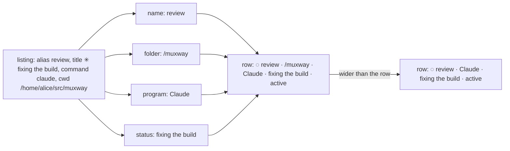

# Feature: the alias is the name; the folder after it

> Status: approved 2026-11-04 ("ok"). Parity with the core's "a name for a pane, the
> folder it works in, a lighter header" (muxway#232), the guideline's
> §1.1 rows *alias*, *tab* and *folder*; this is muxway-glasses-even#42.

## 1. Goal

With a few Claude sessions open the list reads like copies of whatever
Claude last wrote into its title, and two sessions on the same subject
pick the same words. The core now lets the owner name a pane from the
web (the alias, `muxway expose --name`, `POST /v1/panes/{address}/alias`)
and gives the listing's `cwd` for every program under a preview root,
for a writer. The glasses show both:

- A pane with an alias goes by it first wherever the glasses name a
  pane: the rows, the pane page's title, the columns' titles, the
  inbox, the hint and the menu. What the program says about itself,
  Claude's codename or `vim`'s file, follows the program's name as its
  status: `◌ review · Claude · fixing the build · active`, `◌ notes ·
  bash · notes.md · active`. Without an alias nothing changes.
- The folder a pane works in, the last segment of `cwd`, follows the
  name where a row or a title has room for the whole line: `◌ build ·
  /muxway · Claude · active`. Where there is none the folder is left
  out, before anything else is cut. Nothing without `cwd`: a reader, a
  pane outside the roots, a host without them, an older agent.

Already there: the alias is read and `paneName()` puts it first, so
the hint and the menu say it today. Out of scope: renaming (a web and
Android gesture; the glasses only show the name), the whole path (the
web's tooltip; a lens has no pointer), the directory listing
(`GET /v1/panes/{address}/dir`), italics or a dimmer grey for the
status and the folder (a block of text has one strength on the
glasses, so the order and the slash carry what italics do on the web).

## 2. Design

### What the listing gives

`protocol.ts` reads `cwd` into the pane (a string, cleaned of control
bytes and cut to 256 characters; anything else is none). Two readers
of a pane, next to `paneName()`:

- `programSays(p)`: the title as the program wrote it, Claude's spark
  stripped, and nothing when the title is empty or only repeats the
  command or the host. `paneName()` becomes alias, else this, else the
  address path; what it answers today does not change.
- `folder(p)`: the last non-empty segment of `cwd`, cut to 32
  characters; nothing for a `cwd` of `/` or none.

### Where a pane is named

| Where | Today | After |
|---|---|---|
| list row | `mark name [· mail n] [· program] [· word] [· read-only]` | `mark name [· mail n] [· /folder] [· program] [· status] [· word] [· read-only]` |
| pane title, column title | `[bar] mark name [· mail n] · program` | `[bar] mark name [· mail n] [· /folder] · program [· status]` |
| inbox row | `mark name [· program] · kind [· age]` | unchanged: the name is the alias already; the row is 63 bytes and the kind and the age matter more there |
| hint, menu (*open*, *answer*, *Go to*) | the name | unchanged |

The **status** is `programSays(p)` and is shown only when the pane has
an alias (without one the title *is* the name) and when it differs from
the name. The **program** stays as it is: the harness's name, else the
command, left out when it repeats the name.

The **folder** is `/` and the segment, after the name and before the
program, as the guideline's §1.1 puts it after the name and before the
status; the slash says *folder* where the web's italics do, since one
word after a name could as well be a program. It is in only when the
whole line with it fits its width: the row's block (the cursor's `> `
counted), the pane's title block (376 px) or a column's width. The
builders measure with `textWidth()` and fall back to the line without
it, so a long codename costs the folder, never the state word or the
cut's ellipsis. `titleOf()` takes the width it may use; the pane page
passes its title block's, the columns theirs.

Examples, from the guideline's own:

| Listing | Row |
|---|---|
| alias `review`, Claude, title `✳ fixing the build`, cwd `…/muxway` | `◌ review · /muxway · Claude · fixing the build · active` |
| alias `notes`, bash, title `notes.md`, cwd `…/src` | `◌ notes · /src · bash · notes.md · active` |
| no alias, Claude, title `✳ build`, cwd `…/muxway` | `◌ build · /muxway · Claude · active` |
| no alias, bash, title `test-pane`, no cwd | `◌ test-pane · bash · active` (as today) |
| alias `build`, Claude, title `✳ build` | `◌ build · Claude · active` (the status repeats the name) |

## 3. Protocol and API changes

None to the protocol: `alias` and `cwd` are listing fields of v1 as
the core documents them; the glasses read one more. The glasses call
no new endpoint. Compatible with an older hub or agent, which give no
`cwd`: nothing is shown.

## 4. Security analysis

- Abuse: a hub or a proxy may send any `cwd` or `alias`. Both cross
  the trust boundary as text: control bytes are removed by `clean()`,
  `cwd` is cut to 256 characters and its segment to 32, `alias` to 32
  as today; a value that is not a string is none. The row and the
  title are cut to their width and the row to 63 bytes by the page
  builder as every line is, so nothing overflows the display, and the
  firmware's refusal of a bad page is checked in S50.
- Grants: the hub gives `cwd` only to a token that may write the pane;
  the glasses show what they get and ask for nothing more. A reader
  sees no folder, which S51 checks against the real hub.
- What is shown: the folder's last segment only, never the path, so a
  lens or a screenshot of the list carries a directory's name and not
  where it is on the host.
- Logged: nothing new. The app logs no listing field.
- Dependencies: none.

## 5. Privacy check

The plan, the docs, the fixtures and the tests name only the test
environment (`alice-laptop`, `test-pane`, `notes`, `src`, `review`,
`/home/alice/src/muxway`); no real host, person, path or secret. The
run's preview root is a directory under the run's temporary directory.

## 6. Test plan

| # | Test | Kind (unit / e2e / e2e-security / UI) | Expected |
|---|------|---------------------------------------|----------|
| 1 | S50: the hostile listing gains `cwd` of 10 000 characters with control bytes and `..`, one that is not a string, one of slashes only, and an alias of 300 characters | e2e-security | every row within 63 bytes, the control bytes gone, the page accepted by the firmware |
| 2 | S51: a read-only token on a pane under the agent's preview root | e2e-security | the hub gives no `cwd`, the row shows no folder, the title neither |
| 3 | parsePanes: `cwd` read, cleaned and cut; `folder()` on a path, on `/`, on none, on a long segment; `programSays()` with the spark, an empty title, the command, the host | unit | as §2 says |
| 4 | rowLabel and titleOf with an alias, a folder, a long codename, a column's width, a status that repeats the name; inboxLabel unchanged | unit | the rows of §2's table; the folder dropped first when the line is too wide |
| 5 | F43: a window started under the preview root, exposed with `--name notes`, its title `notes.md`; the test pane without a root | UI | rows `◌ test-pane · bash · active` and `◌ notes · /src · bash · notes.md · active`; a title of sixty characters on the named pane drops the folder from its row; the pane page's title `◌ notes · /src · bash · notes.md`; screenshots `list-named`, `list-long`, `pane-named` |

The harness gains an agent argument list (`--preview` on the run's
directory), a `cwd` and a `name` for `new_window()`, and a read-only
token for S51 as S40 makes one.

## 7. Documentation

`docs/features/screens.md` (the list's row and the pane's title: the
alias, the status and the folder), `docs/ARCHITECTURE.md` (the listing
fields: `cwd`), `docs/features/lenses.md` (one line: a named pane's
codename follows as the status), this plan.

## 8. Implementation steps

1. This plan.
2. `protocol.ts`: `cwd`, `programSays()`, `folder()`; the unit tests.
3. `views.ts`: the row, the titles with their width; the unit tests.
4. The harness's agent arguments, `cwd` and `name` on a window; F43,
   S51, S50's hostile fields.
5. The docs.
6. The run on the pull request, recorded; the review below filled in.

---

## Review (after implementation)

- [ ] Diff matches the plan, deviations explained here
- [ ] Security rules (AGENTS.md section 2) hold
- [ ] Privacy check passed: `scripts/prepush-check.sh` clean and diff read
- [ ] Docs and diagrams updated

## Test run

Link to the recorded run: result, commit, logs, screenshots.
