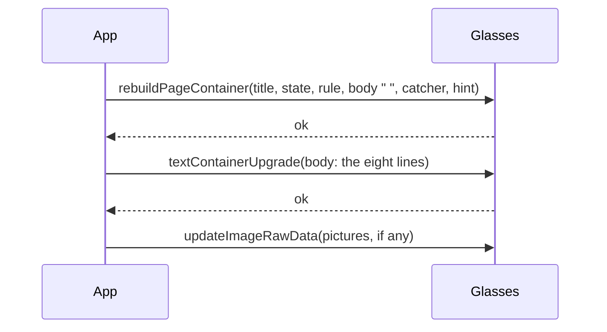

# Feature: a rebuild carries only the short blocks; the long ones follow as upgrades

> Status: implemented, awaiting the owner's device check. The owner's report of 2026-11-06 on the G2, after
> the catcher fix (`2026-11-06-pane-catcher.md`, #81): some panes open
> at once and some are refused again, and the refused ones are those
> the app had already read.

## 1. Goal

The owner's phone log of 2026-11-06 at 17:57, with #81's build:

```
17:57:43 GET pane 200 1013 chars 87 ms
17:57:43 glasses: rebuildPageContainer refused
17:57:55 GET pane 200 2499 chars 88 ms
17:57:55 glasses: rebuildPageContainer refused
17:57:33 GET pane 304 0 chars 103 ms
17:57:34 glasses: rebuildPageContainer refused
```

Every refusal follows a read that returned the pane's text, or a `304`
where the app already held it from an earlier read. A pane the app has
never read opens: its first rebuild carries an empty body (eight blank
lines), and the text follows as an in-place upgrade once the read is
in, which the device takes. A pane the app has read, or reads before
the rebuild goes out, is rebuilt with its eight lines filled in, and
that rebuild is refused. The same text as an upgrade is fine: the owner
sees the content on the panes that open. The architecture notes already
say an oversize row or block rejects the whole page without a word, the
list rows are clamped to 63 bytes for it, and the SDK's create result
has a code named `oversize`; the limit's exact figure is not known and
the simulator does not enforce one.

The goal: no create or rebuild ever carries a long text, so the size of
a page's text cannot refuse it, whatever the limit is. Out of scope: the
limit's figure (the trace of #82 will show the sizes of refused and
accepted rebuilds, and the architecture notes get it when it is known),
and the columns' and list's content, which get the same treatment by
the same rule without needing a case of their own.

## 2. Design

`src/glasses.ts` only.

- A block is **light** in a create or rebuild when its text is one line
  of at most `LIGHT_BYTES` (96) UTF-8 bytes: a title, a state, a rule, a
  catcher, a hint. Every other block (the pane's body, the columns'
  bodies, the list's rows block, the boxes' text) goes into the create
  or rebuild as a single space, and its text follows as an upgrade right
  after the device accepts the page, in block order, before the
  pictures. The hint is a text container of its own and is sent whole
  as today; it is one line.
- `draw()`: the payload is built from the lightened page; on `ok` the
  heavy blocks are upgraded one by one (`upgrade(ID_BLOCK0 + i, …)`),
  then `pushCharts`. `this.last` holds the full page, so the next
  `apply` compares against what the glasses now show. A heavy block
  whose upgrade throws is logged as today's `draw failed`; the page
  stays on screen with that block blank until the next change, which
  upgrades it again, since `last` carries the text the glasses did not
  get only if the upgrade succeeded: on a failed upgrade the block in
  `last` is set to a space so the next apply resends it.
- A refused rebuild retries as today. The trace line gains the count:
  `rebuild 5 containers · 1.2 KB · 300 ms · ok · 1 block follows`.
- `MAX_BLOCKS`, the geometry and the upgrade path are unchanged. A
  rebuild costs one more bridge message per heavy block: the pane one,
  the columns two or three, the list one. Rebuilds happen on a page
  change only; a cursor move or a new line is an upgrade as before.



## 3. Protocol and API changes

None.

## 4. Security analysis

None: the same text reaches the glasses, in two messages instead of
one. The byte count of a block is not logged outside the trace, and
the trace line carries sizes and counts only. No new dependency.

## 5. Privacy check

The plan quotes the owner's log for its timings and sizes only; no
host, pane name or text of his. The tests name the test environment's
panes.

## 6. Test plan

| # | Test | Kind (unit / e2e / e2e-security / UI) | Expected |
|---|------|---------------------------------------|----------|
| 1 | S30: two hundred panes | e2e-security | the list and a pane from it accepted; the rows block follows its rebuild as an upgrade |
| 2 | the light rebuild | unit (fake bridge) | a pane page with eight lines of body: the rebuild's body container holds a single space, the title and the state their text, and the next bridge call is the body's upgrade with the eight lines, before any picture; a page whose blocks are all one short line has no upgrade after its rebuild; the first create behaves the same |
| 3 | the upgrade that fails | unit | an upgrade that throws leaves the block a space in `last`, so the next apply of the same page sends it again |
| 4 | the trace line | unit | `rebuild N containers · … · ok · 1 block follows` |
| 5 | F11, F13, F42 (the pane), F32, F33, F62 (the columns), F10, F15 (the list) | UI | unchanged words and screenshots: the simulator shows the page after the upgrade as it did after the rebuild |
| 6 | the device | by hand, recorded here | the owner opens a pane that was read before and a long-running one: both show at once, with their text; the phone log has no `rebuildPageContainer refused`; with trace on, the rebuilds' sizes |

## 7. Documentation

`docs/ARCHITECTURE.md` (a create or rebuild carries the one-line blocks
only; the long ones follow as upgrades, since the device refused a
rebuild whose body was filled in, seen 2026-11-06; the figure when the
trace gives it), this plan.

## 8. Implementation steps

1. This plan.
2. `src/glasses.ts`: `LIGHT_BYTES`, the lightened payload, the upgrades
   after `ok`, the failed upgrade's mark in `last`, the trace line; the
   unit tests.
3. The docs.
4. The chosen e2e tests locally, the pull request's run, the owner's
   device check, recorded below.

---

## Review (after implementation)

- [x] Diff matches the plan, deviations explained here
- [x] Security rules (AGENTS.md section 2) hold
- [x] Privacy check passed: `scripts/prepush-check.sh` clean and diff read
- [x] Docs and diagrams updated

Deviations: a block of blank lines (a pane not yet read: eight empty
lines) is sent whole as today, since it is a space either way, so a
fresh pane's rebuild stays one message. The trace line with the count
of blocks that follow belongs to the trace switch (#82,
`2026-11-06-trace-log.md`) and is added where the two meet. The
pictures' record is cleared as soon as the device accepts a page, so a
fill that throws cannot leave a picture counted as on the glasses.

## Test run

Run 20261106-171108-5f665fa, local, against the core's main, on the
pull request's commit: S30, F10, F11, F13, F15, F42, F32, F33 and F62
passed with the secret scan, none failed; the unit suite (86) passed,
the three glasses tests among them. The owner's device check (test 6)
is recorded here when it is done.
