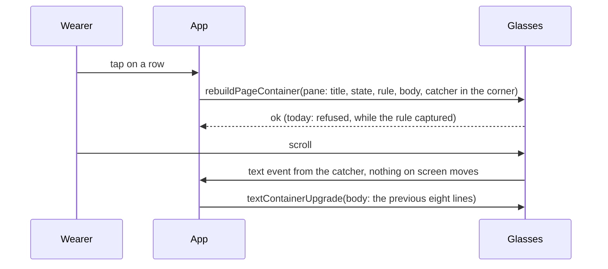

# Feature: the pane and the columns take the gestures in the corner, not on the rule

> Status: implemented; checked on the device by the owner on 2026-11-06. The owner's report of 2026-11-06 on the G2 with
> 0.8.0: the same symptom as #41 (`2026-11-03-pages-above-the-banner.md`)
> is back, on the pane and on the columns. On top of the gestures plan
> (`2026-11-03-gestures.md`).

## 1. Goal

From the list a tap on a pane seems to do nothing and the next tap opens
the answers; on the answers a double tap seems to do nothing and the
next one is back on the list. Two panes side by side behave the same.
The phone pane's log says why: every move to the pane or to the columns
is followed by `rebuildPageContainer refused`, repeated with the app's
growing delay for as long as the page is up, while every list page (the
pane list, the answers, the inbox) is drawn at once.

The overlap of #41 is not back: the unit test holds, and the payload
of both pages, dumped from the build, ends every block at the banner's
top. The SDK's own validator accepts both pages. What the two refused
pages have and the accepted pages do not is the **rule under the title
as the catcher**: a bordered text container two pixels high with
`isEventCapture` set, which the gestures plan gave them on 2026-11-03.
The rule itself, without the capture, and the 26 px title were seen on
the device the same day (`2026-11-03-rules.md`); the catcher on the rule
never was, since the gestures build was checked for the footer standing
still on the list, whose catcher is the unseen square in the corner.
The corner square is what the list, the boxes and every page the owner
uses today draw, and the log shows their scrolls arriving from it. No
build after 2026-11-03 was checked on the device; 0.8.0 and 0.9.0 both
carry the rule as catcher.

The goal: the pane and the columns take the gestures the way every
other dash page does, in the corner, and the rule goes back to being a
line. Out of scope: anything else the device may refuse (the log will
say), and the scroll's lag the owner noticed at times, which is its own
plan once it is clear where it lags (on a refused page every retry is a
rebuild that drops input while it is applied; on the list the turning
mark is an upgrade every second that a scroll's upgrade waits behind).

## 2. Design

`src/views.ts` only; `src/glasses.ts` is unchanged.

- **The pane**: the title gives the corner to the catcher: `TITLE_W` is
  356 px instead of 376, and the folder in it comes and goes by measure
  as before. The state beside it keeps its 192 px, the room its words
  (`read-only · work/0.0`, `paused · 2 pages up`) were chosen for, and
  ends 4 px short of the corner. The rule stays, `capture` off. Five
  blocks: title, state, rule, body, catcher.
- **The columns**: the last column's title ends `CATCH + 4` px short of
  the edge, like the boxes' titles (`BESIDE_W`), and the catcher sits in
  the corner. With two columns the rule stays: two titles, two bodies,
  the rule, the catcher and the hint are seven containers. With three
  the page's eight are three titles, three bodies, the catcher and the
  hint, so the rule is left out, as the lower rule already is on that
  page (`2026-11-03-rules.md`): the gap between the columns is the
  separation there. The folder's room in the last title shrinks by the
  corner, measured the same way whether or not the column is marked.
- `rule()` loses `capture: true`; the catcher test in
  `tests/unit/views.test.ts` expects `gesture` on every dash page, the
  rule without capture, and the corner free on the pane and the columns.

```
┌ pane ───────────────────────────────────────────────────────┐
│ ◐ build · /muxway · Claude            following            ▪│ ← title 356 px, state 192 px, the corner's 16 × 16 is the catcher
├─────────────────────────────────────────────────────────────┤ ← the rule, a line only
│ eight lines of the pane                                     │
├─────────────────────────────────────────────────────────────┤
│ ▽ page · ● answer · ≡ menu · ×× back                        │
└─────────────────────────────────────────────────────────────┘

┌ three columns ──────────────────────────────────────────────┐
│ ◐ build · Claude  │ √ tests · bash   │ ○ shell · bash     ▪│ ← the last title ends short of the corner; no rule
│ …                 │ …                │ …                   │
```



## 3. Protocol and API changes

None.

## 4. Security analysis

None: layout only. The catcher carries no text, so nothing from the hub
reaches it. The state's and the last title's text are fitted to their
narrower room by the same measure as before; no byte budget changes.
Nothing new is logged.

## 5. Privacy check

The plan, the docs and the tests name the test environment's panes; the
owner's log is quoted for its one refusal line only, without the hub,
the hosts or the pane names in it.

## 6. Test plan

| # | Test | Kind (unit / e2e / e2e-security / UI) | Expected |
|---|------|---------------------------------------|----------|
| 1 | S30: two hundred panes | e2e-security | the list and a pane from it accepted, nine rows, the rows' budget unchanged |
| 2 | the catcher | unit | on every page without an OS list exactly one block captures, named `gesture`, 16 × 16 in the corner, with no text; the rule never captures; nothing else reaches the corner |
| 3 | the rule | unit | on the pane always; on the columns with two, not with three; the body right under the title row either way; every block above the banner |
| 4 | the title, the state and the last title | unit | the title block is 356 px, the state 192 px ending 4 px short of the corner; `placeWord` keeps `read-only · work/0.0` and falls back to `read-only` by measure; the last column's title block ends short of the corner, its folder measured by the narrower room |
| 5 | F11, F13, F42 (the pane), F32, F33, F62 (the columns) | UI | unchanged words and screenshots but for the corner; the simulator's scrolls arrive from the catcher |
| 6 | the device | by hand, recorded here | the owner taps a row: the pane shows at once, the answers return to it; two and three side by side show at once; the footer stands still on a scroll; the phone log has no `rebuildPageContainer refused` |

## 7. Documentation

`docs/ARCHITECTURE.md` (the catcher is the corner square on every dash
page; a capturing bordered block two pixels high is refused by the
device, seen 2026-11-06, so the rule is a line only), `docs/features/
screens.md` (the pane's state beside the title leaves the corner; the
columns' rule with two, not with three), this plan.

## 8. Implementation steps

1. This plan.
2. `src/views.ts`: the rule without capture; the pane's state narrower
   with `placeWord`'s room; the columns' last title short of the corner,
   the catcher, the rule with two columns only; the unit tests.
3. The docs.
4. The chosen e2e tests locally, the pull request's run, then the
   owner's device check, recorded below.

---

## Review (after implementation)

- [x] Diff matches the plan, deviations explained here
- [x] Security rules (AGENTS.md section 2) hold
- [x] Privacy check passed: `scripts/prepush-check.sh` clean and diff read
- [x] Docs and diagrams updated

Deviations: one. The first build narrowed the state to 172 px, and the
pull request's run failed F65: `read-only · work/0.0` (175 px) no
longer fit and fell back to `read-only`, and `paused · 2 pages up`
(175 px) would have been cut. The state's words are fixed phrases
chosen for 188 px of room, while the title's folder is optional by
measure already, so the title gives the corner instead: 356 px, the
state 192 px as before, ending 4 px short of the corner as the boxes'
titles do. On the columns the rule is pushed after the catcher
only while the page has a block to spare, which is the two-column case;
the traces of F33 and F62 carry it, F32's three columns do not.

## Test run

Run 20261106-125706-f3c59d6, local, before the pull request's run: S30,
F11, F13, F42, F32, F33 and F62 passed with the secret scan, none
failed, against the core's main; the unit suite (83) passed. The traces
show the pane's catcher at 560,0 16 × 16 with no border, the rule
without capture, and no `refused` in any log. The pull request's first
run failed F65 on the narrowed state (above). With the title giving the
corner: run 20261106-141243-0e524b1, local, F11, F42, F33, F62 and F65
passed (F43 failed there for the local core checkout's age alone: no
folder in its listing), and run 20261106-141749-0e524b1 against the
core's main, F43 and F65 passed; the unit suite (83) passed. The
owner's device check (test 6) on 2026-11-06, with the build from
61eb6f7 packed for the owner's hub: the pane and the columns show at
once; it works on the glasses.
