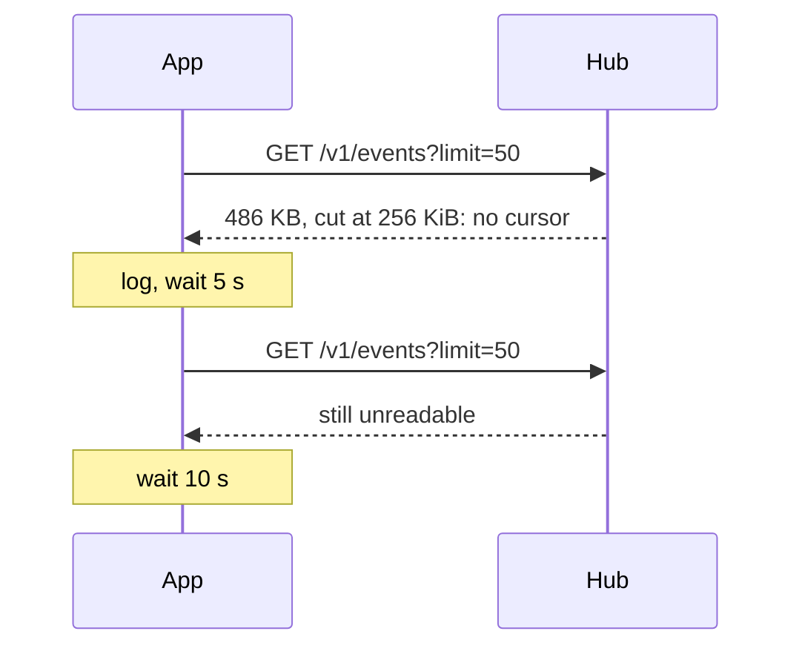

# Feature: an unreadable recent answer is asked again after a wait

> Status: approved by the owner on 2026-11-06 ("go ahead with the fix"),
> after S64 failed on every pull request run while passing on main.

## 1. Goal

S64 feeds the app fifty hostile recent events at start and expects the
build pane to be working from the one working event that was last for
it. The answer is 486 KB, over the app's 256 KiB body cap: cut, it never
parses, so nothing is ever working from the events, and the test passed
on main only when the app's first listing came within ten seconds of
the pane's creation, when the pane's own moving screen reads as working.
On pull request runs the first listing took the usual 27 seconds and
the test failed. Under it, a real defect: an answer without a cursor
restarts the poll at once, and the app asked the hub two hundred times
a second for the rest of the test. Out of scope: raising the cap, which
is a bound chosen for security, and the startup time of the simulator.

## 2. Design

- `runEvents` in `src/app.ts`: an answer whose cursor is not a number
  restarts the poll without one, as before, but after the wait of a
  failed poll (five seconds, doubling to a minute), with a line in the
  log. A good answer resets the wait, as it does today.
- The fixture `recent-hostile` carries 4 KiB texts, so the fifty events
  fit under the cap and are read: S64 then tests what its title says,
  and asserts the recent events were read once or twice and the poll
  went on from their cursor. The old set with 10 KiB texts is the
  fixture `recent-huge` of the new S65: cut and unread, it sets nothing
  working and no toast, and the app asks again a few times in half a
  minute, not thousands.

## 3. Protocol and API changes

None.

## 4. Security analysis

- A hub, or whoever can answer as one, could keep the app in a tight
  loop with an oversized or garbled recent answer: a denial of service
  on the phone's battery and the hub both. The wait bounds it to a
  request every five seconds and then slower.
- The cap and the parsing are unchanged; nothing of a cut body is
  shown. The log line carries no body.
- No new dependency.

## 5. Privacy check

The fixtures are the harness's own (`alice-laptop`, `needs you`).

## 6. Test plan

| # | Test | Kind | Expected |
|---|------|------|----------|
| 1 | S65: fifty recent events with 10 KiB texts | e2e-security | both panes quiet within thirty seconds, no toast, at most four reads of the recent events in that time, no uncaught error |
| 2 | S64 with 4 KiB texts | e2e-security | build working from the events, test-pane quiet, no toast; one or two reads of the recent events and the poll going on from cursor 49 |
| 3 | S06 as before | e2e-security | a bad cursor still restarts the poll, now after the wait |
| 4 | unit: a garbled recent answer | unit | one read in the first second, the log line, no poll with a cursor |

## 7. Documentation

`docs/features/notifications.md`: the cursor bullet and the recent-events bullet.

## 8. Implementation steps

1. The wait in `runEvents`, the unit test.
2. The fixtures, S64's checks, S65.
3. Docs; the run recorded.

---

## Review (after implementation)

- [x] Diff matches the plan, no deviations. The chosen run
  20261106-221255-fe103c8 (S06, S64, S65) passed first: S64 read the
  recent events once and polled on from cursor 49, S65 read the
  oversized answer twice in forty seconds.
- [x] Security rules (AGENTS.md section 2) hold: the cap and the
  parsing are unchanged, the wait bounds the requests, the log line
  carries no body, no new dependency.
- [x] Privacy check passed: `scripts/prepush-check.sh` clean and the diff
  read; the fixtures are the harness's own.
- [x] Docs updated: the notifications page's cursor and recent-events bullets.

## Test run

Run 20261106-221514-3b76129, recorded as [issue #88](https://github.com/notmarkopadjen/muxway-glasses-even/issues/88): 144 tests passed, none failed, at commit 3b76129, against the core at its main of the day, with S65 new and S64 reading a set that fits under the cap.
