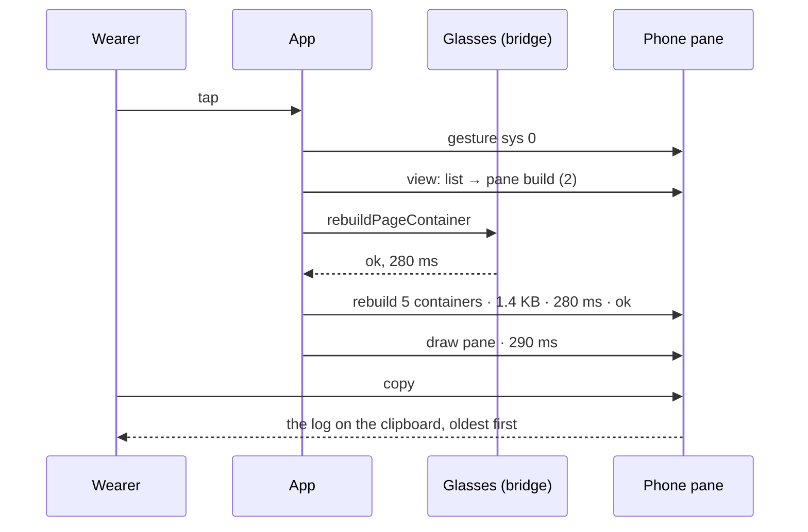

# Feature: a trace switch on the phone, more of the app in the log, and a copy button

> Status: implemented. The owner's ask of 2026-11-06, while the lag and the
> returning refusal of the pane page (`2026-11-06-pane-catcher.md`) are
> being chased: the phone pane's log is what decides them, and today it
> says too little and is awkward to get off the phone.

## 1. Goal

The log on the phone pane has every gesture, request and refusal, but
not what the app did with them: which page it drew, whether that was a
rebuild or an in-place upgrade, how long the bridge took, how big the
message was, when it retried, when it slept and woke, when the working
mark's timer ran. Chasing a lag needs those, and a bug report needs the
log as text, which today means selecting it on the phone's page.

So: a **trace** checkbox on the phone pane, off by default, that makes
the app log those too and keeps ten times as many lines; and a **copy**
button under the log that puts the whole log on the clipboard, oldest
line first. Out of scope: sending the log anywhere, any change to what
the glasses show, and the lag's fix itself, which is the next plan once
a trace says where the time goes.

## 2. Design

`src/settings.ts`: `trace: boolean`, default `false`, kept with the
other settings in the Even app's storage; `normalize` takes `true`
only.

`src/phone.ts`, `index.html`: the checkbox **trace (more log lines)**
beside the lens and voice ones, saved with **save & test**; a **copy**
button under the log with a status line (`copied 212 lines`, or the
failure). The log keeps 40 lines, 400 with trace on. Copy joins the
lines oldest first with newlines and uses the clipboard API from the
click, with the page's selection-and-`copy` command as the fallback
where the WebView has no clipboard API. Trace lines are dimmer
(`class="trace"`), with the theme's muted token.

`src/app.ts`, `src/glasses.ts`: a second logger, `detail`, that writes
only while trace is on (read from the settings at each call, so the
switch takes effect on save without a restart). What it writes:

| where | line |
|---|---|
| glasses | `create 3 containers · 1.1 KB · 310 ms · ok` / `rebuild 5 containers · 1.4 KB · 280 ms · refused` / `upgrade b0 · 212 B · 95 ms` / `picture c0 · 34 KB · 1200 ms` |
| glasses | `rebuild: geometry changed` (why a rebuild and not an upgrade: kind, items, blocks, charts or menu), `retry in 1000 ms` |
| app | `view: list → pane build` / `view: pane build → list` on every push, pop and reset, with the stack's depth |
| app | `draw list · 140 ms` on every redraw, the time from the request to the bridge's answer |
| app | `spin on` / `spin off` when the working mark's timer starts and stops; `tick 1 pending` when a tick finds the last draw still in flight |
| app | `toast done build`, `flash parked`, `sleep`, `wake`, `read pane build in 1 s`, `list in 10 s`: timers set, events shown; the kind and the pane's name, never the text |

Sizes are the JSON payload's bytes as handed to the bridge, which is
what crosses to the Even app; the glasses' own link is not measurable
from here. The `log` lines of today are unchanged, so a log with trace
off reads as before.

## 3. Protocol and API changes

None.

## 4. Security analysis

- The log never held a token or pane content and still does not: the
  new lines carry container ids, byte counts, durations, view kinds,
  timer intervals, event kinds and pane names, which the log has today.
  A toast's or a notice's text stays out.
- Copy puts the log on the owner's own clipboard from the owner's own
  click; nothing leaves the phone. No new permission; the clipboard API
  needs the gesture it has.
- The setting is a boolean, normalised like the others; a stored value
  of any other type is `false`.
- No new dependencies.

## 5. Privacy check

The plan, the docs and the tests name the test environment's panes and
hosts; no real host, person or secret. A copied log from the owner's
phone is the owner's to paste; nothing of it is committed.

## 6. Test plan

| # | Test | Kind (unit / e2e / e2e-security / UI) | Expected |
|---|------|---------------------------------------|----------|
| 1 | S99 | e2e-security | no token in any log, trace on or off; the trace lines carry no pane text |
| 2 | the detail logger | unit | with trace off, `detail` writes nothing; with it on, a rebuild, an upgrade, a push and a pop each write one line of the table's shape; the token's and the body's text never appear in a line |
| 3 | the settings | unit | `trace` defaults to false, a stored `"yes"` is false, `true` is true |
| 4 | F70 the trace switch | UI (phone, Playwright) | with trace on, after a tap on a row the phone's log has `view: list → pane`, a `rebuild` line with `ms` and a `draw pane` line; with it off, none; screenshots `phone-trace-on`, `phone-trace-off` |
| 5 | F70 copy | UI (phone, Playwright) | copy puts the log on the clipboard oldest first, the status says `copied N lines`; screenshot `phone-copied` |
| 6 | the device | by hand | the owner turns trace on, reproduces the lag, copies the log and pastes it here |

## 7. Documentation

`docs/features/phone-pane.md` (the trace checkbox, what it adds, the
copy button), `docs/testing.md` if the phone tests' list is there, this
plan.

## 8. Implementation steps

1. This plan.
2. `settings.ts`: `trace`; the unit test.
3. `glasses.ts` and `app.ts`: the `detail` logger and its lines; the
   unit test with the fake bridge.
4. `index.html`, `phone.ts`, `phone.css`: the checkbox, the 400-line
   cap, the copy button and its status; F70.
5. The docs.

---

## Review (after implementation)

- [x] Diff matches the plan, deviations explained here
- [x] Security rules (AGENTS.md section 2) hold
- [x] Privacy check passed: `scripts/prepush-check.sh` clean and diff read
- [x] Docs and diagrams updated

Deviations: the setting is `detail` in the record and the URL, since
`trace` is the test harness's own query key (the id the drawn pages are
posted under); the phone pane's checkbox says trace. The toast and
flash lines are the event's toast only (`toast done on build`) and the
timer that clears it (`clear in 10 s`): the flashes' words are set in
a dozen places and some carry the hub's error words, so the trace
leaves them to the `bad` lines the log has. F70 reads the phone pane by
its screenshot: the simulator's automation reads the console and the
glasses, not the WebView's page, so the lines' shape is the unit test's
and the switch and the copy button are the phone test's (F16).

## Test run

Run 20261106-152219-f3c59d6, local, against the core's main, before the
pull request's run: F16 (the phone pane in Chromium: the switch off by
default, kept with save, copy with the log oldest first and the status
line) and F70 (the simulator with trace on: a pane opened and left, the
phone pane's screenshots) passed with the secret scan, none failed; the
unit suite (85) passed, the trace test among them with the lines of the
table and no token or pane text in any line.
