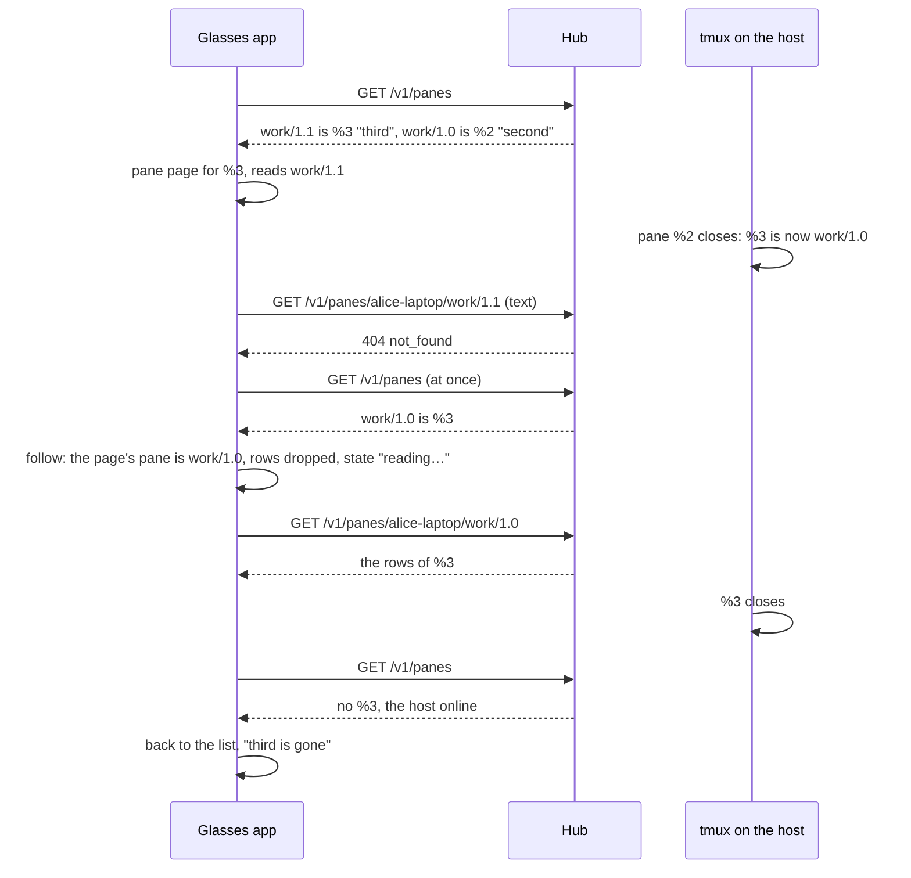

# Feature: the pane page shows its own pane or nothing

> Status: planned on 2026-11-07, implemented the same day. Parity with
> the web's tiles (core #284, core PR #303; the guideline's *tiles* cell,
> `docs/ui-guideline.md` §1.4), asked by #79. Made on the branch of
> `2026-11-07-desk-row.md` (#80): one pull request, one run. The core
> gap this plan records (a text-mode read named no pane) was closed the
> same day by core #315; `2026-11-07-pane-header.md` takes it up here.

## 1. Goal

A tmux address is a position: `work/1.1` is the second pane of the
window, and when the first one closes the host renumbers, so the pane
that was `work/1.1` is `work/1.0` and whatever was `work/1.2` sits at
`work/1.1`. The app today knows the open pane by its address: the page
keeps reading the old address and shows, under the pane's own title,
the lines of whichever pane sits there now, until the wearer notices.
The columns hold their panes by address too, and so do the readers
(`this.readers`), so a pane opened later at a reused address starts
with the previous occupant's rows before its first read. A write (an
answer, Close, + pane) goes to the address too.

Goal: the pane page and the columns know their pane by its id (the
listing's `pane_id`), draw no rows of another pane, follow the pane to
its new address when the host renumbers it (the page stays, its state
shows the new place), close with a word when the pane is gone, and
write only to the address the latest listing gives the pane. While a
page has nothing of its own to draw, it draws nothing: a blank body
with `reading…` in the state, which is the glasses' form of the web's
warm-up (an animation is several text upgrades over Bluetooth for a
box the wearer glances at; the guideline allows blank).

What text mode cannot give, said plainly: the web reads panes in JSON,
and every frame names its pane, so a frame confirms the tile. The
glasses read in text mode (the hub's wrapping and charset folding are
what the display needs, AGENTS.md §7), and a text-mode answer carries
the rows and an `ETag` only. So between a renumber and the next
listing the app cannot tell a stranger's rows from its pane's. The
listing comes every ten seconds, on every event, and, with this
feature, at once when a read answers `404 not_found` (the address is
gone: the window changed). A stranger's rows can therefore be drawn
for up to ten seconds in one case: another pane moved *into* the open
pane's address while the open pane moved too, and no event came. A
pane id in the text-mode read's headers would close that gap; it is a
core gap to report, not something this client can fix. Out of scope:
reading panes in JSON (wrong wrapping, no folding), a faster listing.

## 2. Design

`src/protocol.ts`, `src/app.ts`, `src/views.ts`.

**The key.** `paneKey(p)` is the pane's id when the listing gave one,
else its address (a hub before `pane_id`: everything as today). The
readers, the selection (`selected`) and the identity of every view are
by key. `current(pane)` finds the listing's pane by key.

**Reconcile, after every listing** (`readList`): for every pane the
stack holds (the pane page, the answers, the keys and commands, the
confirmation, the offer, the voice pages' pane and mail target, the
mail page, the messages page's *about*, a Cancel / Confirm about a
pane) and for the selection:

- the listing has the key at **another address**: the pane moved. The
  view's pane becomes the listing's; the reader's rows and `ETag` are
  dropped, so the body is blank until the first read at the new address
  (rows read at the old address after the renumber may be another
  pane's); the phone's to line follows (`aim`); the log says
  `followed <name> to <place>`. The offset, the reveal and the page
  stay.
- the listing **lacks the key** while its host is there (the hosts call
  says online, or a pane of the host is listed): the pane is gone.
  Every view about it is popped; the page under them (the list, or the
  columns the pane was opened from) comes back with a toast,
  `<name> is gone`. A pane in the selection leaves it, as it does today
  when its address is gone.
- the listing lacks the key and its **host is not there** (offline, or
  nothing exposed): nothing changes; the reads say `host offline`, as
  today (F17).

A read that answers `404 not_found` asks for the listing at once: the
window changed, and the follow or the word should not wait ten seconds.

**Writes.** `send`, `answer`, `mail`, `park`, `close` and `split`
resolve the pane with `current` when they run, so a confirmation taken
after a renumber reaches the pane, not its old address.

**Views.** `Model.selected` holds keys; `selectedPanes` matches the
listing's panes by key; `Model.reading` takes the pane, not an address.
The pane page is unchanged in shape: its state already shows the place
while following, so a follow shows as the place changing.

## 3. Protocol and API changes

None. `pane_id` is read from the listing already; nothing new is sent.

## 4. Security analysis

- The feature narrows what can go wrong: a write confirmed on the
  glasses goes to the pane the latest listing names, never to whatever
  pane the host moved into an address; and a pane opened at a reused
  address never starts with another pane's rows.
- The remaining gap, a stranger's rows for up to a listing's wait in
  text mode, is a disclosure to the owner's own glasses of a pane the
  same token may read (the hub checks the read grant on every read):
  nothing the token could not read anyway, drawn under the wrong title
  for a few seconds. Said in §1 and in the docs.
- The key comes from the listing's `pane_id`, checked against the
  grammar `%[0-9]{1,9}` as before; a listing without it falls back to
  addresses. A hostile listing can rename or move panes, as it could
  today; it cannot make the app write anywhere its token may not.
- Nothing new is logged: `followed <name> to <place>` and `<name> is
  gone` carry the pane's name and address, as every line about a pane
  does, never its rows.
- No new dependency.

## 5. Privacy check

The plan, the tests and the docs name the test environment's panes
(`test-pane`, `second`, `third`, `alice-laptop`); no real host, person
or secret.

## 6. Test plan

| # | Test | Kind (unit / e2e / e2e-security / UI) | Expected |
|---|------|---------------------------------------|----------|
| 1 | S66: the pane page on `second` (work/0.1) with a marker on the screen of `third` (work/0.2); `test-pane` (work/0.0) is killed, so `second` is work/0.0 and `third` work/0.1 | e2e-security | the page follows: its state says `work/0.0`, its title still `second`; from the follow on, no page drawn under that title holds the marker; `y, Enter` confirmed after the renumber lands in `second`, nothing in `third`; the proxy saw the input posted to `work/0.0` |
| 2 | F69: the page on `third` (work/0.2); `second` is killed; then `third` is killed | UI | the state shows `work/0.1` within a few seconds of the kill (the 404 asks for the listing), a line typed into `third` after the move shows; then the list with the toast `third is gone`; the columns with `second` and `third` follow a kill of `test-pane` the same way |
| 3 | the app against a fake hub: the listing moves the open pane's id to another address, then drops it | unit | after the listing the reads go to the new address and no page or upgrade drawn after it carries the stranger's rows; the body is blank before the first read at the new address; the drop with the host online pops to the list with the word; without the host nothing closes |
| 4 | keys: `paneKey`, `selectedPanes` by key, `reading` by pane | unit | a pane with an id is matched by it at any address; without one by address |
| 5 | the suite as it stands (F11, F13, F17, F32, F33, F62, F64) | UI | unchanged |

## 7. Documentation

`docs/features/screens.md` (the pane: own pane or nothing, follow,
gone, the blank body; the columns the same; the security list: the
key, the write to the latest address, the text-mode gap),
`docs/ARCHITECTURE.md` (the listing's `pane_id` is the pane's identity
on the app), this plan.

## 8. Implementation steps

1. This plan.
2. `protocol.ts`: `paneKey`. `views.ts`: the selection and `reading`
   by key. `app.ts`: readers and selection by key, `current` by key,
   `reconcile` after the listing, the 404's listing, writes through
   `current`. Unit tests.
3. S66 and F69 in `tests/e2e/run.py`.
4. The docs.
5. With #80 on the same branch: the full run, recorded below.

---

## Review (after implementation)

- [x] Diff matches the plan, deviations explained here
- [x] Security rules (AGENTS.md section 2) hold
- [x] Privacy check passed: `scripts/prepush-check.sh` clean and diff read
- [x] Docs and diagrams updated

Deviations: two. The key is the host and the id together
(`alice-laptop:%3`), not the id alone: ids are tmux's and two hosts can
both have `%3`. And a read's `404` asks for the listing only while the
latest listing still names the pane at that address; a listing that
does not name it has said its word, so a pane whose host is away is not
listed again every second. Found by the first full run: `park` resolved
the listing's pane and left the inbox's own entry unmarked, so Later
from the inbox no longer flipped the row under the cursor to `zz` until
the next listing (F67); both are marked now.

## Test run

Run 20261107-111725-422a247, local, the full suite with #80: 157 tests,
none failed, the unit suite (95) and the secret scan among them,
recorded as
[#92](https://github.com/notmarkopadjen/muxway-glasses-even/issues/92).
Its one note belongs to #80: the core's hub was run with the one-line
CORS fix for `/v1/desk` (see `2026-11-07-desk-row.md`). S66 and F69
pass against the core's main as it is (runs 20261107-104152 and
20261107-104455); the first full run, 20261107-105538-82c8e03, failed
F67 alone (above).
