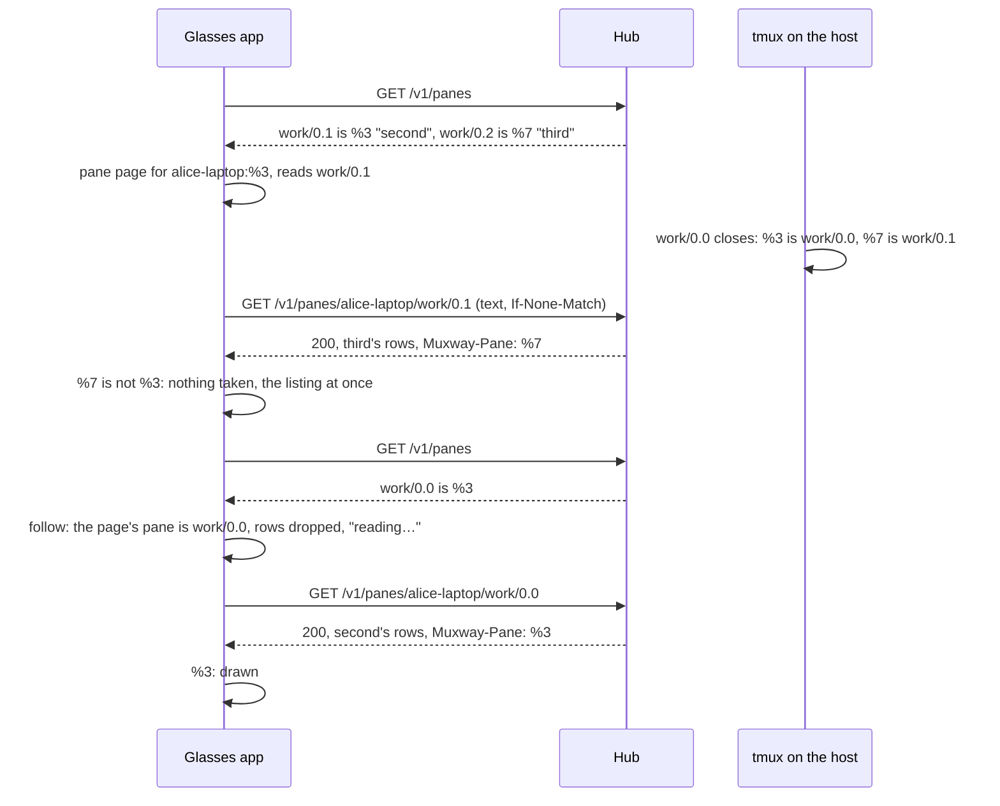

# Feature: a read names its pane

> Status: planned and implemented on 2026-11-07. The follow-up of
> `2026-11-07-own-pane.md` (#79, PR #93), which recorded a core gap:
> a text-mode read named no pane. The core closed it the same day
> (core #315, core PR #320): `GET /v1/panes/{address}` carries
> `Muxway-Pane`, the id of the pane that answered.

## 1. Goal

The pane page and the columns know their pane by its key, the host and
the listing's `pane_id`, and follow it when the host renumbers. But a
text-mode read carried the rows and an `ETag` only, so between a
renumber and the next listing the app could not tell a stranger's rows
from its pane's: when another pane moved *into* the open pane's address
while the open pane moved too, and no event came, the stranger's rows
could show under the pane's title for up to a listing's wait.

The core now answers every read of `GET /v1/panes/{address}`, `200` or
`304`, in text mode too, with `Muxway-Pane: %<digits>`, the id of the
pane that answered, and exposes the header to a page on another origin.
Goal: the app checks every read against the key it holds; when another
pane answers, it draws nothing of those rows and asks for the listing at
once, so the page follows its pane within a second instead of ten. A
hub without the header (older than the core's 7d8fcec) keeps today's
behaviour. Out of scope: the listing's new text-mode `pane_id` column
(the app reads listings in JSON, which carried the id already), the
desk, and any change to what the page shows while it has nothing of its
own (blank with `reading…`, as before).

## 2. Design

`src/api.ts`, `src/app.ts`, `tests/e2e/harness.py`.

**The answer carries the id.** `Answer` gains `pane`: the `Muxway-Pane`
header when it matches the id grammar `%[0-9]{1,9}`, else `''`. Every
call carries it; only the pane read looks at it.

**The read is checked.** In `readPanes`, a read whose `pane` is set and
differs from the pane's `id` is a stranger's answer: the host renumbered
since the listing that named the pane at this address. Nothing of it is
taken: the reader keeps the rows it holds (read while the pane was
there, every one of them its own) and its `ETag`, no error is set, and
the listing is asked for at once, under the same guard as a `404` (only
while the latest listing still names the pane at that address; a
listing that does not name it has said its word). The listing then
follows the pane as `reconcile` does today: the rows are dropped, the
body is blank until the first read at the new address, which is checked
the same way. A read without the header, or of a pane without an id
(a hub before `pane_id`), is taken as today. The log says
`GET pane <status>: %7 answered at work/0.1, not %3`.

**The proxy in the tests** passes `Muxway-Pane` through with `ETag`
and exposes it in its own answers, so a hostile mode can send one.

## 3. Protocol and API changes

None of the app's own. It reads the core's `Muxway-Pane` answer header
(core protocol v1, `GET /v1/panes/{address}`), compatible: absent on an
older hub, and the app then behaves as before.

## 4. Security analysis

- The feature closes the one disclosure left by #79: a stranger's rows
  under the pane's title for up to a listing's wait. Now no row is drawn
  under a title unless the hub said it is that pane's. What a hub, or
  anything between, answers for another pane is not drawn and not kept.
- The header is read, never trusted beyond the check: a value outside
  the id grammar is as good as absent (the read is taken as today, so a
  hub that drops or garbles the header cannot make the app show less
  than before, only as much). A header that *lies*, naming the pane's
  own id over another pane's rows, is the hub's lie about content the
  token may read anyway: the hub checks the read grant on every read.
- No new grant, no new input. Nothing new is written anywhere.
- Logged: the status and the two ids and the place, as every line about
  a pane names its place; never the rows.
- No new dependency.

## 5. Privacy check

The plan, the tests and the docs name the test environment's panes
(`test-pane`, `second`, `third`, `alice-laptop`) and the ids `%3`,
`%7`; no real host, person or secret.

## 6. Test plan

| # | Test | Kind (unit / e2e / e2e-security / UI) | Expected |
|---|------|---------------------------------------|----------|
| 1 | S72: the proxy answers every pane read with a stranger's rows and a `Muxway-Pane` that is not the pane's; then with no header at all | e2e-security | with the header: the page's body never holds a row of them, the state stays `reading…`, and the proxy saw a listing asked right after each read; without the header: the rows are drawn, as on a hub before the header |
| 2 | S66, tightened: the pane page on `second` (work/0.1); `test-pane` (work/0.0) is killed, so `third` sits at work/0.1 | e2e-security | from the kill on (not only from the follow on) no page under `second`'s title holds `third`'s marker; the rest as before |
| 3 | the app against a fake hub whose reads carry `Muxway-Pane`: the reads answer the renumbered map while the listing still names the old one | unit | the stranger's rows are never drawn; the listing is asked for within a second of the read; once the listing follows, the pane's own rows come back at the new address; a header outside the grammar is as absent |
| 4 | the fake hub without the header | unit | the renumber test of #79 as it stands |
| 5 | F69 and the suite as it stands | UI | unchanged |

## 7. Documentation

`docs/features/screens.md` (the pane: a read names its pane; the
security list), `docs/ARCHITECTURE.md` (the read's header in the calls
table and the reading rules), `2026-11-07-own-pane.md` (its status
points here), this plan.

## 8. Implementation steps

1. This plan.
2. `api.ts`: `Answer.pane`. `app.ts`: the check in `readPanes`. The
   proxy: `Muxway-Pane` kept and exposed. Unit tests.
3. S72, and S66 tightened, in `tests/e2e/run.py`.
4. The docs.
5. The full run against the core at 7d8fcec, recorded below.

---

## Review (after implementation)

- [ ] Diff matches the plan, deviations explained here
- [ ] Security rules (AGENTS.md section 2) hold
- [ ] Privacy check passed: `scripts/prepush-check.sh` clean and diff read
- [ ] Docs and diagrams updated

## Test run

Not yet run.
