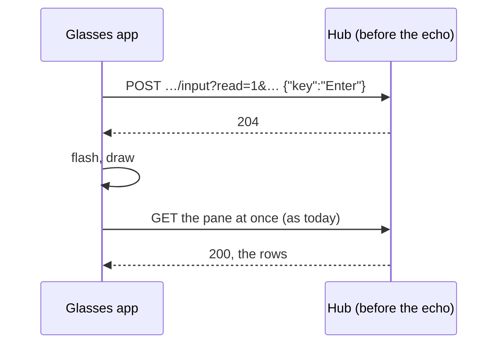

# Feature: a key's echo rides on the input's answer

> Status: planned on 2026-11-09 for #98. The core answers an input with
> the pane's screen (`?read=1`): JSON mode merged in core #327, text
> mode in core PR #329 (`docs/protocol/v1.md`, the input endpoint;
> `docs/ui-guideline.md` §1.4, the *reading* row; merged into the core's
> main on 2026-11-10 as e5cffb3).

## 1. Goal

Today an answer, the phone's text or a spoken reply is one `POST
/v1/panes/{address}/input` per piece, then a read of the pane at once,
and the open pane shows the result when that read answers: two round
trips after the last piece, and on the glasses the first page after the
flash still shows the screen from before the keys. The core now answers
an input with `?read=1` as a text read does, taken 30 ms after the keys
landed, with the read's `ETag` and `Muxway-Pane`.

Goal: every text and key the glasses send asks for the screen, and a
`200` is drawn as the pane's screen at once, through the same path a
read's text takes; a `204` (an older hub or host) keeps today's read at
once. The follow timer goes on unchanged. Out of scope: the answers to a
question (`/answer`, nothing is typed), mail, the mouse, and a change to
what is sent or how it is confirmed.

## 2. Design

`src/api.ts`, `src/app.ts`, `tests/unit/app.test.ts`,
`tests/e2e/harness.py`, `tests/e2e/run.py`.

**The request.** `api.text` and `api.key` post to
`/v1/panes/{address}/input?read=1&lines=<setting>&width=400&charset=<setting>`,
the pane read's own query (one `screen()` helper gives both), with
`Accept: text/plain` as every call has unless it asks for JSON. The body
is as today, `{"text"}` or `{"key"}`, one request per piece.

**The answer.** A `200` is the text read's answer: the rows, `ETag`,
`Muxway-Pane`. The check and the take that `readPanes` does on a read
move into one method, `took(pane, answer)`: a `Muxway-Pane` that is set
and not the pane's id is a stranger's answer, nothing of it is taken and
the listing is asked for at once (as a read, under the same guard); else
a `200` replaces the reader's rows and `ETag` and clears its error. The
input's `200` goes through `took` like a read's; a `204` is not looked
at. The log says `POST input 200 <n> chars` as the read's line does,
never the rows.

**The draw.** The three send paths (`send` for an answer or the
suggestion, `sendText` from the phone, `sendVoice`) send their pieces in
order, pass each answer to `took`, and draw once after the last piece
with the flash, as today. When the last piece answered `200` the screen
is already the pane's: the read at once is skipped, and the next
scheduled read follows as usual. When it answered `204`, or was not
taken, the pane is read at once as today. A refused or failed piece
takes today's error path. The view the draw shows is whatever shows the
pane: the pane page, or the columns with the pane marked.

**A read in flight.** A follow read sent before the input may answer
after the echo, with the screen it captured; the next follow read, at
most *follow* seconds later, puts the echo back. Nothing is done about
it: a read's answer is always the hub's screen at some moment, and the
reader keeps the latest answer it got.

**The proxy in the tests** records the status it answered for every
request (`status`) and the path without its query (`bare`), since every
input now carries one. Two modes: `echo-stranger` answers an input's
`200` with another pane's rows and `Muxway-Pane: %999`; `echo-204`
answers it `204` with no body, as a hub before the echo.

```mermaid
sequenceDiagram
    participant W as Wearer
    participant A as Glasses app
    participant H as Hub
    participant T as tmux on the host
    W->>A: tap, pick "y, Enter", Confirm
    A->>H: POST /v1/panes/alice-laptop/work/0.0/input?read=1&lines=200&width=400&charset=latin1 {"text":"y"}
    H->>T: y, then 30 ms, then capture
    H-->>A: 200 "$ y" ETag, Muxway-Pane: %3
    A->>A: took: %3 is the pane's, rows kept
    A->>H: POST …/input?read=1&… {"key":"Enter"}
    H->>T: Enter, then 30 ms, then capture
    H-->>A: 200 "$ y\ny: command not found\n$ " ETag, Muxway-Pane: %3
    A->>A: took: rows kept; flash "sent y, Enter"; one draw
    Note over A,H: no read at once; the follow read comes when the timer says
    A->>H: GET /v1/panes/alice-laptop/work/0.0?… If-None-Match
    H-->>A: 304
```

An older hub:



## 3. Protocol and API changes

None of the app's own. It uses the core's `POST
/v1/panes/{address}/input?read=1` in text mode (core protocol v1, the
input endpoint, core PR #329), compatible: a hub or host before it
answers `204`, and the app then reads as before. `lines`, `width` and
`charset` are checked by the hub as on a read before anything is typed
(`400 bad_parameter`); the app sends the values its reads already send,
which the hub takes.

## 4. Security analysis

- Nothing new is typed and nothing new is granted: the pieces, their
  confirmation and the write grant the hub checks are as today. The
  screen comes back only to a token that may read the pane (the hub's
  rule; a write-only token gets `204`), which the glasses need to open a
  pane at all.
- The echo is a read's answer and is treated as one: capped at 256 KiB,
  decoded by the charset the answer names, control characters dropped
  by the draw, and checked against the pane's id with `Muxway-Pane`
  exactly as a read is (#79, #93, PR #96): rows the hub names as another
  pane's are never drawn, and the listing is asked for at once. Without
  the header the rows are taken, as on a read from a hub before it.
- A hub, or anything between, that answers an input with a forged
  screen can show the wearer a false screen for one follow interval,
  which it could already do by answering the read that followed the
  input. No new power.
- Logged: the status and the body's size, as the read's line logs them;
  never the rows, never the text sent (the suggestion's line keeps its
  size only, as today).
- No new dependency.

## 5. Privacy check

The plan, the tests and the docs name the test environment's host and
panes (`alice-laptop`, `test-pane`, `work/0.0`) and the id `%3`; no
real host, person or secret.

## 6. Test plan

| # | Test | Kind (unit / e2e / e2e-security / UI) | Expected |
|---|------|---------------------------------------|----------|
| 1 | S73: `echo-stranger`: the input's `200` answers a marker row named as `%999`; then `echo-204` | e2e-security | with the stranger: no page ever holds the marker, the proxy saw a listing asked right after the input, and the pane's own rows come with the read that follows; with `204`: the row comes from a `GET` read made right after the input, the flash and the page as today |
| 2 | S03, S40: a read-only token and a pane the proxy calls writable | e2e-security | unchanged: no input leaves the app under a read-only token; a `403` is said in words |
| 3 | S63, S66: what is sent, and where | e2e-security | unchanged in what they check; the paths now carry `?read=1` and the read's query, and the inputs after a renumber still go to the pane's address |
| 4 | F13, tightened: Confirm on `y, Enter` | UI | on a hub with the echo, both inputs answered `200` and the first page holding `y: command not found` was drawn before any `GET` read of the pane that followed the last input; on a hub before it (`204` to both), the read at once came within 1.5 s and the row's page after it; screenshots `answers`, `confirm`, `pane-after` as today |
| 5 | the request, unit | unit | `sendText('y', true)` posts `{"text":"y"}` then `{"key":"Enter"}` to `…/input?read=1&lines=200&width=400&charset=latin1` with `Accept: text/plain` |
| 6 | a `200` answer, unit | unit | the page drawn when `sendText` resolves holds the echo's rows; no `GET` of the pane came after the last `POST` |
| 7 | a `204` answer, unit | unit | the pane is read at once after the last `POST`, and the rows drawn are the read's |
| 8 | a `200` naming another pane, unit | unit | the rows are not drawn, the listing is asked for after the `POST` |
| 9 | the suite as it stands | all | unchanged |

## 7. Documentation

`docs/features/screens.md` (the pane page: *Following* and the answers'
result; the security list), `docs/features/phone-pane.md` and
`docs/features/spoken-replies.md` where they say the pane is read after
the send, `docs/ARCHITECTURE.md` (the calls table's input row, the
sequence diagram, the reading rules), this plan.

## 8. Implementation steps

1. This plan.
2. `api.ts`: `screen()` and the input's query. `app.ts`: `took`, the
   three send paths. Unit tests 5 to 8.
3. The proxy: `status`, `bare`, the two modes; the tests' `/input`
   checks on `bare`; S73; F13 tightened.
4. The docs.
5. The full run against the core at PR #329's head, recorded below.

---

## Review (after implementation)

- [x] Diff matches the plan, deviations explained here
- [x] Security rules (AGENTS.md section 2) hold
- [x] Privacy check passed: `scripts/prepush-check.sh` clean and diff read
- [x] Docs and diagrams updated

Deviations: none in the behaviour. The three send paths share two
helpers the plan did not name, `type` (the pieces, each answer through
`took`) and `sent` (the flash, the draw, the read at once unless
echoed). The harness also stamps every traced page with the time it
arrived (`sim.timed()`), which F13 and S73 need to say a page came
before or after a request. S73 first expected a listing right after
*each* input answered as a stranger's; the second input's ask finds the
first's listing in flight, which is the listing's one-in-flight rule,
so the test accepts a listing between the first input and 1.5 s after
each. The proxy's two echo modes forge over whatever the hub answered,
and F13 checks the echo on a hub that gives one and the read at once on
a hub that answers `204`, so the suite holds on a core before PR #329
as well: the pull request's first CI run met one and failed F13 and S73
on the hub's `204`.

## Test run

Run 20261110-080421-b042f30, local, the full suite against the core's
main at e5cffb3 (core PR #329 merged): 165 tests, none failed, the unit
suite (101) and the secret scan among them, recorded as
[#101](https://github.com/notmarkopadjen/muxway-glasses-even/issues/101).
Before it, run 20261109-184158-69a3155 against the head of core PR
#329 passed the same 165 on the code before the tests were made to
hold on a hub without the echo, recorded as
[#99](https://github.com/notmarkopadjen/muxway-glasses-even/issues/99),
and the chosen run 20261110-080254-e18867e passed F13 and S73 against
the core at e347b0c, before the echo.
Before it, the full run 20261109-182150-c4882a2 passed the same 165 on
the commit before the review's log-line change, and the chosen run
20261109-181756-cb4e64d failed S73 alone, on the per-input listing
check described under the review.
