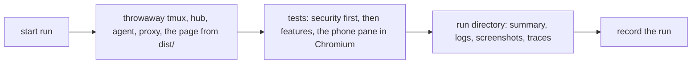
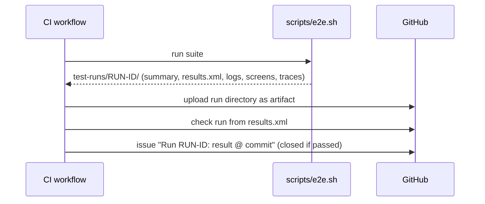

# Testing

End-to-end tests are the main line of defence, and security tests come
first. See AGENTS.md section 6 for the rules; this page describes the
mechanics.

## Test environment

Tests never touch a real machine. Each run starts its own tmux server on a
private socket, a test hub and a test host agent on loopback with throwaway
keys and tokens, and synthetic panes. Nothing from a developer's own
environment is read.

The glasses are the **Even Hub simulator** (`@evenrealities/evenhub-simulator`,
a native binary on WebKitGTK) on a headless X display, started with
`--automation-port`: the harness sends gestures (`up`, `down`, `click`,
`double_click`, `context_menu`), takes glasses screenshots (576 x 288 PNG)
and reads the console for errors. The app, started with `?trace=<id>`
from loopback, posts every page it draws to the harness that serves it
(`/trace/<id>`); the assertions read those pages. The simulator's own
console drops lines under load, so it is not the trace. The simulator reports one scroll per two input ticks on
a text page, one per tick in a list. The phone pane runs in Chromium under
Playwright, with a screenshot per step and a trace.

Between the app and the hub sits a recording **proxy** (`tests/e2e/harness.py`,
`Proxy`) that keeps every request and can misbehave on purpose: a 1 MiB
body, bytes that are not UTF-8, hostile Claude Code screens, forged pane
titles, hostile events.

## The test build

The harness drives the page through three doors a shipped app must not
have: settings in the URL (`?hub=&token=`), the trace of every drawn page
(`?trace=<id>`, posted to the server that serves the page) and the tone
in place of a microphone (`?mic=tone`). Each opens only in a **test
build** served from loopback. The build is `vite build --mode test`,
which `scripts/build.sh --test` makes and `scripts/e2e.sh` uses; it sets
the constant `__MX_TEST__` to true, and the production build
(`scripts/build.sh`, `scripts/pack.sh`) sets it to false, so the bundler
drops that code altogether. `npm run dev` serves the test build too, and
Vite's server binds to `127.0.0.1` only, so neither the dev page nor its
doors are reachable from another machine.

The page carries a Content-Security-Policy (`index.html`): scripts and
styles from its own files, connections to `https:` and loopback `http:`
only, no inline script. The simulator runs under it in every end-to-end
test, so a change the policy would block fails the suite.

## A run



```sh
MUXWAY_CORE=../muxway scripts/e2e.sh        # everything
scripts/e2e.sh S05 F14                      # chosen tests
```

Every run writes `test-runs/<timestamp>-<commit>/` (ignored by git):

| File | Content |
|---|---|
| `summary.md` | date, commit, totals, result per test |
| `results.xml` | JUnit XML, for tools |
| `environment.txt` | core commit, tmux, Node, simulator versions |
| `logs/<test>/` | hub, agent, proxy, simulator and console logs of that test, and `trace.log` with every page drawn |
| `logs/unit.log` | the unit tests' output |
| `screens/<test>/<step>.png` | a glasses screenshot per step and on failure; `-phone` ones are the WebView |
| `traces/<test>.zip` | Playwright trace of the phone tests, opened with `npx playwright show-trace` |
| `report/index.html` | HTML report of the run |

Needs tmux, Xvfb, Go, Python 3, Node 22, `libwebkit2gtk-4.1-0` and
Playwright's Chromium.

## Recording runs

Every run on `main`, and each feature's final run, is recorded as a **test
run**: a GitHub issue labelled `test-run`.

- Title: `Run <run id>: <passed|failed> @ <commit>`, labels `test-run` and
  `run:passed` or `run:failed`.
- Body: result, commit, totals, a link to the workflow run whose artifacts
  hold the logs, screenshots and traces, then the run's `summary.md`.
- A green run is closed at once; a red one stays open until the fix lands
  and links back to it. The issue list filtered by `label:test-run` is the
  run history.

`scripts/record-run.sh <run directory>` creates the entry. CI calls it after
every run outside pull requests; a local run can be recorded by hand.

In CI each run also gets a **check run** with a per-test table and failure
annotations on the commit (the test-reporter action reading
`results.xml`), and its run directory is kept as a workflow artifact for 90
days.



Considered and not used: an Allure report on GitHub Pages (needs a paid plan
while private; may be added for trends once public), and committing runs to
the repository (logs and screenshots would risk leaking private data into
permanent history).
